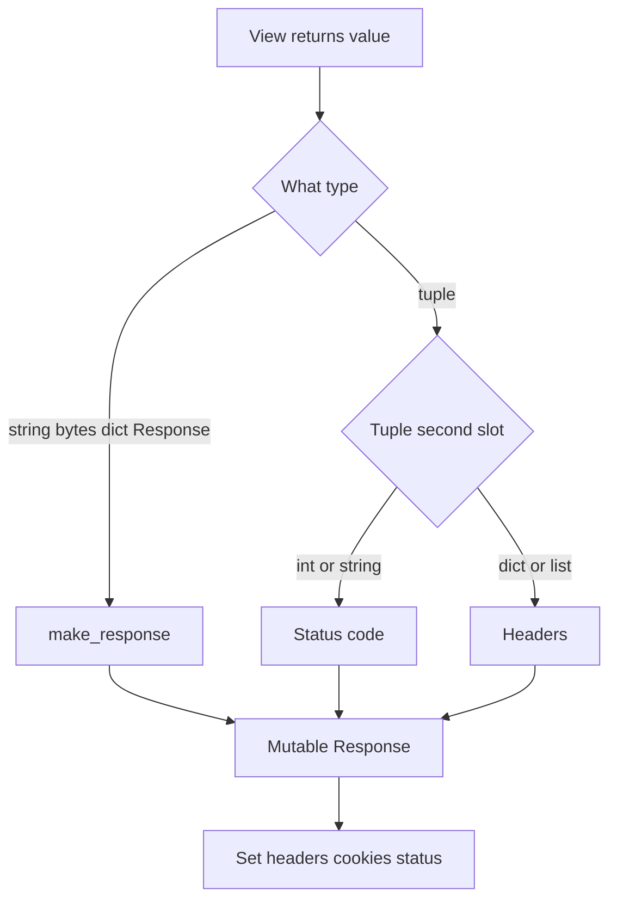

# Sending Responses Without Templates: make_response and the Tuple Contract in Practice

## English

Every Flask view returns something, and Flask has to turn that something into a Response object. The most explicit way is to call make_response(), which accepts a string, bytes, a dict (which becomes JSON), or an existing Response, and hands you back a mutable Response you can then adjust: set headers, attach cookies, change the status code. This is the escape hatch when you need to do more than the shorthand allows, such as setting a custom header that depends on data computed inside the view.

The shorthand Flask also accepts is a tuple of (body, status) or (body, status, headers). The status can be an integer like 201 or a string like '201 CREATED'; headers can be a dict or a list of (name, value) pairs when you need to send the same header twice (for example multiple Set-Cookie lines). The tuple is convenient but easy to misread: (body, headers) with a dict in the second slot is not the same as (body, status) — Flask inspects the type, so a dict is treated as headers and an int or string as status. Mixing them up silently produces a 200 with weird headers.

A common source of confusion is returning JSON. jsonify() builds a Response with Content-Type: application/json and the right encoding, and it also handles serialisation of lists and dicts. If you return a plain dict from a view, modern Flask will also JSON-serialise it, but the behaviour around status codes and custom headers is less obvious — the tuple form still works, but you have to remember that the dict is the body, not headers. When in doubt, call jsonify() explicitly and then use make_response() if you need to add headers or cookies.

Cookies are the classic case where make_response() earns its keep. response.set_cookie(key, value, httponly=True, secure=True, samesite='Lax') gives you fine-grained control over the flags that matter for security. The signed session cookie is just one cookie; setting your own requires the same care. Remember that cookies set on a response are only visible on the next request, not the current one, because the browser has to receive and store them first — a frequent bug when code tries to read a cookie it just set in the same request.

## 中文

每個 Flask view 都會回傳某些東西，而 Flask 要將那個「某些東西」變成 Response 物件。最明確的方法是呼叫 make_response()，它接受字串、bytes、dict（會變成 JSON），或者現成的 Response，然後交回一個可變的 Response 讓你調整：設定標頭、附加 cookie、改變狀態碼。當你需要做超過簡寫所能表達的事情時——例如設定一個依賴 view 內部計算資料的自訂標頭——這就是逃生門。

Flask 亦接受 (body, status) 或 (body, status, headers) 的 tuple 簡寫。status 可以是整數如 201，或字串如 '201 CREATED'；headers 可以是 dict，或者當你需要同一個標頭出現兩次（例如多條 Set-Cookie）時，用 (name, value) 配對的 list。tuple 很方便但容易誤讀：(body, headers) 而第二格是 dict，與 (body, status) 並不相同——Flask 會檢查類型，dict 當作標頭，int 或字串當作狀態碼。搞混了就會靜靜地產生一個 200 加奇怪的標頭。

另一個常見困惑是回傳 JSON。jsonify() 會建立一個 Content-Type: application/json 且編碼正確的 Response，亦會處理 list 與 dict 的序列化。如果你從 view 直接回傳一個普通 dict，現代 Flask 也會將它 JSON 序列化，但狀態碼與自訂標頭的行為就冇咁明顯——tuple 形式仍然有效，但你要記住 dict 是主體，不是標頭。有疑問時就明確呼叫 jsonify()，然後如有需要加標頭或 cookie 就用 make_response()。

Cookie 就是 make_response() 最典型的用武之地。response.set_cookie(key, value, httponly=True, secure=True, samesite='Lax') 讓你精細控制對安全至關重要的旗標。已簽署的 session cookie 只是其中一個 cookie；自己設定 cookie 需要同樣的謹慎。要記住：在 response 上設定的 cookie，只會在「下一個」請求才可見，而不是當前這個，因為瀏覽器要先收到並儲存它——當程式碼試圖在同一個請求內讀取剛設定的 cookie 時，這就是頻繁出現的 bug。

## Key Takeaway

make_response() is the explicit way to build a mutable Response, the (body, status, headers) tuple is convenient but type-sensitive, and cookies you set only become readable on the next request.

## Related Concepts
- Reading Flask's Response: Status, Headers, and the Tuple Contract
- Response Objects Are Mutable, Deferred, and Easy to Get Wrong

## Diagram

