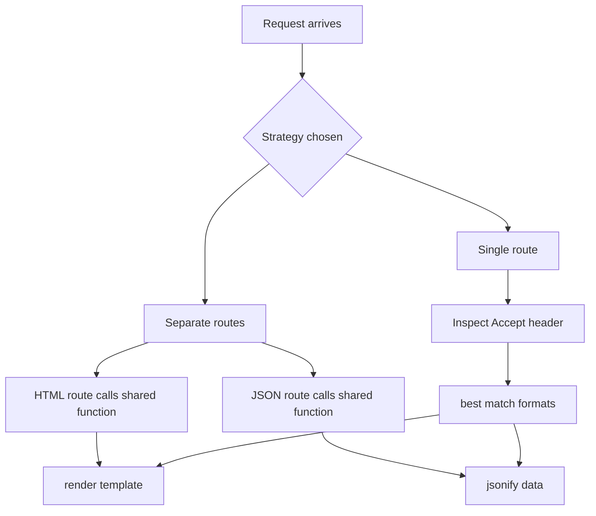

# Serving Two Audiences From One App: HTML, JSON, and the Same Route

## English

A common shape for a small Flask app is to serve both a browser-facing HTML page and a machine-facing JSON API from the same data. There are two broad strategies: separate routes (e.g. '/items' returns HTML, '/api/items' returns JSON) or one route that inspects the request and decides. The separate-route approach is simpler to reason about, easier to cache, and lets you version the API independently — but it duplicates the query logic. The single-route approach is concise but forces you to think about content negotiation, which is where subtle bugs live.

If you go the single-route route, the honest signal is the Accept header. A browser sends something like text/html,application/xhtml+xml,...; a fetch() call with no explicit header sends */*; an API client typically sends application/json. Flask does not do content negotiation for you — request.accept_mimetypes is a Werkzeug object with methods like best_match() that you call yourself. The gotcha is that */* matches everything, so a naive best_match(['text/html', 'application/json']) will happily return HTML to an API client that did not bother to set Accept. Many real APIs therefore use an explicit query parameter or a URL prefix instead of relying on Accept alone.

A pragmatic hybrid: keep the HTML route and the JSON route separate, but factor the shared data-fetching into a plain function that both call. That function returns Python data (dicts, lists), and each route formats it — one through render_template(), one through jsonify(). This keeps the negotiation logic out of the hot path and makes each route trivially testable. It also sidesteps a classic mistake: forgetting that jsonify() sets the JSON content type, so returning a rendered template from a route that the client expected to be JSON produces confusing parse errors on the client side.

Error responses deserve the same treatment. A browser wants an HTML error page; an API client wants a JSON envelope like {"error": "not found"}. Flask lets you register error handlers per blueprint or per app, and you can branch inside the handler on request.path or a custom header. Whatever you choose, be consistent: an API that returns HTML on 500 will break every client that tries to parse the body, and a browser that receives raw JSON on a 404 looks broken to a human. Decide the contract once and document it.

## 中文

小型 Flask 應用常見的形態，是從同一份資料同時服務面向瀏覽器的 HTML 頁面，以及面向機器的 JSON API。大致有兩種策略：分開路由（例如 '/items' 回傳 HTML，'/api/items' 回傳 JSON），或者用單一路由檢查請求再決定。分開路由較易推理、較易快取，亦可以獨立為 API 做版本控制——但會重複查詢邏輯。單一路由較簡潔，但迫使你思考內容協商（content negotiation），而微妙的 bug 就藏在這裡。

如果你走單一路由，最誠實的訊號是 Accept 標頭。瀏覽器會送出類似 text/html,application/xhtml+xml,...；沒有明確設定標頭的 fetch() 呼叫會送出 */*；API 客戶端通常送出 application/json。Flask 不會替你做事前協商——request.accept_mimetypes 是一個 Werkzeug 物件，內有 best_match() 之類的方法，要你自己呼叫。陷阱在於 */* 會匹配所有東西，所以天真地 best_match(['text/html', 'application/json']) 會乾脆向一個懶得設定 Accept 的 API 客戶端回傳 HTML。因此很多真實 API 會用明確的查詢參數或 URL 前綴，而不是單靠 Accept。

一個務實的混合做法：保留分開的 HTML 路由與 JSON 路由，但將共用的資料抓取抽成一個普通函式，兩邊都呼叫它。該函式回傳 Python 資料（dict、list），每個路由各自格式化——一個經 render_template()，一個經 jsonify()。這樣就把協商邏輯移出熱路徑，亦令每個路由都易於測試。它還避開一個經典錯誤：忘記 jsonify() 會設定 JSON content type，於是從客戶端以為是 JSON 的路由回傳渲染後的模板，客戶端就會出現令人困惑的解析錯誤。

錯誤回應也值得同樣處理。瀏覽器想要 HTML 錯誤頁；API 客戶端想要像 {"error": "not found"} 的 JSON 信封。Flask 讓你按 blueprint 或按 app 註冊錯誤處理器，你可以在處理器內部按 request.path 或自訂標頭分支。無論你揀哪種，都要一致：一個在 500 時回傳 HTML 的 API，會弄壞所有試圖解析主體的客戶端；而一個在 404 時收到原始 JSON 的瀏覽器，對人來說就像壞了。一次過決定契約，然後寫成文件。

## Key Takeaway

Serving HTML and JSON from one app is cleanest when shared data-fetching lives in a plain function and each route formats it, and Accept-header negotiation has real traps because */* matches everything.

## Related Concepts
- Content Negotiation and the Accept Header: Serving JSON and HTML From One Route
- Templating Without Jinja2: Returning Plain Data and Choosing Your Output Layer

## Diagram

