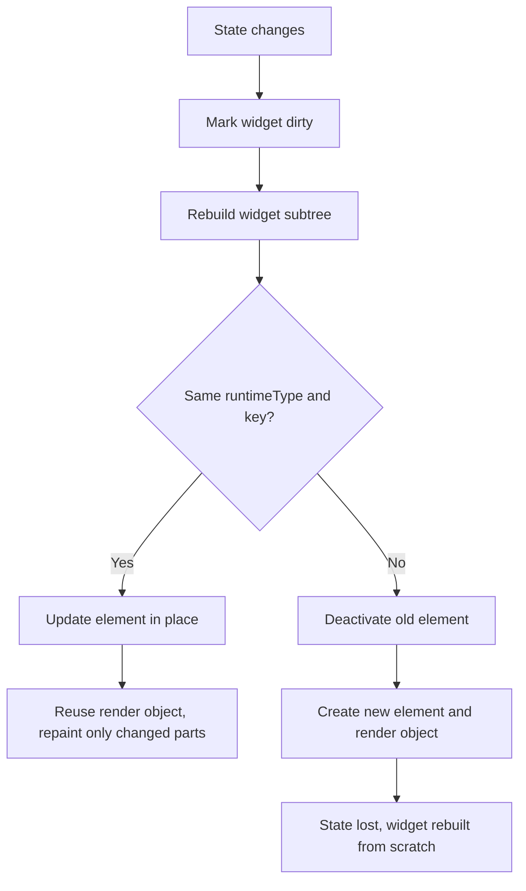

# The Widget Tree and How Flutter Rebuilds

### English

Flutter does not draw pixels directly. It describes the screen as a tree of **widgets** — immutable configuration objects like `Text`, `Padding`, `Column` — and a separate engine turns that tree into pixels. A widget is cheap to throw away; it is a description, not the thing on screen. The live, mutable counterpart of a widget is its **Element**, and the tree of elements is what actually persists and holds state.

Three trees matter. The **widget tree** is rebuilt on every change. The **element tree** mirrors it but is long-lived. The **render object tree** holds the actual layout and painting instructions, created only for widgets that need geometry.

Rebuilding is not "repaint the whole screen". When state changes, Flutter marks a widget as **dirty** and rebuilds it, then asks its parent for a new slot via `RenderObjectElement.updateChild`. If the new widget has the same `runtimeType` and `key` as the old one, Flutter can update the existing element in place and simply swap the configuration — the render object is reused and only what changed is repainted. If the type or key differs, the old element is deactivated and a new one is created from scratch.

This is why widget identity matters so much. Give a list item a `ValueKey` and reordering will move the existing element (and its state) rather than rebuild it; leave keys off and a list reorder can throw away scroll position, text input, and animations. The practical rule is: state should live as high in the tree as possible, and `const` constructors let Flutter skip rebuilding subtrees whose configuration cannot have changed.

Think of the widget tree as a plan for a building, and the element tree as the construction site — re-drawing the plan is cheap, but demolishing and rebuilding a wall is not.

### 中文

Flutter 並不直接畫像素。它用一棵**小部件（widget）**樹描述畫面——`Text`、`Padding`、`Column` 之類不可變的配置物件——再由引擎把這棵樹轉成像素。小部件很便宜，丟棄再造都沒問題；它只是描述，不是螢幕上的實物。小部件真正持久、可變的對應物是 **Element**，而元素樹才是真正保存狀態的地方。

有三棵樹值得留意：**widget 樹**每次變動都會重建；**element 樹**與之對應但長久存在；**render object 樹**負責真正的排版與繪製指令，只有需要幾何資訊的小部件才會產生。

重建並不等於「整屏重繪」。當狀態改變時，Flutter 會把相關 widget 標記為 **dirty** 並重建它，再透過 `RenderObjectElement.updateChild` 向父層索取新的位置。若新舊 widget 的 `runtimeType` 與 `key` 相同，Flutter 就能就地更新既有 element、單純換掉配置，render object 會被重用，只有真正改變的部分才重繪；若型別或 key 不同，舊 element 就會被停用並從頭建立一個新的。

這正是 widget 身分（identity）如此重要的原因。替清單項目加上 `ValueKey`，重新排序時既有的 element（連同其狀態）會被移動，而不是重建；不給 key 的話，重新排序可能會丟失捲動位置、文字輸入與動畫。實務守則是：狀態應盡量放在樹的高處，而 `const`  constructors 能讓 Flutter 跳過配置不可能改變的子樹。

可以這樣想像：widget 樹是建築的設計圖，element 樹是施工現場——重畫設計圖很便宜，但拆掉重建一道牆就不是了。

## Key Takeaway
Flutter rebuilds the widget tree cheaply but preserves state only when widget type and key match, so keys and stable widget identity are essential.

## Related Concepts
- Widget tree, element tree, render object tree
- Keys and element reuse
- `const` constructors and rebuild optimisation

## Diagram

