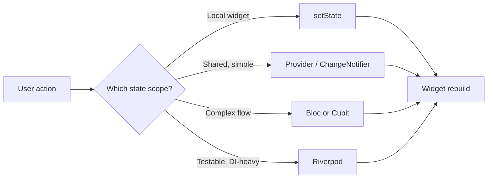

# State Management: setState, Provider, Bloc and Riverpod

### English

Every Flutter app has state: a counter, a logged-in user, a list of items being fetched. The question is not *whether* to manage state but *how much* to manage centrally.

Start with the simplest tool, `setState`. Calling `setState(() { _count++; })` marks the element dirty and rebuilds that widget's subtree. It is perfect for state that only a widget and its descendants care about — a checkbox, a text field controller, an animation flag. Its limits are structural: the state lives inside a `State` object, so it is hard to reach from a sibling widget or a deeply nested route, and passing it down means threading callbacks through every constructor.

**Provider** (the `provider` package) adds an **InheritedWidget** layer. You publish a state object with `ChangeNotifierProvider` and any descendant can read it with `context.watch<T>()` (rebuild on change) or `context.read<T>()` (read without listening). It is a small, learnable step up from `setState` and is a good default for many apps.

**Bloc** and **Cubit** come from the `flutter_bloc` package and are **event-driven**. A Cubit exposes methods that emit new states; a Bloc receives events and transforms them into states. The state is an immutable value object, and the framework only rebuilds widgets whose `BlocBuilder` sees a different state. This gives a very clear audit trail of "what happened and what resulted", which pays off in large teams.

**Riverpod** is compile-time safe: providers are resolved from a container rather than looked up by generic type from the widget tree, so it works outside the widget tree (in services and tests) and removes whole classes of "provider not found" errors.

A practical progression: `setState` for local UI, `Provider` for shared app state, `Bloc` for complex flows with explicit events, `Riverpod` for testability and dependency discipline. Pick one for a given slice of the app and be consistent.

### 中文

每個 Flutter 應用都有狀態：計數器、已登入的使用者、正在載入的項目清單。問題從來不是「要不要管理狀態」，而是「多少狀態要集中管理」。

先由最簡單的工具 `setState` 開始。呼叫 `setState(() { _count++; })` 會把 element 標記為 dirty 並重建該 widget 的子樹。它非常適合只有自己與後代關心的狀態——一個核取方塊、文字輸入控制器、動畫旗標。它的限制是結構性的：狀態住在 `State` 物件裡，因此很難從兄弟 widget 或深層路由存取，要傳下去就必須在每層建構子都用 callback 串接。

**Provider**（`provider` 套件）加上了 **InheritedWidget** 這一層。用 `ChangeNotifierProvider` 發佈狀態物件，任何後代都可以用 `context.watch<T>()`（改變時重建）或 `context.read<T>()`（讀取但不監聽）取得。這是從 `setState` 往上走一小步，對很多應用來說是很好的預設選擇。

**Bloc** 與 **Cubit** 來自 `flutter_bloc` 套件，採用**事件驅動**模式。Cubit 提供會發出新狀態的方法；Bloc 接收事件並轉換成狀態。狀態是不可變的值物件，框架只在 `BlocBuilder` 看到不同狀態時才重建 widget。這會產生非常清楚的「發生了什麼、結果是什麼」的稽核軌跡，在大型團隊特別划算。

**Riverpod** 則具備編譯期安全：provider 從容器解析，而不是靠泛型在 widget 樹中查找，因此可以在 widget 樹之外（服務層、測試）使用，並消除整類「provider not found」的錯誤。

實務上的路徑：本地 UI 用 `setState`，共用狀態用 `Provider`，流程複雜、需要明確事件用 `Bloc`，重視可測試性與依賴紀律用 `Riverpod`。同一個範疇內選一種並保持一致。

## Key Takeaway
State tooling should match how widely the state is shared and how complex the transitions are: local `setState`, shared `Provider`, event-driven `Bloc`, compile-time-safe `Riverpod`.

## Related Concepts
- `setState` and widget-local state
- InheritedWidget and `context.watch`
- Event-driven state machines
- Dependency injection containers

## Diagram

