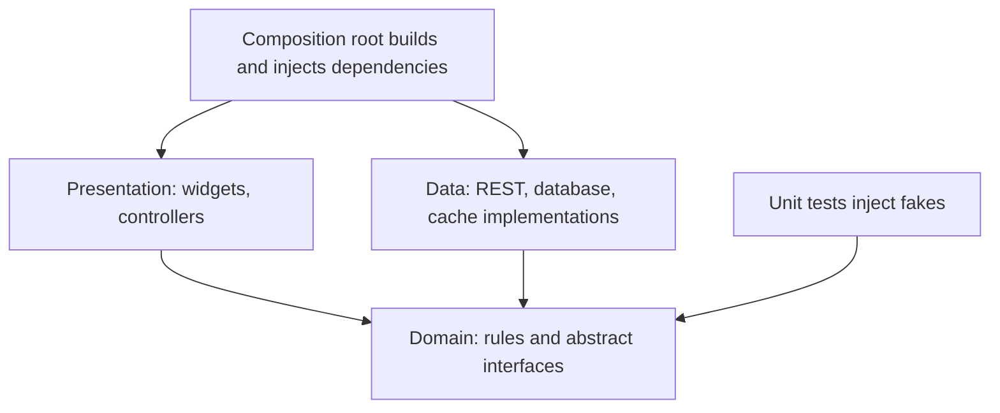

# Layered Architecture, Dependency Injection, and Performance

### English

A Flutter codebase tends to rot when business logic lives inside widgets. The remedy is to split the app into three layers with clear boundaries. The **presentation layer** holds widgets, controllers and navigation — it knows how things look, not how data is fetched. The **domain layer** holds business rules and abstract contracts (an interface like `UserRepository` with a `fetchUser()` method) that have no knowledge of HTTP, JSON or databases. The **data layer** implements those contracts using concrete sources (REST API, local database, cache) and maps raw data into domain objects.

The value is **dependency inversion**: the domain declares what it needs, and the outer layers provide it. The presentation layer depends on the domain, and the data layer depends on the domain too; the data layer never depends on the presentation layer. In practice this means widgets talk to repositories, not to `http` calls.

**Dependency injection** is how the pieces get connected. Rather than having a widget construct its own repository with `UserRepositoryImpl(api: ApiClient())`, the composition root builds the object graph once and injects the result. Packages like `get_it` (a global service locator) or `provider`/`Riverpod` scopes do this. The payoff is testability: in a unit test you substitute a fake repository and assert behaviour without any network calls.

Performance follows from the same discipline. Two levers matter most. First, **const constructors**: a `const` widget's configuration is canonicalised, so identical const widgets are identical objects and Flutter can skip rebuilding them during an ancestor's rebuild. Second, **list builders**: `ListView.builder` creates children lazily as they scroll into view, while `ListView(children: [...])` builds every child up front — catastrophic for a list of a thousand rows. `ListView.builder` with an `itemExtent` (or `prototypeItem`) lets the engine skip measuring each child.

For diagnosing real issues, use **DevTools**' performance view: it shows frame timings, a flame chart of which build and layout work happened, and lets you record a frame to see exactly where time was spent. Look for unexpectedly expensive rebuilds — often a `setState` too high in the tree, or a non-const widget preventing subtree reuse.

### 中文

Flutter 專案最常見的腐壞方式，是把業務邏輯塞進 widget 裡。解法是拆成三層，界線清楚。**表現層**放 widget、控制器與導航——它知道東西長什麼樣子，但不知道資料從哪裡來。**領域層**放業務規則與抽象契約（例如帶有 `fetchUser()` 方法的 `UserRepository` 介面），完全不知道 HTTP、JSON 或資料庫的存在。**資料層**則實作這些契約，用具體來源（REST API、本地資料庫、快取）把原始資料轉成領域物件。

這樣的價值在於**依賴反轉**：領域層宣告自己需要什麼，由外層提供。表現層依賴領域層，資料層也依賴領域層，但資料層永遠不依賴表現層。實務上就是：widget 只跟 repository 對話，而不是直接呼叫 `http`。

**依賴注入**則是把各部分接起來的機制。widget 不要自己 `UserRepositoryImpl(api: ApiClient())` 造出依賴，而是由組合根（composition root）一次建好整個物件圖再注入。`get_it`（服務定位器）或 `provider`／`Riverpod` 的 scope 都能做到。回報是**可測試性**：單元測試裡換成假的 repository 就能驗證行為，完全不需要網絡。

效能同樣來自這套紀律。有兩個最重要的槓桿。第一是 **const constructors**：`const` widget 的配置會被正規化，相同的 const widget 就是相同的物件，因此在上層重建時 Flutter 可以跳過重建。第二是**清單建構器**：`ListView.builder` 只在項目捲進視野時才建立子項，而 `ListView(children: [...])` 會一次把全部子項建好——對上千列的清單是災難。`ListView.builder` 搭配 `itemExtent`（或 `prototypeItem`）還能讓引擎略過逐一量測。

要診斷真實問題，用 **DevTools** 的效能面板：它顯示影格時間、build 與 layout 工作分佈的火焰圖，還能錄影單一影格，看出時間花在何處。留意那些意外昂貴的重建——通常是 `setState` 放得太高，或是一個非 const widget 阻礙了子樹重用。

## Key Takeaway
Layering plus dependency injection keeps business rules testable, and const constructors plus lazy list builders are the two highest-leverage performance habits in Flutter.

## Related Concepts
- Presentation / domain / data layering
- Dependency inversion and service locators
- `const` constructors and rebuild scope
- Lazy list building and frame profiling

## Diagram

