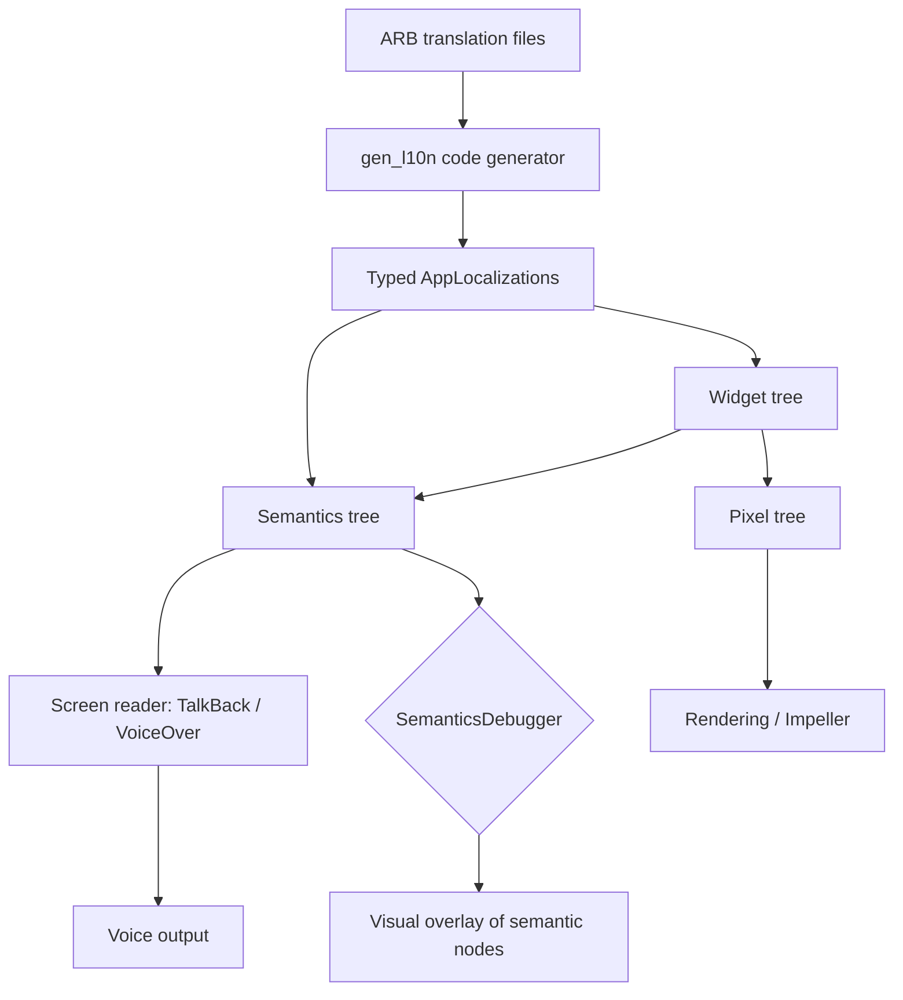

# Accessibility, Semantics, and Internationalization in Flutter

### English

Flutter draws pixels, but a screen reader needs a *tree of meaning*. The bridge is the **semantics tree** — a parallel description of the widget tree that assistive technologies such as TalkBack (Android) and VoiceOver (iOS) consume. By default, Flutter generates semantics automatically for most widgets: a `Text` widget becomes a label, a `Button` becomes a tappable node with a button role. But the moment you build something custom — an icon-only button, a card that responds to taps, a slider drawn from scratch — the automatic tree is either missing or misleading, and the screen reader says "button" with no name, or nothing at all.

The fix is to describe your widget explicitly with `Semantics`. The `label` supplies the human-readable name, `button: true` sets the role, and `container: true` forces Flutter to treat the widget as a single semantic node rather than letting its children be reported separately:

```dart
class LikeButton extends StatelessWidget {
  const LikeButton({super.key, required this.likes, required this.onTap});

  final int likes;
  final VoidCallback onTap;

  @override
  Widget build(BuildContext context) {
    return Semantics(
      button: true,
      label: 'Like, $likes likes so far',
      onTap: onTap,
      child: ExcludeSemantics(
        child: InkWell(onTap: onTap, child: Icon(Icons.favorite)),
      ),
    );
  }
}
```

`ExcludeSemantics` removes the inner icon from the tree so the end user hears "Like, 42 likes so far" once instead of hearing the raw icon and the label separately. `MergeSemantics` is the opposite: it combines descendants into one node, useful for a card made of a title and a subtitle. For a live-updating value — a likes counter, a search result count — wrap it in `Semantics(liveRegion: true, value: '$count results')` so the screen reader announces changes without the end user having to explore the node again. The `flutter` CLI ships an **accessibility checklist** in the inspector, and `SemanticsDebugger` / `showSemanticsDebugger: true` draws the semantics tree on screen, which is the fastest way to see what a screen reader would actually encounter.

Beyond the tree, there are mechanical rules. Any tappable area should be at least 48×48 logical pixels; if the visual icon is smaller, wrap it in a `SizedBox` or `Padding` rather than shrinking the hit target. Colour alone should never carry meaning — add an icon or text, because roughly 1 in 12 men has some form of colour vision deficiency. Respect the platform's text scaling: never hard-code font sizes, and test with a large accessibility font scale, since fixed-height rows overflow when the OS scales text.

**Internationalization** is the other half. Flutter's official solution is `flutter_localizations` plus the `gen_l10n` code generator. You describe each language in an ARB (Application Resource Bundle) file — a JSON-like format with the message and optional placeholders and metadata — and the generator produces typed Dart classes so that a missing translation becomes a *compile error* rather than a runtime blank:

```json
// l10n/app_en.arb
{
  "@@locale": "en",
  "greeting": "Hello, {name}!",
  "@greeting": {
    "placeholders": { "name": { "type": "String" } }
  }
}
```

```yaml
# l10n.yaml
arb-dir: lib/l10n
template-arb-file: app_en.arb
output-localization-file: app_localizations.dart
```

Then reference the generated string with `AppLocalizations.of(context)!.greeting(name)` and provide `localizationsDelegates` and `supportedLocales` to `MaterialApp`. Because the lookups are generated, a translator typo becomes a static error. Material widgets already localise themselves — date pickers, number formatting, text-selection menus all follow the active locale once the delegates are wired up — so most of the work is in your own strings.

A locale change at runtime is not a rebuild of your app but a change of the `locale` property on `MaterialApp`, which makes the whole subtree rebuild with the new strings. To pick the device locale, set `locale: null` and let Flutter resolve it; to force a language, set `locale: const Locale('zh', 'HK')`. For right-to-left languages, Flutter flips the layout direction automatically when the locale's `textDirection` is resolved — but only if you avoid hard-coding `Alignment.left` and `TextAlign.left` and instead use `start`/`end`, `EdgeInsetsDirectional`, and `Directionality.of(context)`.

### 中文

Flutter 負責畫出像素，但讀屏軟件需要的是一棵**意義的樹**。兩者之間的橋樑是**語意樹（semantics tree）**——它是 widget tree 的一份平行描述，供 Android 的 TalkBack 與 iOS 的 VoiceOver 等輔助科技使用。預設情況下，Flutter 會為大部分 widget 自動產生語意：`Text` 變成一段標籤，`Button` 變成一個具按鈕角色的可點擊節點。但只要你自訂了元件——只有圖示的按鈕、可點擊的卡片、由零開始畫的滑桿——自動產生的語意就會缺失或失真，讀屏軟件可能只讀出「按鈕」而沒有名字，甚至完全沒有內容。

解法是用 `Semantics` 明確描述元件：`label` 提供人類可讀的名稱，`button: true` 設定角色，`container: true` 強制 Flutter 把這個 widget 當成單一語意節點，而不是讓它的子節點被分開讀出：

```dart
class LikeButton extends StatelessWidget {
  const LikeButton({super.key, required this.likes, required this.onTap});

  final int likes;
  final VoidCallback onTap;

  @override
  Widget build(BuildContext context) {
    return Semantics(
      button: true,
      label: 'Like, $likes likes so far',
      onTap: onTap,
      child: ExcludeSemantics(
        child: InkWell(onTap: onTap, child: Icon(Icons.favorite)),
      ),
    );
  }
}
```

`ExcludeSemantics` 會把內層圖示從語意樹中移除，使用者便只聽到一次「Like，42 likes so far」，而不是圖示與標籤各聽一次。`MergeSemantics` 剛好相反：把後代合併成單一節點，適合由標題與副標題組成的卡片。若是會即時變動的數值——讚好數、搜尋結果數量——可用 `Semantics(liveRegion: true, value: '$count results')` 包住，讀屏軟件便會自動宣讀變更，使用者毋須再重新探索節點。`flutter` CLI 的 inspector 內建**無障礙檢查清單**，`SemanticsDebugger` 或 `showSemanticsDebugger: true` 會把語意樹畫在畫面上，是理解讀屏軟件究竟會遇到什麼的最快方法。

除了語意樹，還有幾條機械式的規則。任何可點擊區域至少應為 48×48 邏輯像素；若視覺上的圖示較小，應以 `SizedBox` 或 `Padding` 擴大觸控目標，而不是把圖示放大。顏色不應單獨承載意義——要配上圖示或文字，因為大約每十二位男性就有某程度的色覺障礙。要配合作業系統的文字縮放：切勿寫死字級，並用大字級無障礙設定測試，因為固定高度的列在文字放大時會溢出。

**國際化**是另一半。Flutter 的官方方案是 `flutter_localizations` 加上 `gen_l10n` 程式碼產生器。你用 ARB（Application Resource Bundle，一種接近 JSON 的格式）描述每種語言，包含訊息、選填的佔位符與 metadata，產生器會輸出有型別的 Dart 類別，令缺失翻譯成為**編譯期錯誤**而非執行期的空白：

```json
// l10n/app_en.arb
{
  "@@locale": "en",
  "greeting": "Hello, {name}!",
  "@greeting": {
    "placeholders": { "name": { "type": "String" } }
  }
}
```

```yaml
# l10n.yaml
arb-dir: lib/l10n
template-arb-file: app_en.arb
output-localization-file: app_localizations.dart
```

然後用 `AppLocalizations.of(context)!.greeting(name)` 引用，並在 `MaterialApp` 提供 `localizationsDelegates` 與 `supportedLocales`。因為查詢字串由產生器輸出，翻譯者打錯字會變成靜態錯誤。Material 元件本身已經本地化——日期選擇器、數字格式、文字選取選單在掛上 delegates 後都會跟隨當前語系，所以你大部分工作在自己的字串上。

執行期間切換語系並不是重新啟動應用，只是改變 `MaterialApp` 的 `locale` 屬性，整棵子樹便會以新字串重建。想跟隨裝置語系，把 `locale` 設為 `null` 由 Flutter 自行判斷；要強制某語系，就設 `locale: const Locale('zh', 'HK')`。至於由右至左書寫的語言，當語系的 `textDirection` 被解析後，Flutter 會自動翻轉版面方向——前提是你避免寫死 `Alignment.left` 與 `TextAlign.left`，改用 `start`／`end`、`EdgeInsetsDirectional` 以及 `Directionality.of(context)`。

## Key Takeaway
A screen reader only sees what the semantics tree describes, so custom widgets need explicit `Semantics` labels while `gen_l10n` turns missing translations into compile-time errors instead of blank strings.

## Related Concepts
- Semantics tree, `Semantics`, `MergeSemantics`, `ExcludeSemantics`
- Live regions for announcing dynamic values
- Minimum 48×48 hit targets and text scaling
- ARB bundles and `gen_l10n` code generation
- Directionality-aware layout (`start`/`end`, `EdgeInsetsDirectional`)

## Diagram

