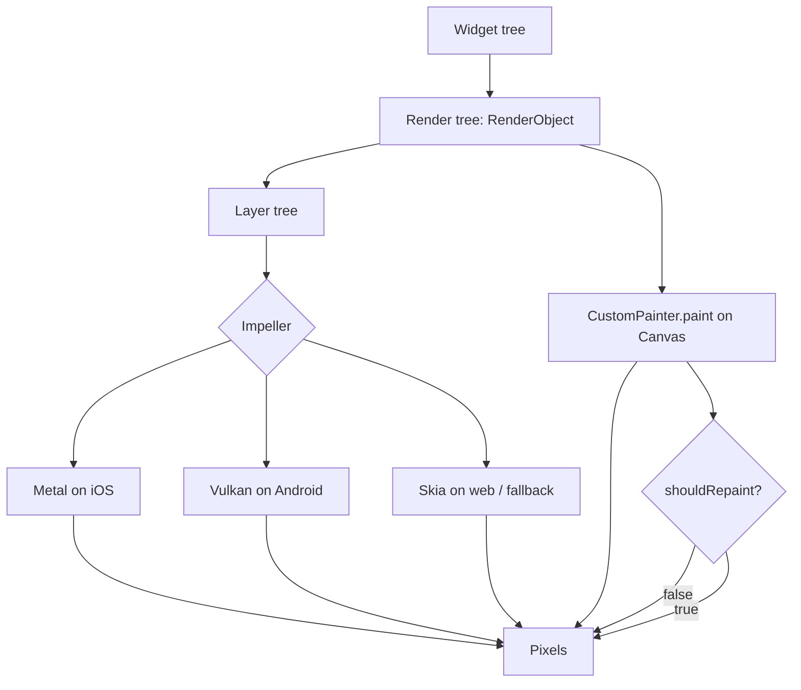

# Impeller, CustomPainter, and How Flutter Actually Produces Pixels

### English

Flutter does not draw through platform widgets. On both Android and iOS it renders the entire application itself: the framework turns the widget tree into a **render tree** of `RenderObject`s, the render tree is packed into a **layer tree**, and the rasteriser converts layers into pixels. Since Flutter 3.10 the default renderer on iOS, and since Flutter 3.16 on Android, is **Impeller**, which replaced the older Skia backend on those platforms. Impeller was designed for modern GPUs: it compiles shaders ahead of time to Metal (iOS) and Vulkan (Android), avoids the expensive shader-compilation stalls that Skia could cause mid-frame, and uses a more predictable memory model for multi-layer compositing. Skia remains the fallback on web and on desktop in some configurations. The practical difference for developers is mostly about frame timing: Impeller makes jank less likely on complex scenes, and it changes some shader-related APIs and blend-mode behaviour that older custom painters may rely on.

Most of the time you never touch the rasteriser — you describe UI with widgets and Flutter composites the layers for you. When you do need pixel-level control, `CustomPainter` is the tool. It gives you a `Canvas` with a drawing API (lines, paths, text, images, gradients) plus a `paint` method that receives the `Canvas` and a `Size`:

```dart
class SparklinePainter extends CustomPainter {
  const SparklinePainter({required this.values, required this.color});

  final List<double> values;
  final Color color;

  @override
  void paint(Canvas canvas, Size size) {
    if (values.length < 2) return;
    final paint = Paint()
      ..color = color
      ..strokeWidth = 2
      ..style = PaintingStyle.stroke;

    final path = Path();
    for (var i = 0; i < values.length; i++) {
      final x = size.width * i / (values.length - 1);
      final y = size.height * (1 - (values[i] / values.max));
      if (i == 0) {
        path.moveTo(x, y);
      } else {
        path.lineTo(x, y);
      }
    }
    canvas.drawPath(path, paint);
  }

  @override
  bool shouldRepaint(covariant SparklinePainter old) =>
      old.values != values || old.color != color;
}
```

The single most important method is `shouldRepaint`. Flutter calls it when the painter's inputs change to decide whether the layer needs to be repainted. Returning `true` unconditionally is a common performance mistake: it repaints on every rebuild even when nothing visual changed. Comparing the fields that actually affect the drawing (as above) keeps the repaint region small.

`shouldRepaint` is about *painting*; `shouldRebuild` on a `RenderObject` is about *layout*. A `RenderBox` subclasses `shouldPerformLayout` and `performLayout`; a custom `RenderObject` overrides `paint` and `hitTest`. Most apps should never need this level — but if you are drawing something that changes every frame (an animation, a chart), doing the maths in `paint` is wasteful because paint runs on every frame while layout runs less often. The standard fix is to compute the geometry in `performLayout` and cache it, then paint the cached data.

Three performance habits keep custom painting smooth. Mark widgets that never change as `const` — the compiler then skips rebuilding them entirely, and Impeller can reuse their layers. Use `RepaintBoundary` around a subtree that repaints frequently, so the rasteriser does not have to re-composite everything above it. And avoid `saveLayer`, which forces an offscreen buffer and is expensive; most of the time a plain `Paint` with `blendMode` or an opacity in the colour achieves the same result.

Custom painters also interact with accessibility and hit testing. If your painted area responds to taps, you must implement `hitTest` in a custom `RenderObject`, or use a `GestureDetector` wrapping the `CustomPaint` so the gesture layer handles input. And since a `CustomPainter` paints no text, it contributes nothing to the semantics tree — if it conveys information, add a `Semantics` widget alongside it so screen readers still get the content.

### 中文

Flutter 不用平台的原生元件作畫。它在 Android 與 iOS 上都是自行渲染整個應用：框架把 widget tree 轉成由 `RenderObject` 組成的**渲染樹**，渲染樹被打包成**圖層樹（layer tree）**，再由光柵化器把圖層轉成像素。自 Flutter 3.10 起，iOS 的預設渲染器改為 **Impeller**；自 3.16 起 Android 亦然，取代了較舊的 Skia 後端。Impeller 是為現代 GPU 而設計：它把著色器預先編譯成 Metal（iOS）與 Vulkan（Android），避開 Skia 有時會在畫面中途造成的著色器編譯停頓，並採用更可預測的記憶體模型處理多圖層合成。Skia 在 web 與部分桌面設定中仍作為備援。對開發者而言，實際差別主要在畫面時序：Impeller 在複雜場景下較少出現掉幀，同時改變了部分著色器相關 API 與混合模式行為，舊有自訂繪製有時要配合調整。

大部分時間你根本不需要碰光柵化器——你用 widget 描述介面，Flutter 負責合成圖層。當你真的需要像素層級的控制時，`CustomPainter` 就是工具：它提供一個 `Canvas`（繪圖 API，支援線條、路徑、文字、圖片、漸層），以及一個接收 `Canvas` 與 `Size` 的 `paint` 方法：

```dart
class SparklinePainter extends CustomPainter {
  const SparklinePainter({required this.values, required this.color});

  final List<double> values;
  final Color color;

  @override
  void paint(Canvas canvas, Size size) {
    if (values.length < 2) return;
    final paint = Paint()
      ..color = color
      ..strokeWidth = 2
      ..style = PaintingStyle.stroke;

    final path = Path();
    for (var i = 0; i < values.length; i++) {
      final x = size.width * i / (values.length - 1);
      final y = size.height * (1 - (values[i] / values.max));
      if (i == 0) {
        path.moveTo(x, y);
      } else {
        path.lineTo(x, y);
      }
    }
    canvas.drawPath(path, paint);
  }

  @override
  bool shouldRepaint(covariant SparklinePainter old) =>
      old.values != values || old.color != color;
}
```

最重要的一個方法是 `shouldRepaint`。當 painter 的輸入改變時，Flutter 會呼叫它來決定該圖層是否需要重繪。無條件回傳 `true` 是常見的效能錯誤：即使畫面沒有變化，每次 rebuild 都會重繪。像上面那樣只比較真正影響繪圖的欄位，可以把重繪範圍收窄。

`shouldRepaint` 講的是**繪製**；`RenderObject` 上的 `shouldRebuild` 講的是**排版**。`RenderBox` 繼承 `shouldPerformLayout` 與 `performLayout`；自訂 `RenderObject` 則覆寫 `paint` 與 `hitTest`。多數應用永遠不需要走到這一層——但若你畫的東西每幀都在變（動畫、圖表），把運算放在 `paint` 裡是浪費，因為 paint 每幀都跑，而 layout 跑得較少。標準做法是在 `performLayout` 內計算好幾何資料並快取，然後用快取的結果繪製。

三個效能習慣可以讓自訂繪製保持流暢。把不會改變的 widget 標為 `const`，編譯器便可完全略過重建，Impeller 亦能重用其圖層。在經常重繪的子樹外加上 `RepaintBoundary`，令光柵化器不必重新合成上方所有圖層。避免使用 `saveLayer`，它會強制配置離屏緩衝，代價高昂；多數情況下用帶 `blendMode` 的 `Paint` 或直接在顏色內調整透明度即可達到相同效果。

自訂繪製亦牽涉無障礙與點擊測試。若你的繪製區域可回應點擊，就必須在自訂 `RenderObject` 中實作 `hitTest`，或者用 `GestureDetector` 包住 `CustomPaint`，讓手勢層處理輸入。而且 `CustomPainter` 不會畫出任何文字，因此不會對語意樹有任何貢獻——若它承載了資訊，請在旁邊加上 `Semantics` widget，讓讀屏軟件仍然讀得到內容。

## Key Takeaway
Impeller owns the pixel pipeline, but `CustomPainter` is your escape hatch — and `shouldRepaint` returning `true` unconditionally is the usual cause of needless repainting.

## Related Concepts
- Render tree, layer tree, and the raster pipeline
- Impeller vs Skia: shader precompilation, Metal and Vulkan
- `CustomPainter`, `Canvas`, `Paint`, and `shouldRepaint`
- `RenderObject`, `performLayout`, `hitTest`
- `const` constructors, `RepaintBoundary`, and `saveLayer` cost

## Diagram

