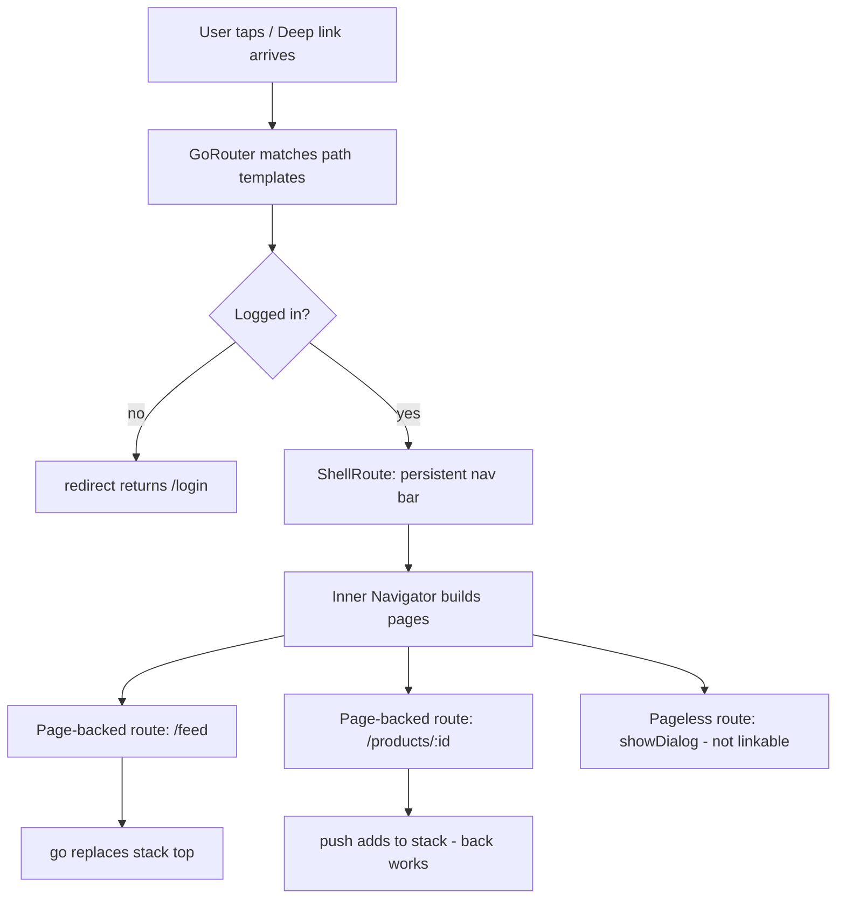

# Navigation and Routing in Flutter: Navigator, go_router, and Deep Links

### English

Flutter's `Navigator` is a stack of **Route** objects. Each route corresponds to one screen, and `Navigator.push` adds a route on top, `Navigator.pop` removes the top one. Routes on a stack form a history, which is why the system back button (Android) and the back swipe (iOS) work "for free" — they pop the top route. This model is simple, and for a linear flow like sign-in → home → settings it is entirely adequate.

The problem appears when navigation stops being linear. Flutter's official navigation documentation now explicitly says it does **not** recommend named routes (`Navigator.pushNamed`) for most applications. Named routes have real limitations: when a new deep link arrives from the platform, a named-route app pushes the new route onto the stack regardless of where the end user currently is, so the resulting screen is not the one the link described; the behaviour cannot be customised; and the browser back button does not work for web builds. The documentation's recommendation is to use the **Router API** with a declarative routing package such as `go_router`.

`go_router` (published by the Flutter team) is built on the Router API and treats navigation as *configuration* rather than *commands*. You declare a set of URL patterns, and the router derives the screens to display:

```dart
final router = GoRouter(
  routes: [
    GoRoute(path: '/', builder: (context, state) => const HomeScreen()),
    GoRoute(
      path: '/products/:id',
      builder: (context, state) {
        final id = state.pathParameters['id']!;
        return ProductScreen(productId: id);
      },
    ),
    GoRoute(path: '/login', builder: (context, state) => const LoginScreen()),
  ],
  redirect: (context, state) {
    final loggedIn = context.read<AuthState>().isLoggedIn;
    final goingToLogin = state.matchedLocation == '/login';
    if (!loggedIn && !goingToLogin) return '/login';
    if (loggedIn && goingToLogin) return '/';
    return null;   // null means "no redirect, continue"
  },
);

MaterialApp.router(routerConfig: router);
```

The three ideas worth internalising are **path templates**, **redirect**, and **shell routes**. Path templates (`/products/:id`) parse the URL into typed parameters and give you deep linking for free: a link shared by SMS opens the exact product screen, on Android and iOS alike, once you declare the intent filters in the Android manifest and the associated domains in the iOS project. The `redirect` callback is a pure function of router state plus application state; returning a path string sends the end user elsewhere, returning `null` lets the navigation proceed. Because it is declarative, the same code path handles a tap, a deep link, and the browser URL bar, which removes an entire class of "works in the app but not in a link" bugs.

Shell routes solve the multi-tab problem. A `ShellRoute` provides a persistent chrome — a bottom navigation bar, a drawer — around an inner navigator whose pages are determined by the matched route:

```dart
ShellRoute(
  builder: (context, state, child) => ScaffoldWithNavBar(child: child),
  routes: [
    GoRoute(path: '/feed', builder: (context, state) => const FeedScreen()),
    GoRoute(path: '/profile', builder: (context, state) => const ProfileScreen()),
  ],
),
```

The distinction between `go` and `push` matters. `context.go('/feed')` replaces the top of the stack with the target location — it is a "jump", and the browser URL changes to match. `context.push('/detail/42')` adds a new entry on top of the stack, so the back button returns to the previous screen. Mixing them up is the classic source of "the back button does nothing" bugs: if you `push` a screen and then `go` elsewhere, the stack and the URL fall out of sync.

Two more mechanics are worth knowing. Navigation transitions are specified per route with `pageBuilder` (you can supply a `CustomTransitionPage` with a slide or fade), rather than being applied globally. And Flutter distinguishes **page-backed** routes from **pageless** ones: routes created from a `Page` via the `pages` argument are deep-linkable, whereas routes created by `Navigator.push` or `showDialog` are not — they exist only in memory and have no URL. If you need a dialog to be linkable, model it as a route instead of a dialog.

### 中文

Flutter 的 `Navigator` 是一疊 **Route**（路由）物件。每個 route 對應一個畫面，`Navigator.push` 會在最上面加一頁，`Navigator.pop` 移除最上面那一頁。這疊 route 形成一段歷史，所以 Android 的系統返回鍵與 iOS 的側滑返回「天生」可用——它們就是 pop 掉最上層。這個模型很簡單，對於登入 → 主頁 → 設定這種線性流程完全足夠。

問題出在導航不再是線性的時候。Flutter 官方導航文件現已明確表示，**並不建議**多數應用使用具名路由（`Navigator.pushNamed`）。具名路由有實際限制：當平台收到新的 deep link（深層連結）時，具名路由的應用一律把新 route push 到堆疊頂端，不論使用者當時在哪裡，結果畫面並非連結所描述的頁面；這個行為無法自訂；而 web 版本亦不支援瀏覽器的返回按鈕。官方建議改用 **Router API**，配合宣告式路由套件，例如 `go_router`。

`go_router`（由 Flutter 團隊發佈）建基於 Router API，核心觀念是把導航當成**設定**而不是**指令**：你宣告一組 URL 規則，路由套件據此推導應顯示哪些畫面：

```dart
final router = GoRouter(
  routes: [
    GoRoute(path: '/', builder: (context, state) => const HomeScreen()),
    GoRoute(
      path: '/products/:id',
      builder: (context, state) {
        final id = state.pathParameters['id']!;
        return ProductScreen(productId: id);
      },
    ),
    GoRoute(path: '/login', builder: (context, state) => const LoginScreen()),
  ],
  redirect: (context, state) {
    final loggedIn = context.read<AuthState>().isLoggedIn;
    final goingToLogin = state.matchedLocation == '/login';
    if (!loggedIn && !goingToLogin) return '/login';
    if (loggedIn && goingToLogin) return '/';
    return null;   // null 代表「不轉移，繼續」
  },
);

MaterialApp.router(routerConfig: router);
```

有三個概念最值得記住：**路徑模板**、**redirect** 與 **shell route**。路徑模板（`/products/:id`）把 URL 解析成具參數，並自動帶來 deep linking 能力：一條以短訊分享的連結，在 Android 與 iOS 都能直接開啟對應的產品頁（前提是在 Android manifest 與 iOS 專案內宣告對應的 intent filter 與網域）。`redirect` 回呼是「路由狀態 + 應用狀態」的純函式：回傳路徑字串就是把使用者導去別處，回傳 `null` 就是照原路行。由於它是宣告式的，點擊、深層連結與瀏覽器網址列走的是同一條程式路徑，直接消除了一整類「app 內正常但連結進不去」的問題。

Shell route 解決多頁籤問題。`ShellRoute` 提供一圈持久的外框（底部導覽列、側邊選單），裡面是一個由匹配路由決定內容的內層 navigator：

```dart
ShellRoute(
  builder: (context, state, child) => ScaffoldWithNavBar(child: child),
  routes: [
    GoRoute(path: '/feed', builder: (context, state) => const FeedScreen()),
    GoRoute(path: '/profile', builder: (context, state) => const ProfileScreen()),
  ],
),
```

`go` 與 `push` 的分別很關鍵。`context.go('/feed')` 會以目標位置取代堆疊最上層，是一次「跳轉」，瀏覽器網址亦隨之改變；`context.push('/detail/42')` 則在堆疊上新增一項，返回按鈕就會回到上一個畫面。兩者用錯是「返回鍵冇反應」這類問題的經典成因：若你先 `push` 一個畫面再 `go` 去別處，堆疊與網址便會失去同步。

還有兩點機制值得知道。轉場動畫是逐個路由設定的，用 `pageBuilder`（可以傳入 `CustomTransitionPage`，自訂滑入或淡入），而非全域套用。Flutter 亦區分**以 Page 為基礎**與**無 Page** 的路由：由 `pages` 參數建立的路由可以 deep link，而由 `Navigator.push` 或 `showDialog` 建立的路由不行——它們只存在於記憶體中，沒有對應網址。若某個對話框需要可以被連結，就應把它模型化成一個路由。

## Key Takeaway
Declarative URL-based routing with `go_router` makes deep links, redirects and shell navigation consistent across taps, links and the browser, and `go` versus `push` decides whether the back button has somewhere to go.

## Related Concepts
- `Navigator` route stack and history
- Router API: `RouteInformationParser` and `RouterDelegate`
- `go_router` path templates, `redirect`, `ShellRoute`
- Deep linking with Android intent filters and iOS associated domains
- Page-backed vs pageless routes

## Diagram

