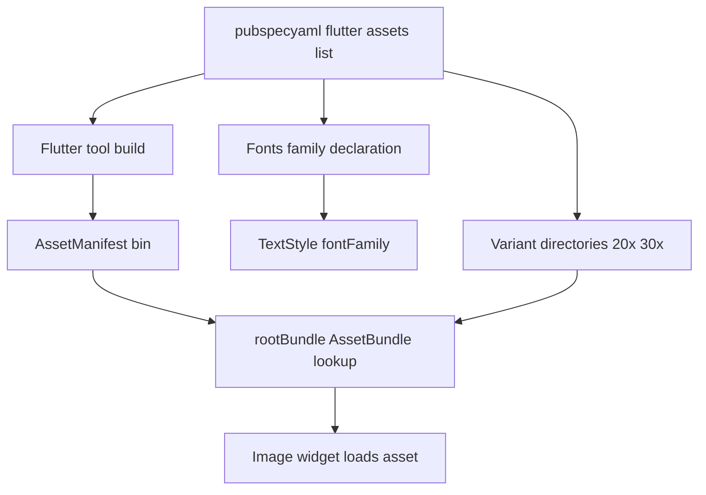

# Asset Bundling and the pubspec.yaml Pipeline

## English

Every image, font, JSON file, or audio clip that ships inside a Flutter app has to be declared in pubspec.yaml before it exists to your code at runtime. The `flutter:` section contains an `assets:` list, and each entry is a path or a directory ending in a slash (a trailing slash means 'include everything in this folder recursively'). If you reference `assets/logo.png` in an Image widget but forget the pubspec entry, you get a runtime error saying the asset was not found — not a compile error, because asset resolution happens at runtime through a lookup table.

Under the hood, the Flutter tool builds an asset manifest (a file called AssetManifest.json or, in newer versions, a binary AssetManifest.bin) that maps logical keys to bundled file locations. The `rootBundle` object and the `AssetBundle` class read from this manifest. That is why `rootBundle.loadString('assets/config.json')` works even though the file lives inside the app package rather than on a normal filesystem path — the bundle abstracts where the bytes actually sit (APK, IPA, web server, or desktop bundle).

Assets can also vary by device characteristics using variant directories. If you have `assets/2.0x/logo.png` and `assets/3.0x/logo.png`, Flutter picks the closest match to the device pixel ratio, the same idea as Android density buckets. Fonts work similarly: you declare a `fonts:` list with a family name and the weight/style of each file, then reference that family in TextStyle. Without the declaration, `TextStyle(fontFamily: 'MyFont')` silently falls back to the platform default.

For large or rarely used assets, consider `flutter build` flags like `--split-debug-info` and deferred components on Android, or simply download content at runtime instead of bundling it. Bundled assets inflate install size directly. A common pattern is to bundle only the first-screen assets and fetch the rest over HTTP, caching locally. Also remember that pubspec changes require a full restart (not a hot reload) because the asset manifest is baked into the build.

Finally, the pubspec is also where you pin dependency versions, declare dev dependencies, and configure build behaviour. The `dependency_overrides` section is a debugging escape hatch: it forces a single version of a package across your whole dependency graph when two libraries disagree. Use it sparingly — it can mask real incompatibilities — but knowing it exists saves hours when a transitive dependency conflict blocks your build.

## 中文

每一個隨 Flutter 應用程式一齊釋出嘅圖片、字型、JSON 檔案或者音效，都必須先喺 pubspec.yaml 入面宣告，程式碼喺執行期先至能夠搵到佢。`flutter:` 區段入面有一個 `assets:` 清單，每一項都係一個路徑，或者以斜線結尾嘅目錄（尾隨斜線代表「遞迴包含呢個資料夾入面所有嘢」）。如果你喺 Image widget 入面引用 `assets/logo.png` 但忘記咗喺 pubspec 加返個宣告，你唔會得到編譯錯誤，而係執行期錯誤，話你搵唔到個 asset——因為 asset 解析係喺執行期透過一張查表進行嘅。

底層運作係咁：Flutter 工具會建立一個 asset manifest（一個叫 AssetManifest.json 嘅檔案，或者喺較新版本係二進位制嘅 AssetManifest.bin），將邏輯 key 對應到打包檔案嘅位置。`rootBundle` 物件同 `AssetBundle` 類別就係讀呢個 manifest。呢個就解釋咗點解 `rootBundle.loadString('assets/config.json')` 可以運作，即使個檔案係住喺 app package 入面而唔係喺正常檔案系統路徑——bundle 抽象咗位元組實際坐喺邊（APK、IPA、web server 定係桌面 bundle）。

Asset 亦可以按裝置特性用變體目錄嚟區分。如果你有 `assets/2.0x/logo.png` 同 `assets/3.0x/logo.png`，Flutter 會揀最接近裝置畫素比例嘅嗰個，同 Android 密度桶嘅概念一樣。字型都係類似：你宣告一個 `fonts:` 清單，包含 family 名同每個檔案嘅 weight/style，然後喺 TextStyle 入面引用嗰個 family。冇宣告嘅話，`TextStyle(fontFamily: 'MyFont')` 會靜靜雞 fallback 去平臺預設值。

對於大型或者好少用嘅 asset，可以考慮 `flutter build` 嘅 flag 例如 `--split-debug-info`，同埋 Android 上面嘅 deferred components，或者乾脆喺執行期下載內容而唔好打包。打包咗嘅 asset 會直接令安裝大小膨脹。一個常見做法係只打包第一屏嘅 asset，其餘透過 HTTP 攞，再喺本地快取。另外要記住，pubspec 嘅改動需要完整重啟（唔係 hot reload），因為 asset manifest 已經烘焙咗入 build 入面。

最後，pubspec 亦係你釘住依賴版本、宣告 dev dependencies 同配置 build 行為嘅地方。`dependency_overrides` 區段係一個除錯逃生門：當兩個 library 唔啱嘅時候，佢會喺你整個依賴圖入面強制用單一版本。要謹慎使用——佢可以掩蓋真正嘅不相容——但知道佢存在，喺傳遞依賴衝突阻礙你 build 嘅時候可以慳返幾個鐘。

## Key Takeaway

Assets must be declared in pubspec.yaml because Flutter resolves them at runtime through a generated manifest, not through filesystem paths.

## Related Concepts
- AssetBundle and rootBundle
- Dependency version resolution in pubspec.yaml

## Diagram

