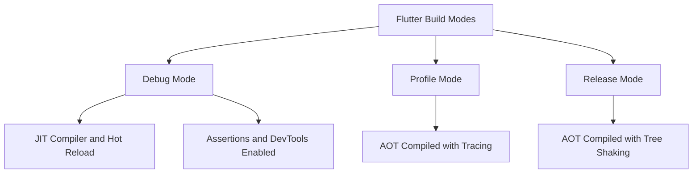

# Build Modes: Debug, Profile, and Release

## English

Flutter has three distinct build modes, and the differences are far deeper than 'debug has logging, release doesn't'. In debug mode, the Dart code runs in the Dart VM with a JIT (just-in-time) compiler attached. That is what makes hot reload possible: the VM can swap in new code while the app is running because it is compiling functions on demand. Debug mode also enables all assertions (`assert(...)` statements), includes the observatory/DevTools service, and skips certain optimisations. It is slow — often several times slower than release — and its memory footprint is much larger.

Profile mode is the middle ground. It compiles ahead-of-time (AOT) like release, so performance numbers are representative, but it keeps the service extensions and tracing hooks that DevTools needs. Critically, profile mode is not available on the iOS simulator or on the web (it is meant for real devices). When you wonder 'why is my animation janky', you must measure in profile mode on a real device; measuring in debug mode will mislead you badly, because JIT overhead dominates.

Release mode is AOT-compiled, strips assertions, disables the debugging service, and applies tree shaking — the compiler removes code that is provably unreachable, including whole libraries that are only referenced from debug-only paths. Tree shaking is why `dart:mirrors` (reflection) is unavailable in Flutter release builds: reflection would require retaining code the compiler cannot prove is dead. This is also why you should never rely on runtime type-string lookup for anything critical.

A subtle consequence: some bugs only appear in release. Assertions that guard invariants vanish, so a null that an assert would have caught silently propagates. Timing changes because AOT code runs faster and differently scheduled. The `kReleaseMode`, `kProfileMode`, and `kDebugMode` constants from `foundation` let you branch behaviour explicitly — for example, pointing at a staging API in debug and production in release, or enabling verbose logging only in debug.

You select modes with flags: `flutter run` defaults to debug, `flutter run --profile` and `flutter run --release` switch modes, and `flutter build apk`, `flutter build ipa`, etc. always produce release artifacts (with `--profile` or `--debug` available where supported). A pragmatic workflow is: develop in debug for hot reload, verify performance and visual fidelity in profile on a real device, and always smoke-test the actual release build before shipping, because that is the only configuration your users will ever run.

## 中文

Flutter 有三種唔同嘅 build 模式，而佢哋之間嘅差異遠比「debug 有 log、release 冇」嚟得深入。喺 debug 模式，Dart 程式碼喺 Dart VM 入面行，附帶一個 JIT（即時編譯）編譯器。呢個就係 hot reload 之所以可能嘅原因：VM 可以喺 app 運行緊嘅時候換入新程式碼，因為佢係按需要編譯函數。Debug 模式亦會啟用所有 assertion（`assert(...)` 陳述式）、包含 observatory/DevTools 服務，同埋跳過某些優化。佢好慢——通常比 release 慢幾倍——而且記憶體足跡大好多。

Profile 模式係中間路線。佢同 release 一樣做 ahead-of-time（AOT）編譯，所以效能數字有代表性，但佢保留咗 DevTools 需要嘅 service extension 同 tracing hook。關鍵係，profile 模式喺 iOS 模擬器或者 web 上面都用唔到（佢係為真機而設）。當你諗「點解我個動畫咁卡」嘅時候，你一定要喺真機上面用 profile 模式量度；喺 debug 模式量度會嚴重誤導你，因為 JIT 開銷會支配一切。

Release 模式係 AOT 編譯、剝走 assertion、停用除錯服務，同埋做 tree shaking——編譯器會移除可證明無法到達嘅程式碼，包括啲只係喺 debug-only 路徑被引用嘅整個 library。Tree shaking 就係點解 `dart:mirrors`（反射）喺 Flutter release build 用唔到：反射需要保留編譯器無法證明係死嘅程式碼。呢個亦係點解你永遠唔應該依賴執行期 type-string 查找去做任何關鍵嘅嘢。

一個微妙嘅後果：有啲 bug 只會喺 release 出現。守護不變量嘅 assertion 消失咗，所以一個 assert 本來會捉到嘅 null 會靜靜雞傳播開去。時序會改變，因為 AOT 程式碼行得快啲、排程唔同。`foundation` 嘅 `kReleaseMode`、`kProfileMode` 同 `kDebugMode` 常數俾你明確咁分支行為——例如喺 debug 指向 staging API、喺 release 指向 production，或者只喺 debug 啟用詳細 log。

你用 flag 揀模式：`flutter run` 預設係 debug，`flutter run --profile` 同 `flutter run --release` 切換模式，而 `flutter build apk`、`flutter build ipa` 等等永遠產生 release artifact（喺支援嘅地方可以用 `--profile` 或 `--debug`）。一個務實嘅工作流程係：喺 debug 開發以獲得 hot reload，喺真機用 profile 驗證效能同視覺保真度，同埋出貨前永遠對實際 release build 做 smoke test，因為嗰個先係你用戶唯一會行嘅配置。

## Key Takeaway

Debug uses JIT for hot reload, profile uses AOT with tracing for realistic measurement, and release uses AOT with tree shaking and no assertions — so always performance-test in profile and smoke-test in release.

## Related Concepts
- Ahead-of-time (AOT) compilation
- Tree shaking and dead code elimination

## Diagram

