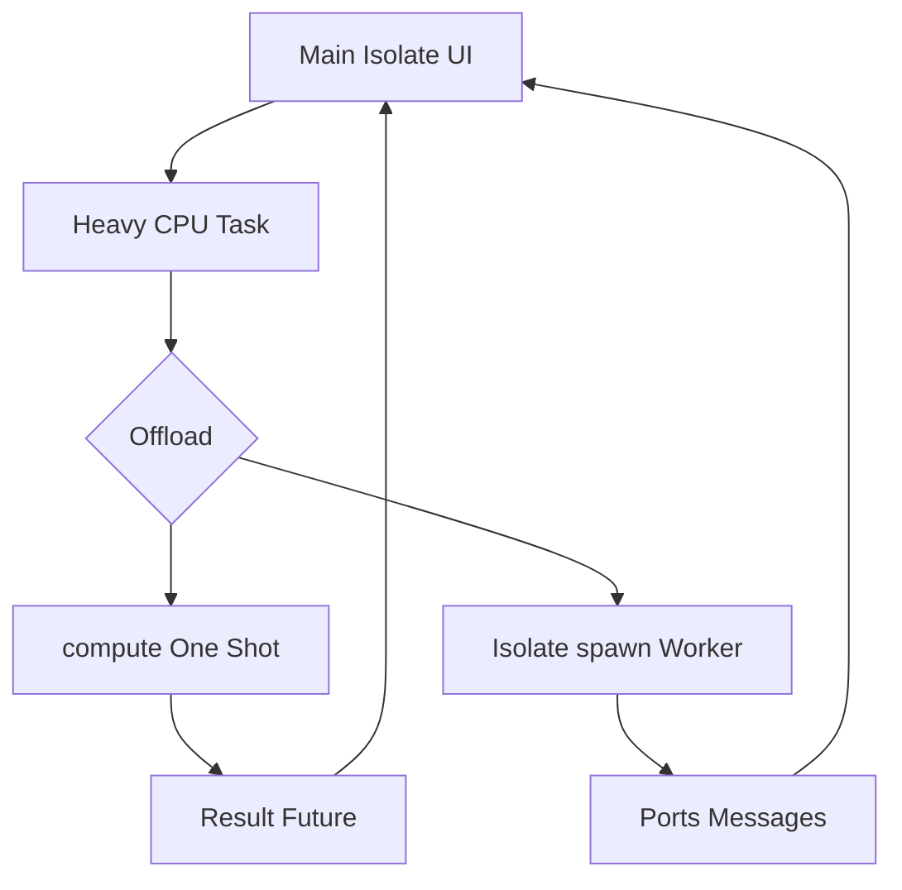

# The Dart Isolate Model and Background Work

## English

Dart is single-threaded in the sense that each isolate has exactly one thread of execution and no shared mutable memory with other isolates. That sounds limiting until you understand what an isolate actually is: an independent worker with its own heap and its own event loop. Isolates do not share objects; they communicate by passing messages (deep copies) over ports. This design eliminates data races by construction — there is no lock, no mutex, no 'synchronized' keyword, because there is nothing to synchronise.

The practical consequence for Flutter is that your UI runs on the main isolate, and anything CPU-heavy on that isolate blocks frame rendering. A frame has roughly 16 milliseconds of budget at 60 Hz (about 8 ms at 120 Hz). If you parse a large JSON payload, decode a big image, or run an expensive computation synchronously, you blow the budget and the user sees jank. The event loop is cooperative: long synchronous work cannot be preempted, so the UI literally cannot paint until your function returns.

For simple offloading, `compute()` from `foundation` spawns a short-lived isolate, runs a top-level or static function with one argument, and returns the result as a Future. It is perfect for one-shot tasks like decoding. For longer-lived workers (a database connection, a socket listener), you create an isolate explicitly with `Isolate.spawn` and keep a `SendPort`/`ReceivePort` pair for ongoing messages. The `IsolateNameServer` lets other parts of the app find a named isolate, which is how some plugins expose background services.

There is also the async path: `async`/`await` with `Future` handles I/O-bound work (network, file reads) efficiently because the underlying operation happens off the Dart thread and the event loop just waits for a callback. But `await` does not make CPU work parallel — an `await` on a synchronous loop still blocks. This distinction trips up many developers: async is about not blocking while waiting, isolates are about not blocking while computing.

A modern refinement is that Flutter can run background isolates that persist and are managed for you, and packages exist that wrap the spawn/port boilerplate. The mental model to keep is: main isolate for UI and light logic, short-lived isolates via `compute()` for one-off heavy tasks, long-lived isolates for streaming workers, and plain `async`/`await` for I/O. If a frame drops, ask whether you are computing on the main isolate — that is the usual culprit.

## 中文

Dart 係單執行緒嘅，意思係每個 isolate 都只有一條執行緒，而且同其他 isolate 之間冇共享嘅可變記憶體。聽落好似好大限制，直到你明白 isolate 究竟係咩：一個獨立嘅 worker，有自己嘅 heap 同自己嘅 event loop。Isolate 之間唔共享物件；佢哋透過 port 傳遞訊息（深複製）嚟溝通。呢個設計從根本上消除咗 data race——冇 lock、冇 mutex、冇 `synchronized` 關鍵字，因為根本冇嘢需要同步。

對 Flutter 嚟講，實際後果係你嘅 UI 喺 main isolate 上面行，任何喺嗰個 isolate 上面嘅 CPU 密集工作都會阻礙畫面渲染。喺 60 Hz 下，一幀大約有 16 毫秒嘅預算（120 Hz 下大約 8 毫秒）。如果你解析一個大型 JSON payload、解碼一張大圖，或者同步咁行一個昂貴嘅計算，你就會爆預算，使用者就會見到卡頓。Event loop 係協作式嘅：長時間嘅同步工作冇得被搶佔，所以 UI 喺你個函式返回之前真係畫唔到。

對於簡單嘅解除安裝，`foundation` 嘅 `compute()` 會開一個短命 isolate，行一個 top-level 或者 static 函式（帶一個引數），然後以 Future 返回結果。佢非常適合一次性任務好似解碼。對於較長壽嘅 worker（一個資料庫連線、一個 socket 監聽器），你明確咁用 `Isolate.spawn` 建立 isolate，並保留一對 `SendPort`/`ReceivePort` 嚟持續傳訊息。`IsolateNameServer` 俾 app 其他部分搵到一個有名嘅 isolate，呢個就係某些 plugin 暴露背景服務嘅方式。

仲有 async 路徑：`async`/`await` 配 `Future` 有效咁處理 I/O 密集工作（網路、檔案讀取），因為底層操作喺 Dart 執行緒以外發生，event loop 只係等一個 callback。但 `await` 唔會令 CPU 工作變並行——喺一個同步迴圈上面 `await` 仍然會阻塞。呢個區別絆倒好多開發者：async 係關於等待時唔阻塞，isolate 係關於運算時唔阻塞。

一個現代嘅改良係 Flutter 可以行持續存在、幫你管理嘅背景 isolate，亦有啲 package 包裝咗 spawn/port 嘅樣板碼。要記住嘅心智模型係：main isolate 做 UI 同輕量邏輯，短命 isolate 透過 `compute()` 做一次性重活，長命 isolate 做串流 worker，而純 `async`/`await` 做 I/O。如果掉幀，問嚇自己係咪喺 main isolate 上面做運算——呢個通常就係元兇。

## Key Takeaway

Isolates are Dart's answer to threads-without-shared-memory, and keeping CPU-heavy work off the main isolate is the key to smooth frames.

## Related Concepts
- Event loop and microtask queue
- compute() and Isolate.spawn

## Diagram

