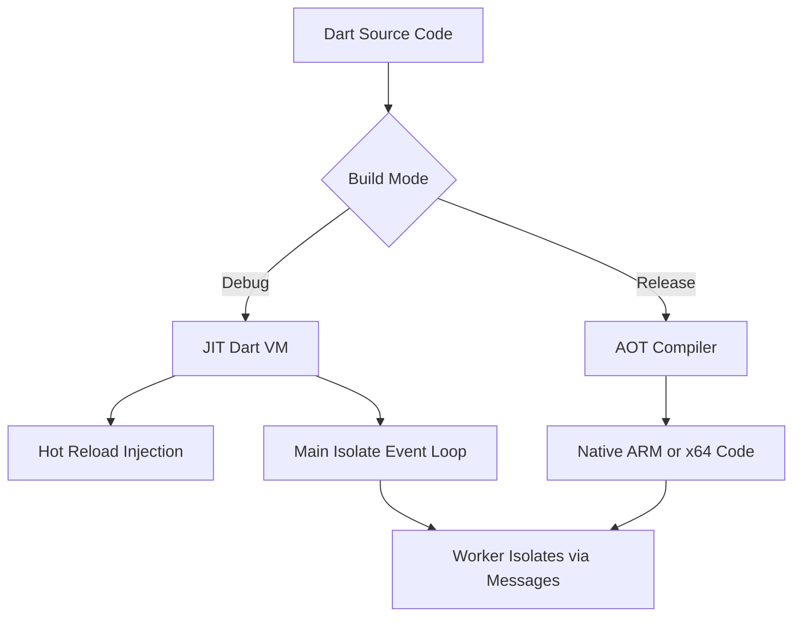

# The Dart Language Itself: Why Flutter Chose It

## English

Flutter is written in Dart, and that choice is not incidental — it shapes how the framework behaves. Dart is a statically typed, object-oriented language with a C-style syntax that most programmers can read within an hour. Unlike JavaScript, it has sound null safety: the type system distinguishes between a String that might be null (String?) and one that never can be (String), and the compiler enforces this. That means whole categories of runtime crashes — the infamous 'undefined is not a function' family — become compile-time errors before your app ever ships. For a UI framework where deeply nested widget trees pass data down many layers, catching type mistakes early is a genuine productivity win.

Dart's killer feature for Flutter is its ahead-of-time (AOT) and just-in-time (JIT) duality. In debug mode, Flutter runs your Dart code through the Dart VM in JIT mode, which is why hot reload can inject new code into a running app — the VM compiles functions on demand. In release mode, the same code is compiled AOT to native ARM or x64 machine code, so there is no interpreter or bridge in the hot path. That is a big part of why Flutter apps feel native rather than webview-like. The same language, two compilation strategies, chosen per build mode.

Dart also has a single-threaded event loop with an async/await model built on Futures and Streams. Each isolate (Dart's unit of concurrency) has its own memory heap and event loop, so there are no shared-memory data races by default — you communicate between isolates by passing messages, not by locking mutexes. For UI work this is a clean fit: one main isolate owns the UI thread and processes a queue of events (taps, timers, network responses), and you offload heavy computation to worker isolates via APIs like compute() or Isolate.spawn.

One more detail worth knowing: Dart compiles to JavaScript too (dart2js and the newer dart2wasm), which is how Flutter Web works. But the JS target has different performance characteristics — garbage collection, numeric precision (JS numbers are doubles), and DOM access all differ — so Flutter Web sometimes needs its own rendering path. Understanding that Dart is the substrate for all of this helps you reason about why a Flutter app behaves the way it does on each platform, rather than treating the framework as magic.

## 中文

Flutter 係用 Dart 寫嘅，而呢個選擇唔係偶然——佢直接影響咗整個框架嘅行為。Dart 係一門靜態型別、物件導向嘅語言，語法近似 C 系，大部分程式設計師一個鐘內就睇得明。同 JavaScript 唔同，佢有健全嘅空值安全（sound null safety）：型別系統會區分「可能係 null 嘅 String」（String?）同「永遠唔會係 null 嘅 String」（String），而且由編譯器強制執行。即係話，好多本來會喺執行期爆煲嘅錯誤——例如經典嘅「undefined is not a function」——會喺你出貨之前就變成編譯期錯誤。對於一個要喺層層疊疊嘅 widget 樹入面傳遞資料嘅 UI 框架嚟講，早啲捉到型別錯誤係實實在在嘅生產力提升。

Dart 對 Flutter 嚟講最殺食嘅特性，係佢同時支援提前編譯（AOT）同即時編譯（JIT）。喺 debug 模式，Flutter 會透過 Dart VM 以 JIT 方式行你嘅程式碼，所以 hot reload 可以將新程式碼注入到執行緊嘅 app——VM 會按需要即時編譯函式。喺 release 模式，同一份程式碼就會 AOT 編譯成原生 ARM 或 x64 機器碼，熱路徑上面冇直譯器、冇橋接層。呢點正正係 Flutter app 感覺似原生、而唔似 webview 嘅重要原因。同一門語言，兩種編譯策略，按 build 模式揀。

Dart 仲有一個單執行緒事件迴圈，配搭建基於 Future 同 Stream 嘅 async/await 模型。每個 isolate（Dart 嘅並行單位）有自己嘅記憶體堆同事件迴圈，所以預設冇共享記憶體嘅資料競爭——isolate 之間係靠傳訊息溝通，而唔係靠鎖 mutex。對於 UI 工作嚟講呢個好夾：主 isolate 擁有 UI 執行緒，處理一連串事件（點選、計時器、網路回應），而你可以用 compute() 或者 Isolate.spawn 之類嘅 API 將重型運算掟去 worker isolate。

仲有一個值得知嘅細節：Dart 都可以編譯成 JavaScript（dart2js 同較新嘅 dart2wasm），Flutter Web 就係咁運作。但 JS 目標嘅效能特性唔同——垃圾回收、數值精度（JS 嘅數字全部係 double）、DOM 存取都唔一樣——所以 Flutter Web 有時需要自己嘅渲染路徑。明白 Dart 係呢一切嘅底層，可以幫你理解點解同一個 Flutter app 喺唔同平臺會有唔同表現，而唔係將個框架當成魔法。

## Key Takeaway

Dart's sound null safety, dual JIT/AOT compilation, and isolate-based concurrency are not side details — they are the reasons Flutter can offer hot reload in debug and native-speed code in release.

## Related Concepts
- Sound null safety
- Isolates and event loops

## Diagram

