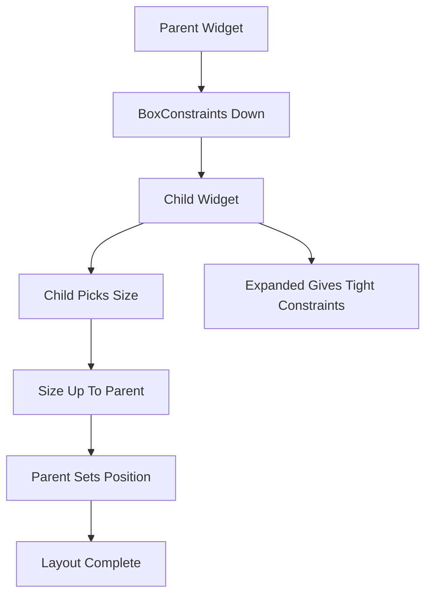

# Constraints Go Down, Sizes Go Up: How Flutter Lays Out Widgets

## English

The single most important rule in Flutter layout is a phrase you will see repeated in the docs: constraints go down, sizes go up, and the parent sets the position. Every widget in the tree receives a BoxConstraints object from its parent — a minimum and maximum width and height. The widget picks a concrete size that satisfies those constraints, reports that size back up to its parent, and the parent then decides where to place it. This one-pass protocol is why Flutter layout is fast: each widget only needs to talk to its parent once, rather than negotiating back and forth.

Picture a Column with three children. The Column itself receives constraints from its own parent (say, the screen). It then passes modified constraints to each child: because a Column stacks children vertically, it gives each child the full available width but an unbounded height (or a height capped by the column's own max). Each child computes its own height, reports it up, and the Column sums the heights to determine its own size. If the total exceeds the available space, you get the dreaded yellow-and-black 'RenderFlex overflowed' stripes — a signal that the constraints were violated, not that the widget is broken.

This is also why Expanded and Flexible exist. By default a Column gives children unbounded height, so a ListView inside a Column without Expanded will throw because ListView wants to fill infinite space. Wrapping it in Expanded tells the Column to give that child a fixed share of the available height (a tight constraint) instead of unbounded. Similarly, a Container with no explicit width inside a Row will size to its child, but a Container with width: double.infinity will try to fill the parent's max width. Learning to read constraints is the difference between fighting layout and directing it.

A few practical corollaries: IntrinsicWidth and IntrinsicHeight force extra measurement passes (expensive — avoid in hot paths). Align, Center, and SizedBox all work by manipulating the constraints they pass down. And when you see a widget that 'doesn't take up space', it is usually because its parent passed it loose constraints (min zero) and its own preferred size happened to be small. Once you internalise the constraint protocol, layout bugs stop feeling mysterious — they become a matter of tracing which parent sent which constraints.

## 中文

Flutter 佈局入面最重要嘅一條規則，就係檔案入面成日重複嗰句：約束向下傳，尺寸向上報，位置由父層決定。widget 樹入面每個 widget 都會由父層收到一個 BoxConstraints 物件——即係最小同最大嘅闊度同高度。個 widget 會揀一個符合呢啲約束嘅具體尺寸，將尺寸報返上去父層，然後父層先決定放佢喺邊。呢個單趟協議正正係 Flutter 佈局快嘅原因：每個 widget 只需要同父層講一次，唔使來來回回咁傾。

想像一個有三個仔女嘅 Column。Column 自己會由佢嘅父層（例如螢幕）收到約束。然後佢會將修改過嘅約束傳俾每個仔女：因為 Column 係垂直堆疊，佢會俾每個仔女完整嘅可用闊度，但高度就唔設上限（或者用 Column 自己嘅最大高度做上限）。每個仔女計出自己嘅高度、報返上去，Column 就將啲高度加埋，決定自己嘅尺寸。如果總高度超出可用空間，你就會見到嗰啲黃黑間條嘅「RenderFlex overflowed」警告——呢個係約束被違反嘅訊號，而唔係個 widget 壞咗。

呢個亦都解釋咗點解會有 Expanded 同 Flexible。預設情況下 Column 會俾仔女無限高度，所以一個冇包 Expanded 嘅 ListView 放喺 Column 入面就會拋錯，因為 ListView 想填滿無限空間。包一層 Expanded 就等於話俾 Column 知：俾呢個仔女一個固定份額嘅可用高度（緊約束），而唔係無限。同樣道理，一個冇指定闊度嘅 Container 放喺 Row 入面會按仔女尺寸決定大細，但一個 width: double.infinity 嘅 Container 就會嘗試填滿父層最大闊度。識得睇約束，就係「同佈局搏鬥」同「指揮佈局」之間嘅分別。

幾個實用推論：IntrinsicWidth 同 IntrinsicHeight 會逼系統做額外嘅測量趟數（好貴——熱路徑要避免）。Align、Center 同 SizedBox 全部都係靠操作佢哋向下傳嘅約束嚟運作。而當你見到某個 widget「唔佔空間」，通常係因為佢父層俾咗鬆約束（最小值係零），而佢自己嘅首選尺寸又啱啱好細。一旦你內化咗約束協議，佈局 bug 就唔再神秘——佢哋變成一個問題：追溯邊個父層傳咗咩約束落嚟。

## Key Takeaway

Flutter layout is a single-pass negotiation where parents pass constraints down, children report sizes up, and parents assign positions — most layout bugs are really constraint misunderstandings.

## Related Concepts
- BoxConstraints
- Expanded and Flexible

## Diagram

