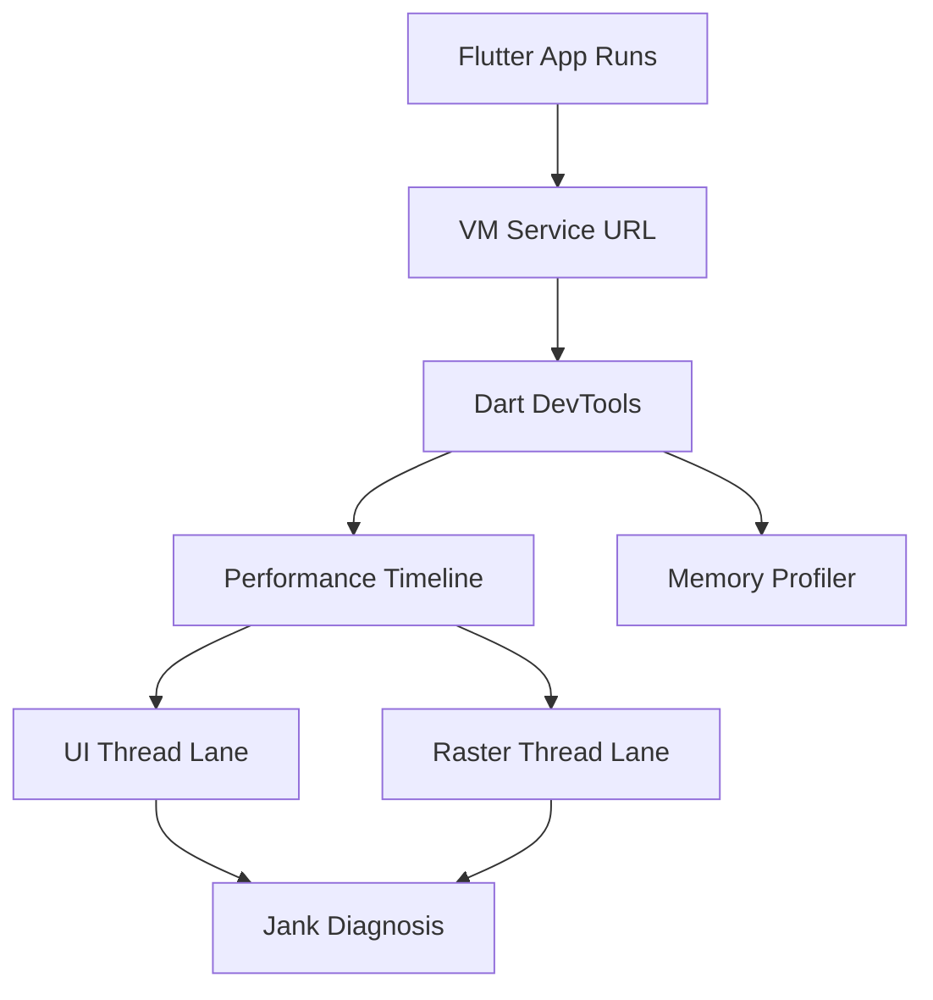

# DevTools, the Observatory, and Profiling a Real Flutter App

## English

Once your Flutter app works, the next question is whether it works well — and Flutter ships a serious set of diagnostic tools. The main one is Dart DevTools, a browser-based suite that connects to a running app via the Dart VM service protocol (the same channel that powers hot reload). You launch it by running your app in debug or profile mode and looking at the VM service URL printed in the console, or by pressing the DevTools shortcut in your IDE. DevTools bundles an inspector, a widget-tree view, a performance timeline, a memory profiler, a network view, and a logging console. It is not optional tooling — it is how you answer questions like 'why is this screen janky?' or 'what is holding this object in memory?'

The performance view is where most of the value lives. Flutter renders at whatever the display refresh rate is — commonly 60Hz (16.67ms per frame) or 120Hz (8.33ms per frame) on modern phones. If a frame takes longer than the budget, you drop it, and the user sees a stutter. The DevTools timeline shows two lanes: the UI thread (where Dart code, layout, and painting happen) and the raster thread (where the GPU turns the layer tree into pixels). A janky frame will show you which lane blew the budget, which immediately narrows the problem: heavy build methods and expensive layout hit the UI thread, while shader compilation and complex painting hit the raster thread. Since Flutter moved to the Impeller renderer on many platforms, shader-compilation jank has been substantially reduced, but the two-lane mental model still applies.

For memory, the profiler shows allocation over time and lets you take heap snapshots. A classic Flutter leak is a listener or a stream subscription that was never cancelled in dispose(), keeping a whole widget subtree alive after the screen is gone. The snapshot view lets you see retained objects and their retaining paths, which is how you find the culprit. The network view, meanwhile, surfaces HTTP requests made through Dart's HttpClient and related APIs, which is useful for spotting accidental polling loops or oversized payloads.

Two practical habits: always profile in profile mode, not debug mode, because debug mode disables many optimisations and will make everything look slower than it is. And use the widget inspector's 'select widget' mode to tap a piece of UI and jump straight to the corresponding widget in the tree — invaluable when you inherit a codebase. Debugging Flutter is less about print statements and more about reading the timeline, the tree, and the heap, and DevTools gives you a first-class window into all three.

## 中文

當你個 Flutter app 行得通之後，下一個問題就係佢行得好唔好——而 Flutter 內建咗一套相當認真嘅診斷工具。最主要嘅係 Dart DevTools，一個以瀏覽器為基礎嘅工具套件，透過 Dart VM service 協議（即係支撐 hot reload 嘅同一條通道）連線執行緊嘅 app。你只要用 debug 或 profile 模式行 app，望下 console 印出嚟嘅 VM service URL，或者喺 IDE 按 DevTools 快捷鍵就開到。DevTools 包埋 inspector、widget 樹檢視、效能時間軸、記憶體分析器、網路檢視同日誌 console。呢啲唔係可有可無嘅工具——佢哋就係你回答「點解呢版咁卡？」或者「係咩嘢 hold 住咗個物件喺記憶體？」嘅方法。

效能檢視係大部分價值所在。Flutter 會按螢幕重新整理率渲染——現代手機常見係 60Hz（每格 16.67 毫秒）或者 120Hz（每格 8.33 毫秒）。如果一格用多過個預算，就會掉格，使用者就會見到窒。DevTools 時間軸會顯示兩條線：UI 執行緒（Dart 程式碼、佈局同繪製喺度發生）同 raster 執行緒（GPU 將 layer 樹變成畫素）。卡頓嘅一格會話你知係邊條線超咗預算，即刻收窄問題範圍：重型 build 方法同貴價佈局會打中 UI 執行緒，而 shader 編譯同複雜繪製就會打中 raster 執行緒。自從 Flutter 喺好多平臺轉用 Impeller 渲染器之後，shader 編譯造成嘅卡頓已經大幅減少，但兩條線嘅心智模型依然適用。

記憶體方面，分析器會顯示隨時間嘅分配情況，亦可以影 heap 快照。Flutter 經典嘅記憶體洩漏，就係喺 dispose() 入面冇取消嘅 listener 或者 stream 訂閱，令成個 widget 子樹喺畫面消失之後仍然生存。快照檢視可以睇到被保留嘅物件同佢哋嘅保留路徑，咁你就搵到元兇。至於網路檢視，就會顯示透過 Dart 嘅 HttpClient 同相關 API 發出嘅 HTTP 請求，用嚟捉無意中嘅輪詢迴圈或者過大嘅 payload 好有用。

兩個實用習慣：永遠喺 profile 模式而唔係 debug 模式做效能分析，因為 debug 模式會停用好多最佳化，會令所有嘢睇落慢過實際。另外，用 widget inspector 嘅「選取 widget」模式，點一下畫面任何位置就直接跳去 widget 樹對應嘅 widget——接手舊 codebase 嗰陣尤其救命。Flutter 除錯唔係靠 print，而係靠讀時間軸、讀樹、讀 heap，而 DevTools 就係你窺探呢三樣嘢嘅第一流視窗。

## Key Takeaway

DevTools turns Flutter debugging from guesswork into measurement — the timeline tells you whether the UI or raster thread is the bottleneck, and profile mode is the only honest place to look.

## Related Concepts
- Dart VM service protocol
- Frame budget and jank

## Diagram

