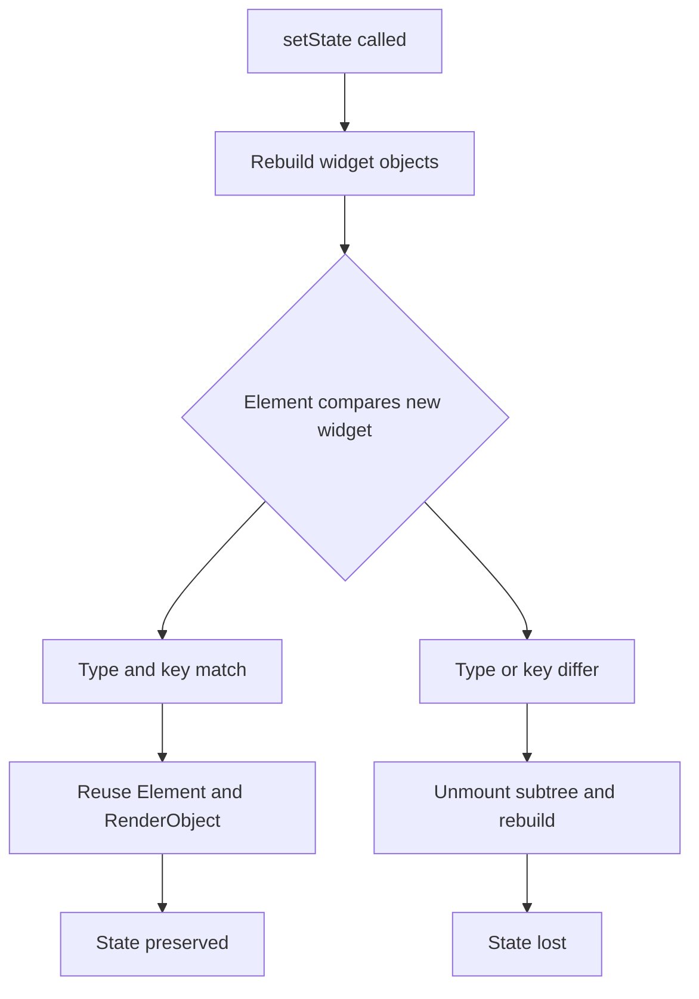

# The Element Tree: The Hidden Middle Layer Between Widgets and RenderObjects

## English

Most explanations of Flutter stop at two trees: the immutable widget tree you write, and the RenderObject tree that measures and paints. In between sits a third tree — the element tree — and understanding it explains almost every confusing behaviour you will hit in practice. An Element is a long-lived object that represents a widget's position in the tree. When you call setState, Flutter does not throw away the whole subtree; it rebuilds the widget objects (cheap, immutable configuration) and then asks each Element whether the new widget can update it in place. If the runtime type and key match, the Element is reused and its RenderObject is preserved. If not, the Element and everything beneath it is unmounted and rebuilt from scratch. This is why a widget's State object survives rebuilds but dies when its position or type changes.

The classic demonstration is swapping two children in a Column of stateful widgets. Without keys, Flutter matches children by index, so the first Element now receives a widget of the same type but conceptually different data, and its State — say, a TextField's cursor position — stays behind with the wrong child. Assigning a ValueKey or GlobalKey tells the reconciliation algorithm to match by identity rather than position, and the State follows its widget. GlobalKey goes further: it is globally unique across the entire app, which lets you move an Element (and its State) to a different part of the tree in one frame, at the cost of a global registry lookup and some bookkeeping overhead.

Elements also come in flavours that mirror widget categories. A StatelessElement holds no mutable state; a StatefulElement owns the State object and triggers rebuilds via setState; a RenderObjectElement is the bridge that creates and updates the actual RenderObject in the layout tree. InheritedElement is special: it caches a map of dependent Elements so that when the inherited value changes, only those dependents are marked dirty rather than the whole subtree. That dependency bookkeeping is the machinery behind Theme.of(context) and MediaQuery.of(context) rebuilding exactly the widgets that read them.

The practical payoff is knowing when to reach for keys and when not to. Keys are unnecessary for static lists and actively harmful if you generate a new key on every build (for example, using UniqueKey() inside build), because the Element can never be reused and the subtree is destroyed each frame — a subtle but severe performance and state-loss bug. Conversely, when reordering or inserting items in a dynamic list, keys are essential for correctness. The rule of thumb: use keys when the identity of a child matters across rebuilds, not merely its position.

Finally, the element tree is what DevTools' widget inspector is really showing you when it displays the tree with its "widget" and "render object" views side by side. The element is the node that persists across frames and owns the lifecycle methods — initState, didUpdateWidget, dispose — that you write. Thinking of widgets as descriptions and elements as the living instances makes phrases like "the framework rebuilds the widget" precise instead of mystical.

## 中文

大部分 Flutter 教學只講兩棵樹：你手寫、不可變的 widget 樹，以及負責量度與繪畫的 RenderObject 樹。其實中間還有第三棵樹——element 樹——明白它，就幾乎能解釋你在實戰中遇到的所有古怪行為。Element 是一個長壽的物件，代表某個 widget 在樹中的位置。當你呼叫 setState，Flutter 並不會丟棄整個子樹；它會重建 widget 物件（便宜、不可變的設定），然後問每個 Element：新的 widget 能否就地更新它。若 runtime type 與 key 相符，Element 會被重用，其 RenderObject 亦得以保留；若不相符，該 Element 及其下所有東西都會被解除安裝並從頭重建。這就是為何 widget 的 State 物件能在重建中存活，但一旦位置或型別改變就會死亡。

最經典的示範，是在一個 Column 中交換兩個有狀態 widget 的次序。沒有 key 的話，Flutter 會按索引配對子項，於是第一個 Element 現在收到同型別但概念上不同的 widget，它的 State——例如 TextField 的游標位置——就留在錯誤的子項身上。加上 ValueKey 或 GlobalKey，就等於告訴協調演演算法按身份而非位置配對，State 便會跟隨它的 widget。GlobalKey 更進一步：它在整個 app 中全域唯一，讓你能在一幀之內把一個 Element（連同其 State）搬到樹的另一處，代價是一次全域登錄檔查詢及一些簿記開銷。

Element 亦有幾種對應 widget 類別的分支。StatelessElement 不持有可變狀態；StatefulElement 擁有 State 物件並透過 setState 觸發重建；RenderObjectElement 則是橋樑，負責在佈局樹中建立及更新真正的 RenderObject。InheritedElement 較特別：它快取一張依賴它的 Element 地圖，當繼承值改變時，只會把這些依賴者標記為骯髒，而非整個子樹。這套依賴簿記，正是 Theme.of(context) 與 MediaQuery.of(context) 能只重建真正讀取它們的 widget 的機制。

實際的好處，是知道何時該用 key、何時不該。靜態清單不需要 key；但如果你在每次 build 時都產生新 key（例如在 build 內用 UniqueKey()），反而有害，因為 Element 永遠無法被重用，子樹每幀都被摧毀——這是個隱蔽但嚴重的效能與狀態流失 bug。相反，在動態清單中重排或插入專案時，key 對正確性至關重要。經驗法則：當子項的身份（而非位置）在重建之間有意義時，就用 key。

最後，element 樹正是 DevTools 的 widget inspector 並排顯示「widget」與「render object」檢視時真正展示的東西。Element 是跨幀持續存在、並擁有你撰寫的生命週期方法——initState、didUpdateWidget、dispose——的節點。把 widget 想成描述、把 element 想成活生生的例項，「框架重建 widget」這類說法就會變得精確而非神秘。

## Key Takeaway

The element tree is the persistent middle layer that decides whether a rebuild reuses existing state and render objects or destroys them, which is why keys matter.

## Related Concepts
- Widget keys and reconciliation
- RenderObject lifecycle

## Diagram

