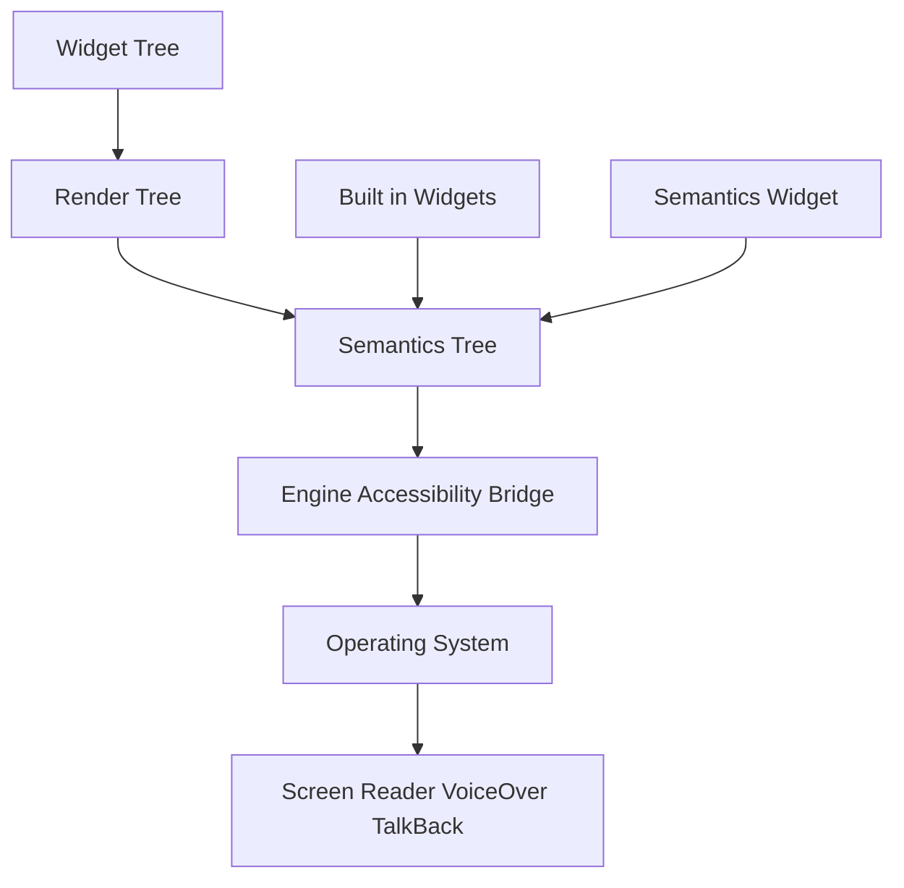

# Semantics Tree and Accessibility: How Flutter Speaks to Screen Readers

## English

A Flutter app paints pixels, but assistive technologies like VoiceOver and TalkBack do not read pixels — they read a semantics tree. Flutter maintains this tree alongside the widget and render trees, and it is populated lazily: semantics nodes are only generated when an accessibility service actually requests them, so apps that are never inspected pay almost no cost. Each SemanticsNode describes a region of the screen with a label, a value, a role (button, header, text field), flags such as enabled or checked, and actions like tap or scroll. The platform's accessibility bridge reads this tree through the engine and exposes it to the OS, which is how a screen reader announces "Add to cart, button" instead of reading raw glyphs.

Many built-in widgets already produce sensible semantics: a Text widget contributes its string as a label, an ElevatedButton exposes a button role with a tap action, and a TextField reports its editing state. Problems arise with custom painting. If you draw an icon with CustomPainter or compose a tappable area from a GestureDetector wrapping a Container, there is no text and no role, so the screen reader sees nothing or an unlabelled tappable region. The fix is the Semantics widget: wrap the visual and supply a label, plus button: true or an onTap handler so the node advertises the right action. For purely decorative images, wrap them in ExcludeSemantics so they are skipped rather than announced as meaningless graphics.

Two subtleties trip people up. First, labels should describe purpose, not appearance — "Delete message" rather than "trash can icon" — and should not duplicate text that is already visible, or the reader announces it twice. Second, the semantics tree has its own merge behaviour: a Semantics widget with container: true creates a new node, while merging combines descendants into one announcement. Getting this wrong produces either a wall of tiny fragments read one by one, or one giant blob where the user cannot navigate to individual controls. The DevTools accessibility view and the Semantics Debugger (enable it via the inspector or by setting showSemanticsDebugger in WidgetsApp) let you see exactly what the tree looks like.

Beyond screen readers, semantics powers keyboard and switch-access navigation, and Flutter exposes focus traversal through FocusNode and FocusTraversalGroup so that Tab moves through controls in a logical order. On the web, Flutter's semantics tree is what gets mapped onto ARIA roles in the DOM, which is why enabling semantics on web has a performance cost — it builds a parallel DOM representation. Testing accessibility is also automatable: the flutter_test package provides matchesSemantics and containsSemantics matchers, so you can assert that a widget exposes the expected label and actions in a widget test rather than discovering the gap from a user report.

A useful mental model is that semantics is a second, coarser rendering pass aimed at non-visual consumers. Just as you would not ship a UI without checking it on a small screen, you should not ship one without walking through it with a screen reader enabled at least once, because the semantics tree is invisible in normal development and silently degrades. Small habits — labelling icon buttons, excluding decorative art, marking headers — carry most of the benefit.

## 中文

Flutter app 會繪畫畫素，但 VoiceOver、TalkBack 這類輔助技術讀的不是畫素，而是語意樹（semantics tree）。Flutter 會沿著 widget 樹與 render 樹維護這棵樹，而且是懶生成的：只有當輔助功能服務真正請求時，才會產生語意節點，所以從未被檢視的 app 幾乎沒有成本。每個 SemanticsNode 以標籤、數值、角色（按鈕、標題、文字欄）、enabled 或 checked 等旗標，以及 tap、scroll 等動作，描述畫面上的一個區域。平臺的無障礙橋樑會透過引擎讀取這棵樹並暴露給作業系統，螢幕報讀器因此會說「加入購物車，按鈕」，而不是讀出原始字形。

許多內建 widget 本身已產生合理的語意：Text 會把字串貢獻為標籤，ElevatedButton 會暴露按鈕角色與點選動作，TextField 會報告其編輯狀態。問題出在自訂繪畫。若你用 CustomPainter 畫圖示，或用 GestureDetector 包住 Container 組成可點區域，就沒有文字、沒有角色，螢幕報讀器要麼甚麼都看不到，要麼只見到一個沒有標籤的可點區域。解法是 Semantics widget：包住視覺元素並提供 label，加上 button: true 或 onTap 處理器，讓節點宣告正確動作。純裝飾性的圖片則用 ExcludeSemantics 包住，令它被略過，而不是被報讀成無意義的圖形。

有兩個微妙之處常令人出錯。第一，標籤應描述用途而非外觀——用「刪除訊息」而非「垃圾桶圖示」——而且不應重複畫面上已可見的文字，否則報讀器會讀兩次。第二，語意樹有自己的合併行為：container: true 的 Semantics widget 會建立新節點，而 merging 則把後代合併成單一宣告。做錯的話，要麼變成一堆細碎片段逐個讀出，要麼變成一團巨物，使用者無法導航到個別控制元件。DevTools 的 accessibility 檢視與 Semantics Debugger（可透過 inspector 啟用，或在 WidgetsApp 設定 showSemanticsDebugger）讓你確切看到這棵樹的模樣。

除螢幕報讀器外，語意亦驅動鍵盤與開關存取導航，Flutter 透過 FocusNode 與 FocusTraversalGroup 暴露焦點遍歷，令 Tab 鍵按邏輯次序走過控制元件。在 web 上，Flutter 的語意樹會對映到 DOM 的 ARIA 角色，這也是為何在 web 啟用語意有效能成本——它要建立平行的 DOM 表示。無障礙亦可自動化測試：flutter_test 套件提供 matchesSemantics 與 containsSemantics 匹配器，讓你可在 widget 測試中斷言某 widget 暴露了預期的標籤與動作，而不是等使用者回報才發現缺口。

一個有用的心智模型：語意是第二次、較粗略的渲染，物件是非視覺的消費者。就像你不會未在小螢幕檢查就出貨，你也不應未開過一次螢幕報讀器走一遍就出貨，因為語意樹在正常開發中隱形，會無聲地退化。一些小習慣——為圖示按鈕加標籤、排除裝飾圖、標記標題——已能帶來大部分好處。

## Key Takeaway

Flutter builds a separate, lazily generated semantics tree that screen readers consume, so custom-painted or composed controls need explicit Semantics labels and roles to be usable.

## Related Concepts
- Semantics widget and SemanticsNode
- Focus traversal and keyboard navigation

## Diagram

