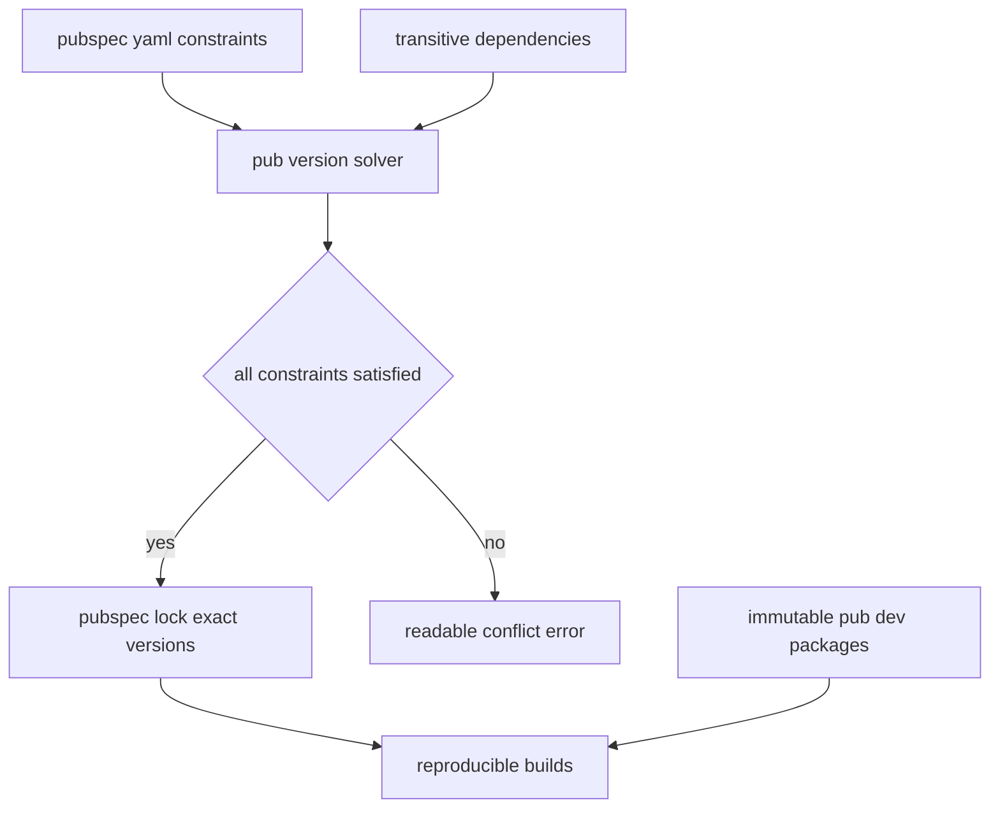

# Pub, Version Solving, and the Reproducibility of Flutter Builds

## English

A Flutter project depends on dozens of packages, and the tool that manages them — pub — does more than download code. Its most important job is version solving: given constraints in pubspec.yaml, it searches for a single set of package versions that satisfies every constraint simultaneously, including transitive dependencies you never wrote. This is a constraint satisfaction problem, and pub's solver is designed to fail loudly with an explanation when no combination works, rather than silently picking something that half-satisfies your requirements. That is why a dependency conflict surfaces as a readable error listing which packages demanded which versions, not as a mysterious runtime crash.

The pubspec.yaml declares two kinds of constraints. A caret constraint like ^1.4.0 means "at least 1.4.0 but below 2.0.0", following semantic versioning where the leftmost non-zero number is the breaking-change boundary. A plain range like '>=1.2.0 <1.5.0' is more explicit. Dependencies under dependencies are for code your app ships; dev_dependencies are for tooling, tests, and code generation and are not included in the shipped app. The pubspec.lock file records the exact resolved versions and content hashes, and it should be committed for applications so every machine and CI runner builds the same graph. For a library package, the lock file is typically not committed, because consumers resolve against their own app's constraints.

Reproducibility goes further than version numbers. Packages hosted on pub.dev are immutable once published — a version number can never be republished with different contents — which is what makes the lock file trustworthy. Git dependencies and path dependencies do not have this guarantee, so pinning to a specific commit hash rather than a branch is essential if you depend on a repository directly. The flutter pub get command reads the lock file and fetches exactly those versions; flutter pub upgrade re-solves and may move versions within your constraints; flutter pub upgrade --major-versions deliberately crosses breaking boundaries and is a migration task, not routine maintenance.

Flutter adds its own layer: the SDK version constraint in the environment section gates which Flutter and Dart versions a package supports, and the Flutter SDK itself pins the versions of packages like flutter_test and the engine artifacts. This means upgrading Flutter can force a cascade of package upgrades, and the recommended workflow is to upgrade the SDK, run pub get, and read the resolver's complaints rather than hand-editing constraints blindly. The flutter pub outdated command shows current, upgradable, and resolvable versions side by side, which is the fastest way to see what is holding a package back.

A practical habit that prevents most dependency pain: keep constraints reasonably tight for direct dependencies, avoid depending on packages that are unmaintained or that pin transitive dependencies too aggressively, and treat every upgrade as a small, tested change rather than a bulk operation the night before a release. The pub cache also matters for build speed and CI — caching the pub cache directory between runs turns minutes of downloads into seconds, and flutter pub cache repair exists for the rare case of a corrupted local cache.

## 中文

一個 Flutter 專案依賴數十個套件，而管理它們的工具——pub——所做的遠不止下載程式碼。它最重要的職責是版本求解（version solving）：給定 pubspec.yaml 中的約束，它要搜尋出一組能同時滿足所有約束的套件版本，包括你從未寫過的傳遞依賴。這是個約束滿足問題，而 pub 的求解器設計成在無解時大聲失敗並附上解釋，而不是靜靜挑一個半滿足你要求的組合。這就是為何依賴衝突會以可讀的錯誤列出哪些套件要求哪些版本，而不是變成神秘的執行期崩潰。

pubspec.yaml 宣告兩種約束。像 ^1.4.0 的 caret 約束意思是「至少 1.4.0 但低於 2.0.0」，遵循語意化版本，最左邊的非零數字就是破壞性變更的界線。像 '>=1.2.0 <1.5.0' 的明確範圍則更清楚。dependencies 下的相依是 app 會出貨的程式碼；dev_dependencies 是工具、測試與程式碼生成用，不會包含在出貨的 app 中。pubspec.lock 檔記錄了確切解析出的版本與內容雜湊，應用程式應把它提交，令每部機器與 CI runner 都建構同一個依賴圖。至於函式庫套件，lock 檔通常不提交，因為使用者會按自己 app 的約束去解析。

可重現性不止於版本號。釋出在 pub.dev 的套件一經釋出便不可變——同一版本號永遠不能以不同內容重新釋出——這正是 lock 檔值得信賴的原因。Git 依賴與 path 依賴沒有這個保證，所以若你直接依賴某個儲存庫，必須釘選到特定 commit hash 而非分支。flutter pub get 會讀取 lock 檔並抓取確切那些版本；flutter pub upgrade 會重新求解，可能在你約束範圍內移動版本；flutter pub upgrade --major-versions 則刻意跨越破壞性界線，屬於遷移任務而非例行維護。

Flutter 另加一層：environment 區段的 SDK 版本約束，決定一個套件支援哪些 Flutter 與 Dart 版本，而 Flutter SDK 本身亦釘選了 flutter_test 等套件及引擎產物的版本。這意味著升級 Flutter 可能強制一連串套件升級，建議流程是先升級 SDK、執行 pub get、細讀求解器的抱怨，而不是盲目手改約束。flutter pub outdated 指令會並列顯示目前、可升級與可解析的版本，是看清哪個套件被卡住的最快方法。

一個能避免大部分依賴痛苦的實用習慣：對直接依賴保持合理收緊的約束，避免依賴無人維護或過度釘死傳遞依賴的套件，並把每次升級當成小而受測的改動，而不是釋出前一晚的大量操作。pub 快取對建構速度與 CI 亦很重要——在執行之間快取 pub 快取目錄，能把數分鐘下載變成數秒，而 flutter pub cache repair 則用於罕見的本機快取損壞情況。

## Key Takeaway

Pub's version solver plus the committed pubspec.lock and immutable pub.dev releases are what make a Flutter build reproducible across machines and CI.

## Related Concepts
- Semantic versioning and caret constraints
- pubspec.lock and CI caching

## Diagram

