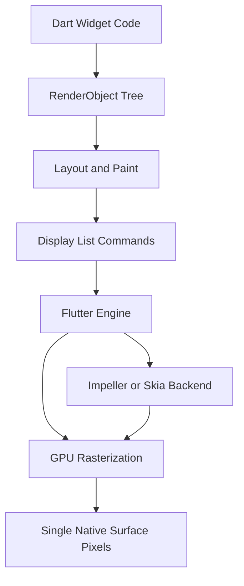

# The Canvas Model: How Flutter Draws Without Platform UI Kits

## English

Most cross-platform frameworks translate your UI into the host operating system's native controls: a button becomes a UIButton on iOS, an android.widget.Button on Android. Flutter does not do this. Instead, it takes ownership of an entire rendering surface — typically a single native view such as a FlutterView on Android or a UIView on iOS — and paints every pixel itself using its own graphics engine. This is why a Flutter button looks identical on every platform unless you deliberately theme it, and why you can animate a shadow or a rounded corner in a way that would be expensive or impossible with native widgets. The trade-off is that Flutter must reimplement text input, scrolling physics, and accessibility bridging itself, which it does through a combination of the engine and platform plugins.

Under the hood, the engine talks to the GPU through a rendering backend. Historically Flutter used Skia; newer versions default to Impeller, which precompiles shaders to avoid the first-run jank that plagued Skia on iOS. Your Dart code never issues draw calls directly — it builds a tree of RenderObjects (the layout and paint layer), and the engine walks that tree, converts it into a display list of drawing commands, and rasterises it on the GPU. A Container with a BoxDecoration becomes a series of rectangles, rounded-rect paths, and shader fills in that display list.

The practical consequences are significant. Because Flutter controls the whole surface, it can guarantee pixel-perfect consistency across devices and OS versions — a luxury that frameworks relying on native controls cannot offer when, say, Android 14 restyles its buttons. It also means Flutter apps tend to have a larger binary size than a thin native wrapper, since the engine (including the Dart runtime and graphics stack) ships inside your app. And it means that when you need a genuinely native control — a platform date picker, a map view, a web view — you must embed it as a platform view, which is a native view composited into Flutter's scene and can carry performance costs because it breaks the single-surface assumption.

A useful analogy is a theatre company that brings its own stage, lighting rig, and set rather than performing in whatever venue it is booked into. The company can guarantee the show looks exactly as designed, but it has to transport and assemble everything, and if the venue insists on its own curtains, integrating them takes extra work. Flutter's canvas model is the same bargain: total control over appearance in exchange for owning the rendering stack.

When you debug visual issues, this mental model pays off. A weird seam between a widget and an embedded platform view is a compositing issue, not a layout bug. A colour that looks slightly different on one device may be a colour-space or wide-gamut issue in the engine rather than a theme problem. Knowing that Flutter paints everything itself tells you where to look.

## 中文

大部分跨平台框架會把你的介面翻譯成宿主作業系統的原生控件：按鈕在 iOS 上變成 UIButton，在 Android 上變成 android.widget.Button。Flutter 並不是這樣做。它接管了一整塊繪製表面——通常是一個原生視圖，例如 Android 上的 FlutterView 或 iOS 上的 UIView——然後用自家的圖形引擎自行繪製每一個像素。這就是為何一個 Flutter 按鈕在每個平台上都一模一樣（除非你刻意套用主題），也是為何你可以用原生控件難以做到或成本高昂的方式去動畫化陰影或圓角。代價是 Flutter 必須自行重新實作文字輸入、滾動物理和無障礙橋接，它透過引擎與平台外掛的組合來完成這些工作。

在底層，引擎透過渲染後端與 GPU 溝通。歷史上 Flutter 使用 Skia；較新版本預設使用 Impeller，它預先編譯著色器，避免 Skia 在 iOS 上為人詬病的首次執行卡頓。你的 Dart 程式碼從不直接發出繪製指令——它建立一棵 RenderObject 樹（佈局與繪製層），引擎走訪該樹，把它轉換成繪製指令的顯示列表，然後在 GPU 上光柵化。一個帶有 BoxDecoration 的 Container 會變成該顯示列表中的一連串矩形、圓角路徑和著色器填充。

實際後果相當重大。因為 Flutter 控制整個表面，它可以在不同裝置和 OS 版本之間保證像素級一致——這是依賴原生控件的框架所無法提供的奢侈，例如 Android 14 重新設計按鈕樣式時就做不到。這也意味著 Flutter 應用程式的二進位大小通常比薄薄的原生封裝更大，因為引擎（包括 Dart 執行時期和圖形堆疊）會隨你的應用程式一起出貨。同時也意味著當你需要真正的原生控件——平台日期選擇器、地圖視圖、網頁視圖——你必須把它作為平台視圖嵌入，那是合成進 Flutter 場景的原生視圖，可能帶來效能成本，因為它打破了單一表面的假設。

一個有用的比喻是一間自帶舞台、燈光和佈景的劇團，而不是在預訂的任何場地演出。劇團可以保證演出與設計完全一致，但它必須運送和組裝一切；如果場地堅持要用自己的布幕，整合起來就要額外功夫。Flutter 的畫布模型就是同樣的交易：以擁有整個渲染堆疊為代價，換取對外觀的完全控制。

當你除錯視覺問題時，這個心智模型會很有用。控件與嵌入式平台視圖之間奇怪的接縫是合成問題，不是佈局錯誤。某部裝置上顏色略有不同，可能是引擎的色彩空間或廣色域問題，而不是主題問題。知道 Flutter 自行繪製一切，就告訴你該往哪裡找。

## Key Takeaway

Flutter owns the entire rendering surface and paints every pixel itself, trading native-control reuse for pixel-perfect consistency and full control over appearance.

## Related Concepts
- Impeller rendering backend
- Platform views and native embedding

## Diagram

