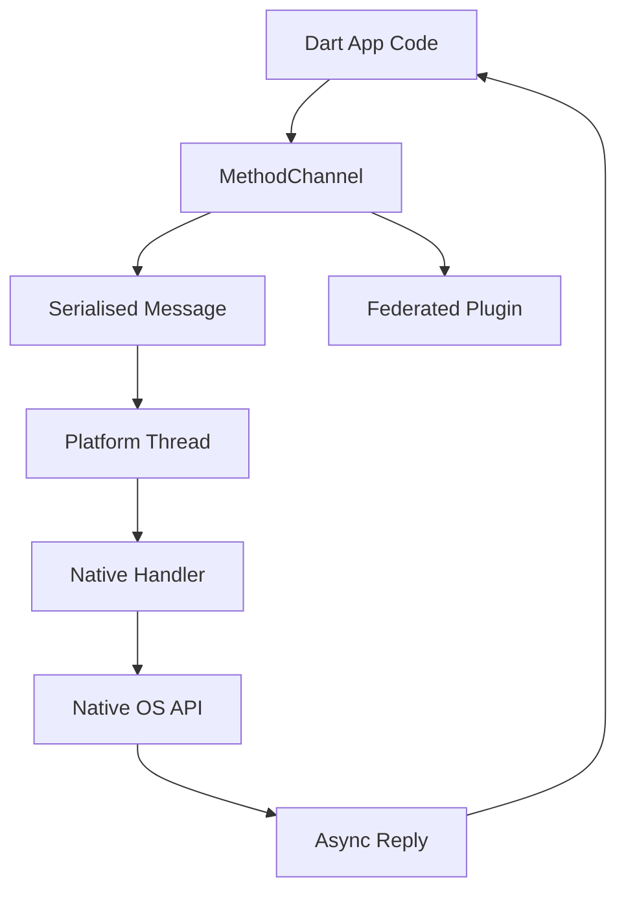

# How Flutter Talks to the OS: Plugins, Federated Packages, and MethodChannel in Practice

## English

Flutter's Dart code runs in its own runtime, isolated from the platform's native APIs. When your app needs something the framework does not provide — camera access, Bluetooth, biometric authentication, push notifications — it must cross the boundary into native code. The mechanism is a message-passing channel: Dart sends a serialised message over a MethodChannel (or EventChannel for streams, or BasicMessageChannel for raw bytes), the platform side receives it on a background thread, dispatches to native code, and replies asynchronously. On Android the receiving end is typically a MethodCallHandler registered on the FlutterEngine; on iOS it is a FlutterMethodChannel with a handler block. The Dart side awaits a Future that resolves when the reply arrives.

Almost nobody writes these channels by hand for common functionality. Instead you depend on a plugin — a package that bundles Dart code with native code for each platform. A well-designed plugin is federated: it splits into an app-facing package (the API you import), a platform interface package (the contract), and one or more platform implementation packages (the Android, iOS, web, or desktop code). This structure lets the community or the vendor ship a new platform implementation without breaking the public API, and lets you swap implementations in tests by depending on a mock of the platform interface. The camera plugin, for example, exposes a stable Dart API while each platform package handles its own native quirks.

There are real costs to this boundary. Every channel call involves serialisation, a thread hop, and asynchronous latency — fine for a one-off permission request, bad inside a per-frame animation loop. Platform views (embedding a native map or web view) are heavier still, because the native view must be composited into Flutter's scene, and on some platforms this involves texture copying or hybrid composition modes that can hurt frame times. Understanding which operations are cheap (pure Dart) and which are expensive (channel round-trips, platform views) is a core performance skill.

A useful analogy is a company with two offices that speak different languages. Dart is the design office; native code is the legal office. They communicate by written memos (messages) rather than shouting across the hall, so each memo has a cost and a delay. You want to batch memos, avoid sending one per frame, and keep the memo format simple. If you find yourself sending thousands of tiny messages, the design is wrong — move the loop into native code or into Dart, whichever side owns the data.

In practice, you should reach for a maintained plugin before writing your own channel, and you should prefer plugins that are federated and well-tested. When you do write a custom channel, keep the payload small and JSON- or primitive-friendly, handle errors explicitly on both sides (a thrown PlatformException in Dart corresponds to a native error), and remember that channel names are global strings — collisions between plugins are possible, so namespace them. This boundary is where most cross-platform bugs live, so treat it with the respect you would give any inter-process interface.

## 中文

Flutter 的 Dart 程式碼在自己的執行時期中運行，與平台的原生 API 隔離。當你的應用程式需要框架沒有提供的東西——相機存取、藍牙、生物識別認證、推送通知——它就必須跨越邊界進入原生程式碼。機制是訊息傳遞通道：Dart 透過 MethodChannel（或用於串流的 EventChannel，或用於原始位元組的 BasicMessageChannel）送出序列化訊息，平台端在背景執行緒接收，分派到原生程式碼，然後非同步回覆。在 Android 上接收端通常是註冊在 FlutterEngine 上的 MethodCallHandler；在 iOS 上則是帶有處理區塊的 FlutterMethodChannel。Dart 端會 await 一個在回覆到達時解決的 Future。

對於常見功能，幾乎沒有人會手寫這些通道。相反，你會依賴外掛——一個把 Dart 程式碼與各平台原生程式碼捆綁在一起的套件。設計良好的外掛是聯邦式的：它拆分為面向應用程式的套件（你匯入的 API）、平台介面套件（契約），以及一個或多個平台實作套件（Android、iOS、網頁或桌面程式碼）。這種結構讓社群或廠商可以在不破壞公開 API 的情況下推出新的平台實作，也讓你在測試中透過依賴平台介面的模擬來替換實作。例如相機外掛對外暴露穩定的 Dart API，而每個平台套件處理自己原生的特殊情況。

這道邊界有真實成本。每次通道呼叫都涉及序列化、執行緒跳轉和非同步延遲——對一次性的權限請求來說沒問題，但放在每幀動畫迴圈裡就很糟。平台視圖（嵌入原生地圖或網頁視圖）更重，因為原生視圖必須合成進 Flutter 的場景，在某些平台上這涉及紋理複製或混合合成模式，可能拖慢幀時間。理解哪些操作便宜（純 Dart）、哪些昂貴（通道往返、平台視圖）是核心的效能技能。

一個有用的比喻是一間有兩個辦公室、說不同語言的公司。Dart 是設計辦公室；原生程式碼是法務辦公室。它們靠書面備忘錄（訊息）溝通，而不是隔著走廊大喊，所以每份備忘錄都有成本和延遲。你會想批次處理備忘錄、避免每幀送一份、保持備忘錄格式簡單。如果你發現自己送出數千條微小訊息，設計就錯了——把迴圈移到原生程式碼或 Dart，取決於哪一邊擁有資料。

實務上，你應該先找有維護的外掛，而不是自己寫通道，並偏好聯邦式且測試良好的外掛。當你真的要寫自訂通道時，保持負載小且對 JSON 或基本型別友善，在兩邊都明確處理錯誤（Dart 中拋出的 PlatformException 對應原生錯誤），並記住通道名稱是全域字串——外掛之間可能碰撞，所以要加命名空間。這道邊界是大多數跨平台錯誤的所在，所以要用對待任何行程間介面的敬意來對待它。

## Key Takeaway

Native functionality crosses into Flutter through message-passing channels, and well-designed federated plugins hide that boundary behind a stable Dart API — but every crossing has a cost.

## Related Concepts
- Federated plugin architecture
- Platform channel performance

## Diagram

