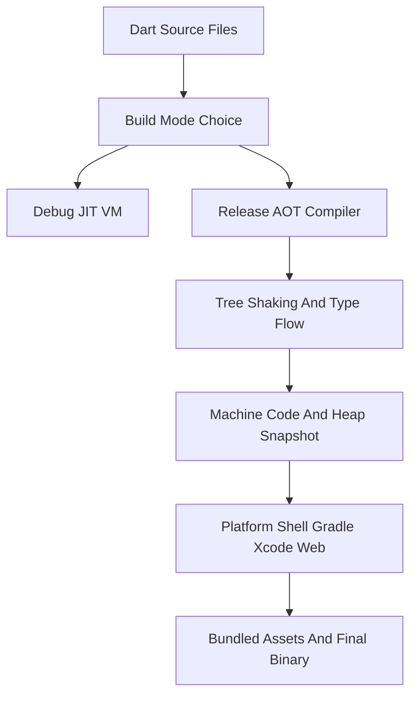

# The Build Pipeline: From dart compile to a Shipped Binary

## English

When you run flutter build, a lot happens between your source files and the artifact a user installs. The Dart code is compiled ahead of time (AOT) into native machine code — not interpreted, not shipped as source. The Dart AOT compiler performs whole-program analysis, tree-shaking (removing unused code), and type-flow optimisations, then emits machine code bundled with a snapshot of the program's initial heap. In debug mode the story is different: code runs in the Dart VM using just-in-time (JIT) compilation, which is what makes hot reload possible, but JIT builds are slower and larger, which is why release builds use AOT. This is also why Dart, unlike JavaScript, has no eval and why reflection (dart:mirrors) is not available in AOT builds — the compiler needs to know the whole program at compile time.

Around the Dart compilation, the tool assembles a platform-specific app shell. On Android, Gradle builds an APK or Android App Bundle (AAB), merges the Flutter engine's native libraries for each ABI (armeabi-v7a, arm64-v8a, x86_64), and packages assets — your pubspec assets, fonts, and the compiled Dart snapshot — into the APK's assets directory. On iOS, Xcode builds an .app or .ipa, linking the Flutter engine framework and copying the App.framework containing your compiled Dart. On web, the Dart code is compiled to JavaScript (or WebAssembly in newer experimental paths), and the engine is a JavaScript/WASM runtime rather than a native library. Each target has its own packaging rules, signing requirements, and size characteristics.

Asset bundling is part of this pipeline and is easy to underestimate. Everything declared under flutter/assets in pubspec.yaml is copied into the build, and the AssetManifest generated at build time tells the runtime what is available. Large images, uncompressed audio, and unused fonts bloat the binary; tools like deferred components (for Android) and tree-shaking of icon fonts (via --tree-shake-icons) exist to trim this. The Flutter tool also runs a font subsetting pass for Material icon fonts so you do not ship thousands of glyphs you never use.

A useful analogy is a bakery that ships a fully baked cake rather than a box of ingredients. The AOT compiler is the oven: it does all the work up front so the customer (the device) just serves the cake. JIT is more like a customer assembling the cake at home — flexible, but slower and needing more equipment. Tree-shaking is trimming the recipe to only the ingredients actually used.

Understanding this pipeline explains several everyday phenomena. Why is a release build's first frame fast but a debug build's slow? AOT versus JIT. Why does adding a package sometimes balloon your app size? Its native libraries and assets are being merged in. Why does code that uses reflection fail in release but work in debug? The AOT compiler cannot see dynamic reflection targets. Why does an iOS build require a Mac? Xcode's toolchain and code signing are mandatory for the iOS target. Knowing the pipeline turns mysterious build errors into diagnosable stages.

## 中文

當你執行 flutter build 時，從原始碼到使用者安裝的成品之間發生了很多事。Dart 程式碼會被提前編譯（AOT）成原生機器碼——不是解譯執行，也不是以原始碼形式出貨。Dart AOT 編譯器會做全程式分析、tree-shaking（移除未使用的程式碼）和型別流優化，然後輸出機器碼，並附上程式初始堆積的快照。除錯模式則不同：程式碼在 Dart VM 中以即時編譯（JIT）執行，這正是熱重載可行的原因，但 JIT 組建較慢且較大，所以發佈組建使用 AOT。這也是為何 Dart 與 JavaScript 不同，沒有 eval，也為何反射（dart:mirrors）在 AOT 組建中不可用——編譯器需要在編譯時期就知道整個程式。

在 Dart 編譯之外，工具會組裝平台特定的應用程式外殼。在 Android 上，Gradle 建置 APK 或 Android App Bundle（AAB），為每個 ABI（armeabi-v7a、arm64-v8a、x86_64）合併 Flutter 引擎的原生函式庫，並把資源——你 pubspec 中的資源、字型，以及編譯後的 Dart 快照——打包進 APK 的 assets 目錄。在 iOS 上，Xcode 建置 .app 或 .ipa，連結 Flutter 引擎框架並複製包含你編譯後 Dart 的 App.framework。在網頁上，Dart 程式碼被編譯成 JavaScript（或在較新的實驗路徑中編譯成 WebAssembly），而引擎是 JavaScript/WASM 執行時期而非原生函式庫。每個目標都有自己的打包規則、簽署要求和大小特性。

資源捆綁是這條管線的一部分，而且很容易被低估。pubspec.yaml 中 flutter/assets 下宣告的一切都會被複製進組建，而組建時產生的 AssetManifest 會告訴執行時期有哪些可用。大型圖片、未壓縮音訊和未使用的字型會讓二進位膨脹；延遲元件（Android）和圖示字型的 tree-shaking（透過 --tree-shake-icons）就是為了削減這些。Flutter 工具也會對 Material 圖示字型執行字型子集化，這樣你就不會出貨數千個從未使用的字形。

一個有用的比喻是一間出貨完整烤好蛋糕、而不是一盒食材的烘焙店。AOT 編譯器是焗爐：它預先做完所有工作，讓顧客（裝置）只需上菜。JIT 更像顧客在家組裝蛋糕——靈活，但較慢且需要更多設備。Tree-shaking 則是修剪食譜，只留下實際用到的食材。

理解這條管線可以解釋幾個日常現象。為何發佈組建的第一幀很快，除錯組建卻很慢？AOT 對 JIT。為何加入一個套件有時會讓應用程式大小暴增？它的原生函式庫和資源被合併進來了。為何使用反射的程式碼在發佈版失敗、在除錯版卻可行？AOT 編譯器看不到動態反射目標。為何 iOS 組建需要 Mac？Xcode 的工具鏈和程式碼簽署對 iOS 目標是必需的。了解管線，就能把神秘的組建錯誤變成可診斷的階段。

## Key Takeaway

A Flutter release build is a fully compiled, tree-shaken, platform-packaged artifact — knowing each stage of that pipeline explains build errors, app size, and debug-versus-release behaviour.

## Related Concepts
- AOT versus JIT compilation
- Android App Bundle and iOS packaging

## Diagram

