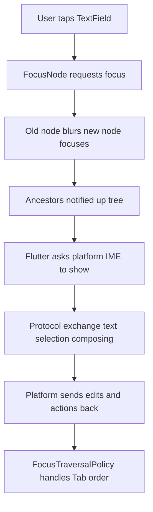

# Keyboard, Focus, and Text Input: The Invisible Plumbing Behind a TextField

## English

A TextField looks trivial until you ask where the characters actually come from. On desktop and mobile, Flutter does not draw its own keyboard: it asks the operating system to show the platform's native input method (IME, the software that turns key presses into composed text, used heavily for Chinese, Japanese and Korean). Flutter communicates with that IME through a text input plugin, and the two sides exchange a small structured protocol: the app tells the platform what kind of keyboard to show (numeric, email, multiline), where the cursor is, what text is currently selected, and what composing region is in progress; the platform sends back text edits, selection changes, and action events such as 'done' or 'search'. If you have ever seen a Chinese IME underline a syllable while you type before committing it, that underline is the composing region, and a Flutter app must faithfully report it or the IME will behave strangely.

Focus is the second half of the story. Only one widget at a time should own keyboard input, so Flutter maintains a focus tree, managed by FocusNode objects, that mirrors the widget tree. When you tap a field, Flutter requests focus for that node; the previously focused node receives a blur event, the new one receives focus, and the framework walks up the tree notifying ancestors. FocusTraversalPolicy then decides what happens when the user presses Tab: it walks the focusable widgets in a sensible order, which is why you can declare a form in any layout and still get predictable tab order. FocusScope groups nodes so that, for example, a dialog can trap focus inside itself while it is open and restore it to the button that opened it when dismissed.

Keyboard shortcuts and actions are a separate but related layer. Shortcuts maps a key combination (Ctrl+S, Cmd+Enter) to an Intent, a plain object describing what the user wants, and Actions maps that Intent to a callback. This indirection means the same intent can be handled differently in different parts of the app, and it also lets Flutter integrate with platform conventions: on macOS the shortcut may be Cmd+S while on Windows it is Ctrl+S, with the same intent underneath. RawKeyboardListener, the older low-level API, gives you every key event directly, which is useful for games or custom editors but is usually overkill for forms.

A subtle but important consequence: because text input is asynchronous and lives on the platform side, a Flutter TextField is not a plain string buffer. The TextEditingController holds the Dart-side text and selection, while the platform holds its own copy for the IME. They are kept in sync by messages, and bugs often appear when you programmatically set controller.text while the IME is composing, or when you rebuild a field with a new key and the platform's IME state gets out of step. Knowing this explains a whole class of weird behaviours: cursor jumping to the end, duplicated characters on fast typing, or an IME that refuses to compose.

Practically, this means you should treat focus and text input as state to be managed deliberately. Give each field a stable FocusNode if you need to move focus programmatically (for example, jumping from a username field to a password field on submit), wrap dialogs in a FocusScope, and use Shortcuts and Actions rather than raw key listeners for app-level hotkeys. When debugging input problems, ask whether the Dart side or the platform side is out of sync, and check whether your composing region is being reported correctly for languages that need it.

## 中文

一個 TextField 看似微不足道，但當你問「這些字元究竟從哪裡來」時，事情就變得有趣了。在桌面和手機上，Flutter 並不自己繪製鍵盤：它要求作業系統顯示平台原生的輸入法（IME，即把按鍵轉換成組合文字的軟件，中文、日文、韓文都高度依賴它）。Flutter 透過一個 text input 插件與該 IME 溝通，雙方交換一套小型而有結構的協議：應用程式告訴平台要顯示哪種鍵盤（數字、電郵、多行）、游標在哪裡、目前選取了哪些文字、正在組合的區段是甚麼；平台則回傳文字編輯、選取範圍變更，以及「完成」、「搜尋」等動作事件。如果你見過中文輸入法在你確認之前為音節加上底線，那條底線就是組合區段（composing region），Flutter 應用必須忠實報告它，否則輸入法會表現怪異。

焦點是故事的另一半。同一時間只應有一個 widget 擁有鍵盤輸入，所以 Flutter 維護一棵焦點樹，由 FocusNode 物件管理，並與 widget 樹互相對應。當你點擊某個輸入框，Flutter 為該節點請求焦點；先前擁有焦點的節點收到失焦事件，新節點收到聚焦事件，框架再沿樹向上通知祖先。接著 FocusTraversalPolicy 決定使用者按 Tab 時會發生甚麼：它按合理次序走訪可聚焦的 widget，這就是為何你可以用任何佈局宣告表單，仍然得到可預測的 Tab 次序。FocusScope 把節點分組，例如對話框開啟時可以把焦點困在自身之內，關閉時再把焦點還給開啟它的按鈕。

鍵盤快捷鍵與動作是相關但獨立的一層。Shortcuts 把一組按鍵組合（Ctrl+S、Cmd+Enter）對應到一個 Intent，即描述使用者想做甚麼的普通物件；Actions 則把該 Intent 對應到回呼函式。這層間接讓同一個 intent 可以在應用不同部分有不同處理方式，也讓 Flutter 能配合平台慣例：macOS 上快捷鍵可能是 Cmd+S，Windows 上是 Ctrl+S，但底層是同一個 intent。較舊的低階 API RawKeyboardListener 直接給你每一個按鍵事件，對遊戲或自訂編輯器有用，但對表單而言通常是大材小用。

一個微妙但重要的後果：由於文字輸入是非同步且發生在平台一側，Flutter 的 TextField 並不是單純的字串緩衝區。TextEditingController 持有 Dart 端的文字與選取範圍，平台則為 IME 持有自己的一份副本。兩者透過訊息保持同步，而 bug 往往在你於 IME 正在組合時以程式方式設定 controller.text，或以新的 key 重建輸入框導致平台 IME 狀態脫節時出現。明白這點就能解釋一整類奇怪行為：游標跳到末尾、快速打字時字元重複，或輸入法拒絕組合。

實務上，這意味著你應把焦點與文字輸入視為需要刻意管理的狀態。若需要以程式方式移動焦點（例如提交時由使用者名稱欄跳到密碼欄），為每個輸入框提供穩定的 FocusNode；把對話框包在 FocusScope 中；並在應用層熱鍵使用 Shortcuts 與 Actions，而非原始按鍵監聽器。除錯輸入問題時，先問是 Dart 端還是平台端失去同步，並檢查對於需要組合的語言，你的組合區段是否被正確報告。

## Key Takeaway

Flutter does not draw keyboards; it negotiates with the platform IME through a structured text-input protocol while a focus tree decides who owns input.

## Related Concepts
- FocusNode and the focus tree
- Input Method Editor (IME) composing region

## Diagram

