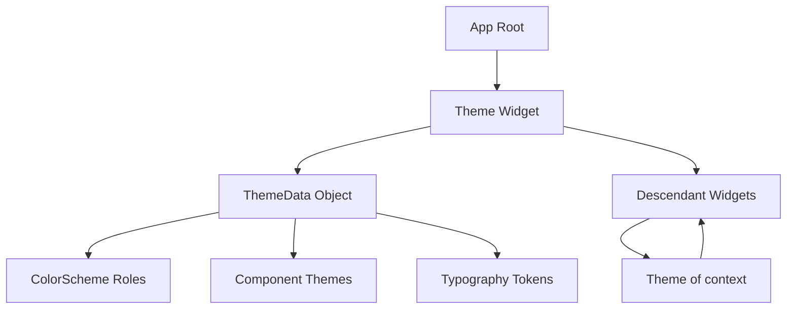

# Themes, Design Tokens, and Why ThemeData Is an InheritedWidget

## English

A Flutter app that hardcodes colours and font sizes in every widget becomes impossible to restyle. The framework's answer is ThemeData, a large object holding colour schemes, typography, component defaults, and shape definitions, which is injected into the tree by a Theme widget. Crucially, Theme is an InheritedWidget: any descendant can call Theme.of(context) to read the nearest theme above it, and because inherited widgets register dependencies, a widget that reads the theme automatically rebuilds when the theme changes. This is how a light/dark toggle can repaint the whole app without you passing colours down manually. The same mechanism underlies MediaQuery and DefaultTextStyle.

Inside ThemeData, the most important field in modern Flutter is ColorScheme, which replaced the older primaryColor/secondaryColor approach. A ColorScheme is a set of named roles: primary, onPrimary (the colour that is legible on top of primary), surface, onSurface, error, and so on. The 'on' pairs exist because contrast is a real accessibility requirement, not an afterthought; if you pick a primary colour, the scheme also tells you what text colour will remain readable on it. Material 3, the current design language, is built around these roles plus tonal palettes, which are generated from a seed colour so that a whole harmonious palette can be derived from one brand colour.

ThemeData also carries component themes: AppBarTheme, CardTheme, ElevatedButtonTheme, and many others, each of which sets defaults for that widget type. This is where design tokens live in practice. A design token is simply a named decision, such as 'corner radius for cards is 12 logical pixels' or 'body text uses the bodyMedium text style', stored once and referenced everywhere. By putting tokens into component themes rather than into each widget, you get consistency for free and can change a decision in one place. TextTheme similarly names styles (displayLarge, headlineSmall, bodyMedium, labelLarge) rather than raw sizes, so a typographic scale can be swapped wholesale.

There is a practical subtlety: Theme.of(context) creates a dependency, which is usually what you want, but calling it inside a build method that runs very often, or inside a widget that only needs the theme once, can cause unnecessary rebuilds. Flutter offers Theme.of(context, listen: false) to read without subscribing, and for performance-critical cases you can cache values. Also note that nested Theme widgets shadow outer ones entirely for descendants, which is useful for a dark section inside a light page but can surprise you if you only override one field and expect the rest to be inherited; ThemeData.copyWith is the safe way to derive a variant.

Finally, theming interacts with platform expectations. On iOS, users expect Cupertino styling; Flutter provides CupertinoThemeData and Cupertino widgets, and many apps choose a Material theme with platform-adaptive widgets rather than two separate UIs. When you support dark mode, you supply theme and darkTheme plus a themeMode (system, light, dark), and Flutter picks based on the platform's brightness setting. Getting this right early, by defining a ColorScheme from a seed and a TextTheme once, saves enormous refactoring later.

## 中文

一個在每個 widget 都寫死顏色和字體大小的 Flutter 應用，日後將無法重新設計風格。框架的答案是 ThemeData：一個包含配色方案、字體排印、元件預設值與形狀定義的大型物件，由 Theme widget 注入樹中。關鍵在於 Theme 是一個 InheritedWidget：任何後代都可以呼叫 Theme.of(context) 讀取上方最近的 theme，而由於 inherited widget 會登記依賴，讀取 theme 的 widget 在 theme 改變時會自動重建。這就是為何一個淺色／深色切換可以重繪整個應用，而不需要你手動把顏色逐層傳下去。同樣機制也是 MediaQuery 與 DefaultTextStyle 的基礎。

在 ThemeData 之內，現代 Flutter 最重要的欄位是 ColorScheme，它取代了較舊的 primaryColor／secondaryColor 做法。ColorScheme 是一組有名字的角色：primary、onPrimary（在 primary 之上仍清晰可讀的顏色）、surface、onSurface、error 等等。「on」配對之所以存在，是因為對比度是實實在在的無障礙要求，而非事後補救；當你選了一個 primary 顏色，方案同時告訴你甚麼文字顏色在其上仍然可讀。Material 3 這套現行設計語言，正是圍繞這些角色加上色調調色板（tonal palette）而建立；調色板可由一顆種子顏色生成，令整個和諧配色能從單一品牌色推導出來。

ThemeData 亦承載元件主題：AppBarTheme、CardTheme、ElevatedButtonTheme 等等，各自為該類 widget 設定預設值。設計代幣（design token）在實務上就住在這裡。設計代幣說穿了就是一個有名字的決定，例如「卡片圓角為 12 邏輯像素」或「正文使用 bodyMedium 文字樣式」，只存一次、處處引用。把代幣放進元件主題而非每個 widget，你便免費得到一致性，並可在一處改變決定。TextTheme 同樣以名稱（displayLarge、headlineSmall、bodyMedium、labelLarge）而非原始大小來命名樣式，讓整套字體比例可以整體替換。

有個實務上的微妙之處：Theme.of(context) 會建立依賴，這通常正是你想要的，但在執行得非常頻密的 build 方法中呼叫，或在小 widget 中只需讀一次 theme，就可能造成不必要的重建。Flutter 提供 Theme.of(context, listen: false) 讓你讀取但不訂閱；對效能關鍵的情況，你也可以快取值。另外要注意，巢狀的 Theme widget 會完全遮蔽外層，對後代而言只看到內層；這對於淺色頁面中的深色區塊很有用，但若你只覆寫一個欄位並期望其餘繼承，就會感到意外；ThemeData.copyWith 才是安全地衍生變體的方法。

最後，主題與平台期望互相影響。在 iOS 上，使用者期望 Cupertino 風格；Flutter 提供 CupertinoThemeData 與 Cupertino widget，而許多應用選擇 Material 主題配平台適應型 widget，而非兩套獨立介面。當你支援深色模式，你提供 theme 與 darkTheme 以及 themeMode（system、light、dark），Flutter 便按平台亮度設定選擇。及早做對這件事——用一顆種子定義 ColorScheme、定義一次 TextTheme——可省下日後巨大的重構功夫。

## Key Takeaway

ThemeData is an InheritedWidget carrying named design tokens, and ColorScheme's role-based 'on' pairs bake contrast and accessibility into the theme itself.

## Related Concepts
- InheritedWidget dependency registration
- Material 3 ColorScheme roles

## Diagram

