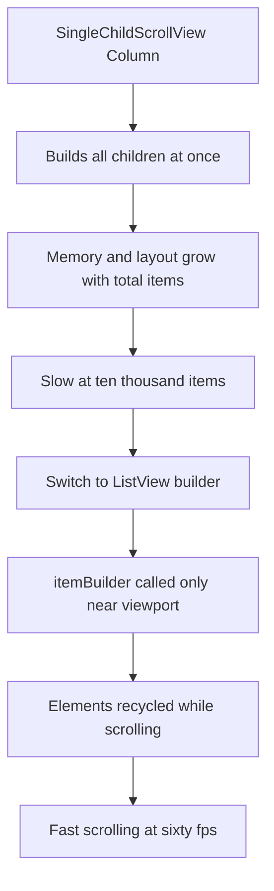

# Lists That Scale: Slivers, Lazy Building, and Why ListView Is Not a Column

## English

Beginners often build a scrollable page with SingleChildScrollView containing a Column of children, and it works fine for ten items. At ten thousand items it collapses: a Column builds and lays out every child immediately, so memory and layout time grow with the total number of items, not the number visible. Flutter's answer is lazy building. ListView.builder takes an itemCount and an itemBuilder callback, and the framework only calls itemBuilder for items near the viewport, recycling elements as you scroll. This is the same idea as virtualised lists in other frameworks, and it is why a feed of a million rows can still scroll at sixty frames per second.

Underneath, ListView is a thin wrapper around slivers. A sliver is a piece of a scrollable area that knows how to lay out children along one axis while reporting how much it consumed, rather than being given a fixed size by its parent. CustomScrollView lets you compose multiple slivers in one scroll view: a SliverAppBar that shrinks as you scroll, a SliverList for the main content, a SliverGrid for a gallery, and a SliverToBoxAdapter to wrap a single ordinary widget. Because slivers negotiate with the scroll position rather than being sized by a box parent, they can do things a Column never could, such as headers that collapse smoothly or lists that pin a section title.

Lazy building has consequences you must design around. First, itemBuilder must be cheap and must not depend on side effects, because it may be called in an unpredictable order and more than once for the same index. Second, if your items have different heights, the scroll view cannot always know the total scroll extent up front, so the scrollbar may jump or the scroll position may shift as items are measured; providing itemExtent or prototypeItem when heights are uniform makes scrolling smoother and enables accurate scrollbar sizing. Third, state inside a list item is fragile: if the element is recycled when scrolled off-screen, local state may be lost, so keep per-item state in a model or a state management layer keyed by item identity.

Keys matter here too. When list items are reordered or inserted, Flutter matches old elements to new widgets by position and type unless you give each item a Key. Without keys, a stateful row can appear to 'jump' to another item's data after a reorder. ValueKey(item.id) is the usual fix. This is the same underlying reconciliation rule you meet elsewhere in Flutter, but lists are where it bites hardest because the item set changes constantly.

Performance tuning follows from understanding this model. Use const constructors for static subtrees so they are not rebuilt; avoid expensive work inside itemBuilder; use RepaintBoundary around items that animate independently so one item's repaint does not dirty its neighbours; and prefer ListView.builder or CustomScrollView over nested scroll views, which fight each other for gesture handling. If you find yourself nesting a ListView inside a Column, you almost always want Expanded around it, or better, to promote the whole page to a CustomScrollView with slivers.

## 中文

初學者常用 SingleChildScrollView 包住一個 Column 來建立可捲動頁面，十個項目時運作良好。到一萬個項目就崩潰了：Column 會立即建立並排版每一個子項，所以記憶體與排版時間隨項目總數增長，而非隨可見數量增長。Flutter 的答案是惰性建立（lazy building）。ListView.builder 接受 itemCount 與 itemBuilder 回呼，框架只為接近視窗的項目呼叫 itemBuilder，並在捲動時回收 element。這與其他框架的虛擬化列表是同一概念，也是為何一百萬行的動態消息仍能以每秒六十格捲動。

在底層，ListView 只是 sliver 的薄薄一層包裝。sliver 是可捲動區域的一部分，它懂得沿一個軸排版子項，並報告自己消耗了多少空間，而不是由父層給予固定大小。CustomScrollView 讓你在同一個捲動檢視中組合多個 sliver：隨捲動收縮的 SliverAppBar、放主要內容的 SliverList、放相簿的 SliverGrid，以及包裹單一普通 widget 的 SliverToBoxAdapter。由於 sliver 是與捲動位置協商，而非由 box 父層定大小，它們能做到 Column 永遠做不到的事，例如平滑收合的標頭，或把區段標題釘住的列表。

惰性建立有些你必須據此設計的後果。第一，itemBuilder 必須便宜，且不可依賴副作用，因為它可能以不可預測的次序被呼叫，且同一索引可能被呼叫多於一次。第二，若項目高度不一，捲動檢視未必能預先知道總捲動範圍，於是捲軸可能跳動，或捲動位置在項目被量度時偏移；當高度一致時提供 itemExtent 或 prototypeItem，可令捲動更順暢並讓捲軸準確調整大小。第三，列表項目內的狀態很脆弱：若 element 在捲出畫面時被回收，局部狀態可能遺失，所以應把每項狀態放在以項目身份為鍵的模型或狀態管理層中。

Key 在這裡也很重要。當列表項目被重排或插入，除非你為每項提供 Key，Flutter 會按位置與類型把舊 element 配對到新 widget。沒有 key，一個有狀態的列在重排後可能看起來「跳」到另一個項目的資料。ValueKey(item.id) 是常見的修正。這與你在 Flutter 其他地方遇到的協調（reconciliation）規則相同，但列表是它咬得最深的地方，因為項目集合不斷改變。

效能調校由此模型推導而來。為靜態子樹使用 const 建構子，令它們不被重建；避免在 itemBuilder 內做昂貴工作；在獨立動畫的項目周圍使用 RepaintBoundary，令一項的重繪不會弄髒鄰居；並優先使用 ListView.builder 或 CustomScrollView，而非巢狀捲動檢視，因為後者會互相爭奪手勢處理。若你發現自己在 Column 內巢狀一個 ListView，你幾乎總是想在它外面加 Expanded，或更好是把整頁提升為使用 sliver 的 CustomScrollView。

## Key Takeaway

ListView is a sliver wrapper that builds only visible items, so lists scale when you keep itemBuilder cheap, use keys for identity, and compose pages from slivers rather than nested scroll views.

## Related Concepts
- Sliver protocol and CustomScrollView
- Element recycling and widget reconciliation keys

## Diagram

