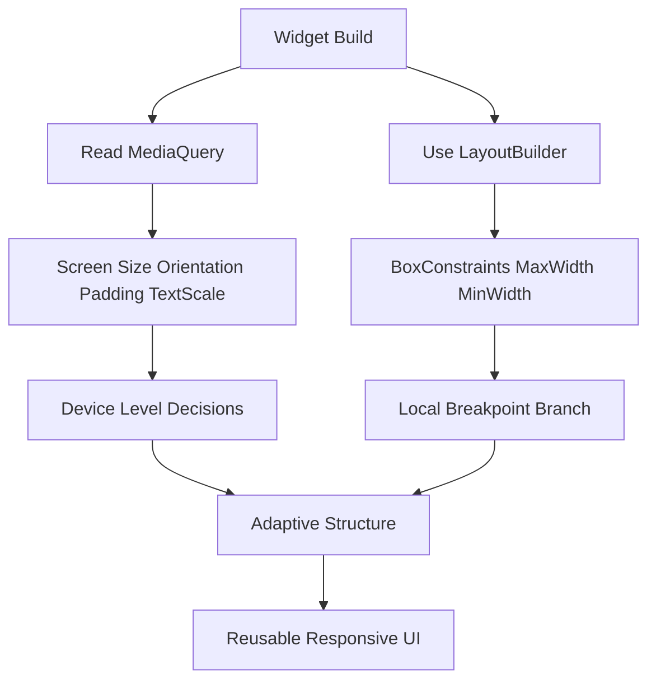

# Responsive Layout: MediaQuery, LayoutBuilder, and Adaptive Design

## English

A Flutter app runs on a phone, a tablet, a desktop window, and a browser tab, all with wildly different sizes. The naive approach is to hardcode pixel sizes, which breaks the moment the window is resized. Flutter gives you two complementary tools to react to available space. MediaQuery.of(context) reads the overall screen metrics: size, devicePixelRatio, orientation, padding (safe areas like notches), and the text scaling setting the user has configured in the system accessibility options (exposed today as `MediaQuery.textScaler`, a `TextScaler` object; the older `textScaleFactor` double has been deprecated in favour of it since Flutter 3.16). LayoutBuilder is the more local tool: it hands you a BoxConstraints describing the maximum and minimum space its child may occupy, and lets you branch your build on those numbers. The key distinction is scope. MediaQuery describes the whole window; LayoutBuilder describes the space at that point in the tree, which may be much smaller because of padding, a sidebar, or a split view.

A practical pattern is to decide breakpoints inside LayoutBuilder rather than MediaQuery when your widget lives inside a pane. For example, if constraints.maxWidth < 600, render a single-column ListView; otherwise render a two-pane Row with a detail view. This keeps a widget reusable whether it fills the screen or sits in a narrow drawer. MediaQuery is best reserved for things that genuinely depend on the device: safe-area padding, orientation, and text scaling. Wrapping text in a widget that respects MediaQuery.textScaler matters for accessibility, because a user who has enlarged system fonts expects your layout to grow rather than clip.

Adaptive design also means changing structure, not just size. On a phone you might use a bottom navigation bar; on a wide screen, a NavigationRail on the left is a better fit. Flutter's built-in adaptive constructors (like the Material widgets' platform-specific variants) help, but the real work is deciding which layouts make sense at which widths. A common mistake is to scale everything proportionally with a fraction of screen width, which produces giant text on tablets. Instead, constrain content width (for instance, center a column inside a ConstrainedBox with a maxWidth) so lines of text stay readable on large displays.

Finally, remember that resizing is an event your build must handle gracefully. Desktop and web users drag window edges constantly, and Flutter rebuilds on every constraint change. Keep layout logic cheap: compute breakpoints from constraints rather than doing expensive work in build. Test by resizing the window in debug mode and by rotating a device in the emulator. If a widget overflows, the yellow-and-black overflow stripes tell you the constraints were too tight; wrapping in FittedBox, Flexible, or SingleChildScrollView are the usual fixes, but the deeper fix is to design for the constraint, not for one assumed screen.

## 中文

一個 Flutter 應用程式會同時跑在手機、平板、桌面視窗和瀏覽器分頁上，尺寸差異極大。天真的做法是把像素尺寸寫死，視窗一被重新縮放就會壞掉。Flutter 提供兩個互補的工具來回應可用空間。MediaQuery.of(context) 讀取整體螢幕資訊：尺寸、devicePixelRatio、方向、padding（例如瀏海等安全區域），以及使用者在系統無障礙選項裡設定的文字縮放（現今以 `MediaQuery.textScaler` 這個 `TextScaler` 物件暴露；舊的 `textScaleFactor` 雙精度數值自 Flutter 3.16 起已棄用）。LayoutBuilder 則是較局部性的工具：它交給你一個 BoxConstraints，描述子元件可佔用的最大與最小空間，讓你依這些數字在 build 中分支。關鍵差別在於範圍。MediaQuery 描述整個視窗；LayoutBuilder 描述樹中該位置的空間，可能因為 padding、側邊欄或分割檢視而小得多。

實務上的模式是：當元件位於某個面板內時，在 LayoutBuilder 裡判斷斷點，而不是用 MediaQuery。例如若 constraints.maxWidth < 600，就渲染單欄 ListView；否則渲染包含詳細檢視的雙欄 Row。這樣一來，不論元件是填滿螢幕或放在狹窄抽屜裡都能重用。MediaQuery 最好保留給真正取決於裝置的項目：安全區域 padding、方向與文字縮放。讓文字尊重 MediaQuery.textScaler 對無障礙很重要，因為把系統字級放大的使用者，期待你的版面跟著變大而不是被裁切。

適應式設計也意味著改變結構，而不只是尺寸。手機上你可能用底部導覽列；寬螢幕上，左側的 NavigationRail 更合適。Flutter 內建的適應式建構子（例如 Material 元件的平台特定變體）有幫助，但真正的工作是決定哪些版面適合哪些寬度。常見錯誤是依螢幕寬度比例縮放所有東西，結果在平板上出現巨大文字。相反地，應限制內容寬度（例如把欄位置中於設定 maxWidth 的 ConstrainedBox 內），讓大螢幕上的文字行仍易讀。

最後，記得縮放是你的 build 必須優雅處理的事件。桌面與網頁使用者會不斷拖曳視窗邊緣，Flutter 會在每次 constraint 改變時重建。讓版面邏輯保持便宜：從 constraints 計算斷點，而不是在 build 裡做昂貴工作。在 debug 模式下縮放視窗、在模擬器旋轉裝置來測試。若元件溢出，黃黑相間的溢出條紋告訴你 constraints 太緊；包在 FittedBox、Flexible 或 SingleChildScrollView 裡是常見修法，但更根本的修法是為 constraint 設計，而不是為某個假設的螢幕設計。

## Key Takeaway

Use LayoutBuilder for local space decisions and MediaQuery for device-wide facts, and design layouts for constraints rather than one assumed screen size.

## Related Concepts
- BoxConstraints
- Adaptive navigation patterns

## Diagram

