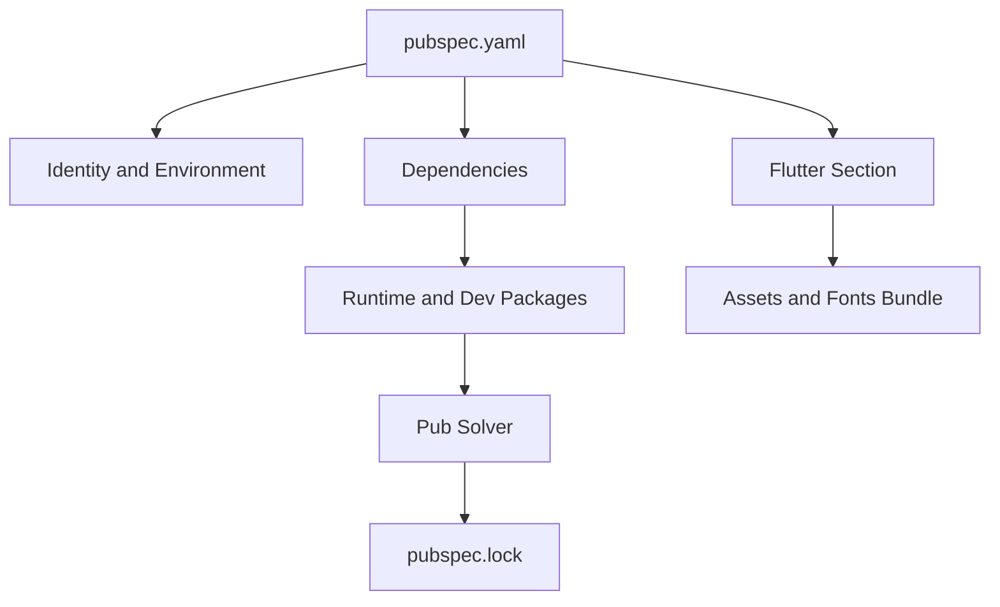

# The pubspec.yaml Manifest: Dependencies, Assets, and Flutter-Specific Sections

## English

Every Flutter project is anchored by pubspec.yaml, a YAML file that declares the project's identity and its dependencies. The top section sets the name (which must be a valid Dart package identifier), a description, and the publish_to field (usually "none" for apps). The environment block pins the Dart SDK constraint, telling pub which language versions your code is compatible with; getting this wrong causes confusing resolution failures. Below that, dependencies lists runtime packages and dev_dependencies lists packages used only during development, such as flutter_test, flutter_lints, and build_runner. Each dependency can be pinned to an exact version, a caret range (like ^2.1.0, meaning compatible with 2.x), or a git or path source for local development.

Flutter adds its own sections. The flutter: block is where you register assets, fonts, and other build-time configuration. The assets: list names directories or files to bundle into the app; a trailing slash includes every file in that directory (but not subdirectories). Fonts: lets you declare font families and map weight and style to specific font files, so that FontWeight.w700 resolves to the right asset. These are not just metadata: the build tool copies the referenced files into the asset bundle, and a typo in a path produces a runtime error when you try to load the asset. The pubspec.lock file records exact resolved versions and should be committed for apps so every machine builds identically.

Dependency resolution is the hidden complexity. When two packages require different major versions of a shared dependency, pub's solver must find a set of versions that satisfies all constraints simultaneously, or it fails with a version-solving error. This is why the environment constraint matters: a package that requires Dart 3.x cannot be used in a project pinned to Dart 2.x. The solver explores the constraint graph and picks the highest versions that fit; if none exist, you get a detailed report of which package blocked which. Understanding this turns cryptic errors into actionable information: usually you upgrade a dependency, loosen a constraint, or find an alternative package.

A few practical habits pay off. Keep dependencies minimal, because each one adds resolution time, potential conflicts, and supply-chain risk. Run flutter pub outdated to see which packages have newer versions, and flutter pub upgrade to move within your declared constraints. Use dependency_overrides sparingly and only temporarily, since they bypass the solver and can hide real incompatibilities. For monorepos, path dependencies let you develop a package and its consumer side by side. And remember that pubspec.yaml is a build input: changing it triggers a fresh resolution and often a rebuild, so treat it with the same care as source code.

## 中文

每個 Flutter 專案都以 pubspec.yaml 為錨，這是一個 YAML 檔，宣告專案身分與相依套件。最上方區段設定 name（必須是合法的 Dart 套件識別字）、description，以及 publish_to 欄位（應用程式通常設為 "none"）。environment 區塊釘住 Dart SDK 約束，告訴 pub 你的程式碼相容哪些語言版本；設錯會導致令人困惑的解析失敗。再往下，dependencies 列出執行期套件，dev_dependencies 列出僅在開發時使用的套件，例如 flutter_test、flutter_lints 與 build_runner。每個相依可釘在確切版本、插入號範圍（如 ^2.1.0，代表相容 2.x），或 git、path 來源以便本機開發。

Flutter 另加自己的區段。flutter: 區塊用來註冊資源、字型與其他建置期設定。assets: 清單列出要打包進應用程式的目錄或檔案；結尾加斜線會包含該目錄下所有檔案（但不含子目錄）。fonts: 讓你宣告字型家族，並把字重與樣式對應到特定字型檔，使 FontWeight.w700 解析到正確資源。這些不只是中介資料：建置工具會把被引用的檔案複製進資源包，路徑打錯會在載入資源時產生執行期錯誤。pubspec.lock 記錄確切解析出的版本，應用程式應提交它，讓每台機器建置結果一致。

相依解析是隱藏的複雜度。當兩個套件要求共用相依的不同主版本時，pub 的求解器必須同時找到滿足所有約束的版本組合，否則就以版本求解錯誤失敗。這就是 environment 約束重要的原因：要求 Dart 3.x 的套件無法用在釘在 Dart 2.x 的專案中。求解器會探索約束圖並挑選符合的最高版本；若不存在，你會得到詳細報告，指出哪個套件擋住哪個。理解這點能把晦澀錯誤變成可行動資訊：通常你升級某個相依、放寬某個約束，或尋找替代套件。

幾個實務習慣很有回報。讓相依保持精簡，因為每個都增加解析時間、潛在衝突與供應鏈風險。執行 flutter pub outdated 看哪些套件有更新版本，執行 flutter pub upgrade 在宣告約束內升級。dependency_overrides 要節制且只暫時使用，因為它繞過求解器，可能掩蓋真正的不相容。在單一倉庫中，path 相依讓你同時開發套件與其使用方。並記住 pubspec.yaml 是建置輸入：改動它會觸發重新解析，通常也觸發重建，所以要像對待原始碼一樣謹慎。

## Key Takeaway

pubspec.yaml is the build manifest: its SDK constraint, dependency ranges, and flutter sections (assets, fonts) directly shape resolution and what ships in the app.

## Related Concepts
- Semantic versioning and caret ranges
- The pubspec.lock file

## Diagram

