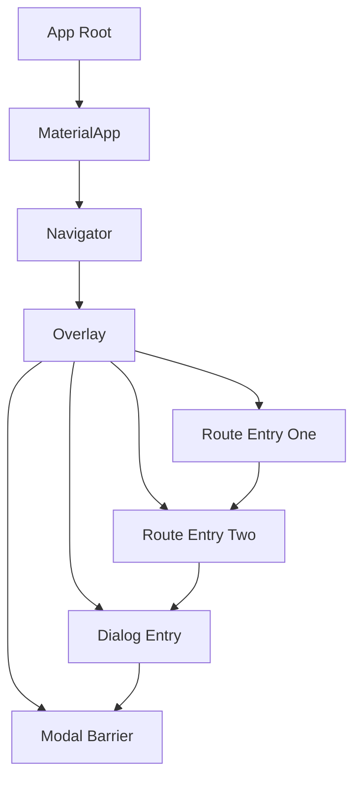

# Overlay, Dialogs, and the Navigator's Stack: How Popups Actually Appear

## English

When you call showDialog, showModalBottomSheet, or showMenu, nothing is inserted into your page's widget subtree. Instead, Flutter uses an Overlay: a special widget that stacks child OverlayEntry objects on top of the main content in painting order. The Overlay is typically provided by the Navigator, which itself lives near the root of the app inside a MaterialApp or WidgetsApp. Each route you push is an OverlayEntry, which is why a new screen covers the previous one and why dialogs can appear above everything: they are simply later entries in the same overlay stack. This explains a common puzzle: a dialog's context is not a descendant of the button that opened it, so InheritedWidgets from that button's subtree are not visible inside the dialog.

Understanding the overlay clarifies several behaviors. A modal barrier is an OverlayEntry that dims the background and absorbs taps, which is why tapping outside a dialog dismisses it. Routes have a maintainState flag: when false, a covered route may be disposed to save memory, which is why some screens rebuild from scratch when you return. The Navigator's stack is a list of routes, and Navigator.pop removes the topmost one. Because dialogs and sheets are pushed as routes onto the same navigator (or a nested one), popping them is symmetric with pushing them, and the back button on Android naturally dismisses the topmost overlay entry.

Nested navigators matter for tabs and split views. If each tab has its own Navigator, pushing a detail screen inside a tab keeps the tab bar visible, because the push happens in the inner navigator's overlay rather than the root one. Dialogs shown from inside that tab will also target the nearest navigator, so they stay within the tab's visual region. This is powerful but requires care: a dialog that should cover the whole app must be shown with a navigator that sits at the root, often via a GlobalKey<NavigatorState> or rootNavigator: true on showDialog.

There are practical consequences for state and lifecycle. Because a dialog is built in a different part of the tree, passing data into it explicitly (through constructor arguments) is more reliable than relying on inherited context. If you need to update the dialog while it is open, use a StatefulBuilder or a ValueNotifier, since the dialog's builder does not automatically rebuild when the page behind it changes. And when a route is removed, its OverlayEntry is disposed, so any controllers or listeners it owns must be cleaned up in dispose. Treat the overlay as a stack of layers you can reason about, and popup behavior stops feeling magical.

## 中文

當你呼叫 showDialog、showModalBottomSheet 或 showMenu 時，其實沒有任何東西被插入到頁面的 widget 子樹中。Flutter 改用 Overlay：一個特殊 widget，把子 OverlayEntry 物件依繪製順序疊在主要內容之上。Overlay 通常由 Navigator 提供，而 Navigator 位於 MaterialApp 或 WidgetsApp 內、靠近應用程式根部。你推入的每個 route 都是一個 OverlayEntry，這就是為什麼新畫面會蓋住前一個，也是為什麼對話框能出現在所有東西之上：它們只是同一個 overlay 堆疊中較晚的項目。這解釋了一個常見困惑：對話框的 context 不是開啟它的按鈕的子代，所以該按鈕子樹中的 InheritedWidget 在對話框內看不到。

理解 overlay 能釐清幾種行為。modal barrier 是一個 OverlayEntry，負責調暗背景並吸收點擊，這就是點擊對話框外部會關閉它的原因。Route 有 maintainState 旗標：設為 false 時，被覆蓋的 route 可能被銷毀以節省記憶體，這就是某些畫面在你返回時會從頭重建的原因。Navigator 的堆疊是一串 route，Navigator.pop 移除最上層那個。因為對話框與底部表單是以 route 形式推入同一個 navigator（或巢狀 navigator），彈出它們與推入它們對稱，而 Android 的返回鍵自然會關閉最上層的 overlay 項目。

巢狀 navigator 對分頁與分割檢視很重要。如果每個分頁有自己的 Navigator，在分頁內推入詳細畫面會讓分頁列保持可見，因為推入發生在內層 navigator 的 overlay，而非根層。從該分頁內顯示的對話框也會以最近的 navigator 為目標，因此留在分頁的視覺區域內。這很強大但需謹慎：應該覆蓋整個應用程式的對話框，必須用位於根部的 navigator 顯示，通常透過 GlobalKey<NavigatorState> 或在 showDialog 設 rootNavigator: true。

這對狀態與生命週期有實務後果。因為對話框建構在樹的不同位置，明確把資料傳進去（透過建構子參數）比依賴繼承 context 更可靠。若需要在對話框開啟時更新它，使用 StatefulBuilder 或 ValueNotifier，因為對話框的 builder 不會在背後頁面改變時自動重建。而當 route 被移除，它的 OverlayEntry 會被銷毀，所以它擁有的任何 controller 或 listener 必須在 dispose 中清理。把 overlay 當成可推理的層堆疊，彈出視窗的行為就不再神奇。

## Key Takeaway

Dialogs and sheets are just OverlayEntries pushed as routes on a Navigator, so their context, stacking, and dismissal all follow from the overlay stack.

## Related Concepts
- OverlayEntry
- Nested Navigator

## Diagram

