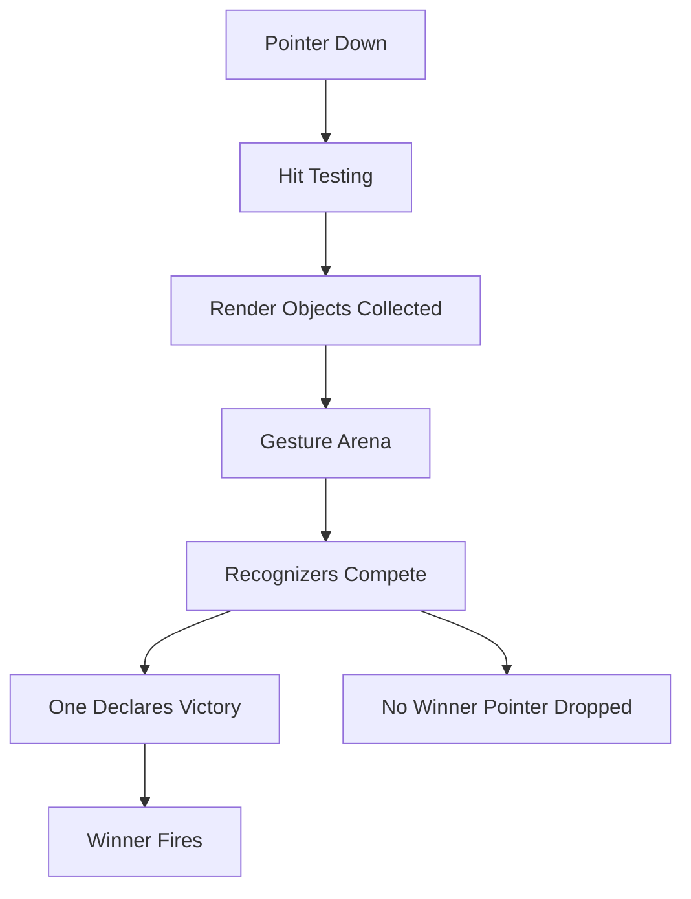

# Gesture Arena and Hit Testing: Who Wins the Tap

## English

When you put a GestureDetector inside a ListView, or a button inside a scrollable card, Flutter has to decide which widget actually receives the touch. It does not simply pick the innermost widget. Instead, every pointer event first goes through hit testing: Flutter walks the render tree and collects every RenderObject whose painted bounds contain the touch point, ordered from the deepest child outward. Those candidates then enter the gesture arena (GestureArenaManager), a small arbitration system where each recognizer competes for the pointer. Recognizers declare interest, and the arena resolves when one recognizer declares victory (for example, a tap recognizer wins once the pointer lifts without moving, while a drag recognizer wins once movement passes its touch slop threshold). If nobody claims the pointer, it is simply dropped. This is why a tap inside a scrollable often does nothing visible until you release, and why a horizontal drag inside a horizontal ListView can be stolen by the scrollable: the scrollable's drag recognizer wins the arena because it accepts earlier. You can influence the outcome with recognizers that declare victory eagerly, or by wrapping in a widget that disambiguates. Understanding this explains a whole class of 'my button doesn't fire inside a ListView' bugs, and it also explains why GestureDetector with both onTap and onPan sometimes feels laggy: the recognizers are waiting on the arena to settle before firing.

## 中文

當你把 GestureDetector 放進 ListView，或者把按鈕放進可滾動的卡片裡，Flutter 必須決定哪個 widget 真正收到觸控。它並不是簡單地選最內層那個。實際上，每個指標事件首先會經過命中測試（hit testing）：Flutter 走訪 render tree，收集所有繪製邊界包含觸控點的 RenderObject，並由最深的子節點向外排序。這些候選者接著進入手勢競技場（gesture arena，GestureArenaManager）——一個小型仲裁系統，每個 recognizer 在此爭奪該指標。Recognizer 會宣告有興趣，而競技場會在某一方宣告勝利時結束（例如 tap recognizer 在指標抬起且未移動時勝出，而 drag recognizer 在移動超過其 touch slop 門檻時勝出）。如果沒有人認領該指標，它就會被丟棄。這就是為何在可滾動區域內點一下，通常要等到放開才會有反應；也是為何在水平 ListView 內做水平拖曳，可能被滾動元件搶走——滾動元件的 drag recognizer 因為較早接受而在競技場中勝出。你可以用更早宣告勝利的 recognizer，或包一層負責消歧的 widget 來影響結果。理解這一點，就能解釋一整類「我的按鈕在 ListView 裡不會觸發」的 bug，也能解釋為何同時有 onTap 和 onPan 的 GestureDetector 有時感覺遲鈍：recognizer 正在等競技場裁決後才觸發。

## Key Takeaway

Touches are arbitrated by a gesture arena after hit testing, so the winner is decided by recognizer competition, not by nesting depth alone.

## Related Concepts
- Hit testing
- Gesture recognizers

## Diagram

