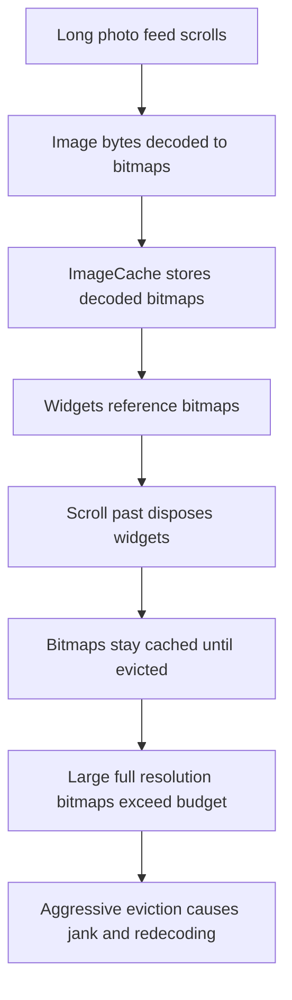

# Images, Caching, and Memory: Why Your ListView Eats RAM

## English

A Flutter app that scrolls a long feed of photos is doing three memory-sensitive things at once: decoding image bytes into GPU-friendly bitmaps, caching those bitmaps so scrolling back is instant, and keeping the decoded pixels alive as long as any widget references them. The ImageCache is a global, size-bounded store (measured in bytes, with a default maximum you can read from PaintingBinding.instance.imageCache.maximumSizeBytes) that holds recently decoded images. When you scroll past an image and its widget is disposed, the image is not necessarily freed: it stays in the cache until evicted. That is usually what you want, because re-decoding a large JPEG is expensive. But it also means a feed of very large images can blow your memory budget, and Flutter will start evicting aggressively, causing jank as images re-decode mid-scroll. The fix is not magic: request appropriately sized images. Use ResizeImage or the cacheWidth/cacheHeight parameters on Image.network and Image.asset so the decoder produces a bitmap close to the display size rather than the full source resolution. A 4000-pixel-wide photo shown in a 200-pixel thumbnail should never be decoded at full size. You can also call imageCache.evict or clear when navigating away from a screen, and use precacheImage to warm the cache for the next screen deliberately. Understanding that decoded bitmaps, not the compressed files, dominate memory is the key mental model.

## 中文

一個滾動長串相片動態的 Flutter app，同時在做三件對記憶體敏感的事：把圖片位元組解碼成 GPU 友善的點陣圖、快取這些點陣圖讓往回滾動時即時顯示、以及只要還有 widget 引用就讓解碼後的像素保持存活。ImageCache 是一個全域、有大小上限的儲存區（以位元組計，預設上限可從 PaintingBinding.instance.imageCache.maximumSizeBytes 讀取），用來保存最近解碼過的圖片。當你滾過一張圖片、其 widget 被銷毀時，圖片不一定會被釋放：它會留在快取裡直到被淘汰。這通常是你要的，因為重新解碼一張大 JPEG 很昂貴。但這也意味著一整串超大圖片可能撐爆你的記憶體預算，Flutter 會開始積極淘汰，導致滾動中途重新解碼而卡頓。解法並不神奇：請求尺寸合適的圖片。使用 ResizeImage，或 Image.network 與 Image.asset 上的 cacheWidth／cacheHeight 參數，讓解碼器產生的點陣圖接近顯示尺寸，而非完整來源解析度。一張四千像素寬、顯示在兩百像素縮圖裡的照片，絕不該以完整尺寸解碼。你也可以在離開某個畫面時呼叫 imageCache.evict 或 clear，並用 precacheImage 刻意預熱下一個畫面的快取。關鍵心智模型是：佔用記憶體的是解碼後的點陣圖，不是壓縮檔。

## Key Takeaway

Memory is dominated by decoded bitmaps, so request images at display size and manage the ImageCache deliberately.

## Related Concepts
- ImageCache
- ResizeImage

## Diagram

