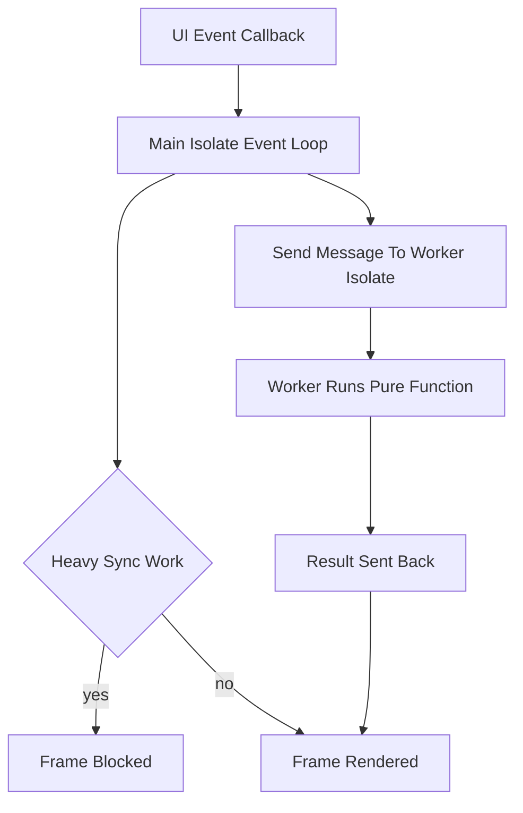

# Isolates, Compute, and the Single-Threaded UI Trap

## English

Dart runs your UI code on a single thread with an event loop. That means any synchronous work you do in a build method, a button callback, or a future's continuation blocks the entire frame: no repaint, no input, no animation. Parsing a large JSON payload, decrypting a file, or running an image filter on the main isolate will visibly freeze the app even though 'Dart has isolates'. Isolates are separate memory spaces with their own event loops, and they do not share mutable state; they communicate by passing messages, which are copied (or, for certain transferable objects, moved). The modern way to offload work is Isolate.run, which spawns an isolate, runs a function, sends back the result, and tears the isolate down. For repeated work, you keep a long-lived isolate alive and send it requests. There is also compute, a convenience wrapper that historically spawned an isolate per call and is now backed by Isolate.run. The subtle trap is that anything an isolate captures or receives must be sendable — you cannot hand it a reference to your BuildContext or a mutable object graph and expect it to work. (Isolate.run accepts closures directly; the top-level-or-static restriction applies to Isolate.spawn, and even there the real constraint is on what the closure captures, which may implicitly send unexpected state.) So the practical pattern is: keep the isolate's job pure (input data in, result out), do the heavy lifting there, and apply the result back on the main isolate via a Future or a stream. This keeps the UI thread free to hit its frame budget, typically around 16 milliseconds at 60Hz.

## 中文

Dart 在單一執行緒上跑你的 UI 程式碼，並搭配一個事件迴圈。這意味著你在 build 方法、按鈕回呼或 future 續傳中做的任何同步工作，都會阻塞整個影格：沒有重繪、沒有輸入、沒有動畫。解析大型 JSON、解密檔案，或在主 isolate 上跑影像濾鏡，即使「Dart 有 isolate」，也會明顯讓 app 凍結。Isolate 是擁有自己事件迴圈的獨立記憶體空間，彼此不共享可變狀態；它們透過傳遞訊息溝通，訊息會被複製（或對某些可轉移物件而言，是被移動）。現代卸載工作的方式是 Isolate.run：它生成一個 isolate、執行函式、回傳結果，然後拆掉該 isolate。對於反覆性的工作，你會保留一個長命的 isolate 並向它發送請求。另外還有 compute，一個便利包裝，歷史上每次呼叫都生成一個 isolate，現在則由 Isolate.run 支撐。微妙的陷阱是：送到 isolate 的任何捕獲值或接收值都必須可傳送——你不能把 BuildContext 的引用或可變物件圖交給 isolate 並期望它能運作。（Isolate.run 可以直接接受閉包；「必須是頂層或靜態函式」的限制適用於 Isolate.spawn，而即使在那裡，真正受限的也是閉包捕獲了什麼——它可能隱含地傳送意料之外的狀態。）所以實務模式是：讓 isolate 的工作保持純粹（輸入資料進、結果出），在那裡做重活，再透過 Future 或 stream 把結果套回主 isolate。這讓 UI 執行緒能空出來達成影格預算，在 60Hz 下通常約 16 毫秒。

## Key Takeaway

Offload heavy synchronous work to isolates with Isolate.run, keeping jobs pure and results marshalled back to the UI thread.

## Related Concepts
- Isolate.run
- Event loop

## Diagram

