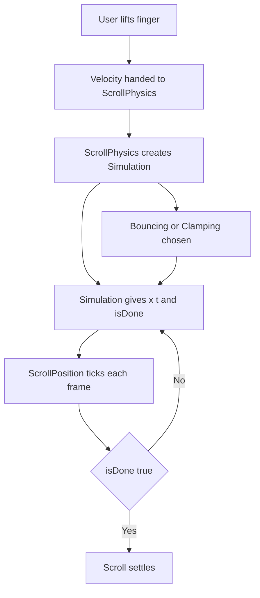

# Scroll Physics and Ballistic Simulation: What Happens After You Lift Your Finger

## English

When you drag a list and let go, Flutter does not simply stop. It hands the current velocity to a ScrollPhysics object, which runs a physics simulation to decide whether to coast, snap, or bounce back. The default BouncingScrollPhysics (iOS-flavoured) and ClampingScrollPhysics (Android-flavoured) differ not just in visuals but in the simulation they run: bouncing uses a spring-like simulation that overshoots and settles, while clamping uses friction that decays velocity to zero and then refuses to go past the edge. You can pick either explicitly, because scroll physics is just a constructor argument on ListView, SingleChildScrollView, and friends.

The core object is a Simulation from the physics package. A ScrollPhysics produces a Simulation given a position, velocity, and the min/max scroll extents. The simulation exposes x(t) — position at time t — and isDone(t), plus dx(t) for velocity. The scroll position then ticks this simulation on every frame until isDone returns true. That is the whole trick behind a fling: no timers, no animation controllers, just a differential equation sampled once per frame by the scheduler.

Analogy: think of a puck on ice. Friction physics is a puck on a long flat rink — it slides and slowly stops. Bouncing physics is a puck with a wall at each end — it hits the wall, compresses an imaginary spring, and comes back. Because both are expressed as the same Simulation interface, the scroll machinery does not care which one you chose; it just keeps asking for the next position.

This matters for feel. A short fling with high velocity will coast much farther under bouncing physics than under clamping physics because the friction curves differ. If you build a custom carousel, a paginated sheet, or a snapping picker, you often subclass ScrollPhysics and override the method that creates the simulation, or use PageScrollPhysics which snaps to page boundaries. The takeaway is that 'smooth scrolling' is not a rendering feature — it is a small numerical simulation running in Dart every frame.

One practical caution: physics only governs what happens when the user is not touching the screen. While a finger is down, the drag is applied directly to the scroll offset and the simulation is cancelled. So if your custom physics feels wrong, check whether the problem is in the drag phase (sensitivity, gesture competition) or the ballistic phase (simulation), because they are entirely separate code paths.

## 中文

當你拖動列表然後放手，Flutter 不會就此停住。它會把當下的速度交給一個 ScrollPhysics 物件，由它執行一段物理模擬，決定是繼續滑行、吸附到定位，還是彈回原處。預設的 BouncingScrollPhysics（iOS 風格）與 ClampingScrollPhysics（Android 風格）的分別不只在視覺，更在於它們跑的模擬不同：彈跳版用類似彈簧的模擬，會越過邊界再回穩；夾緊版則用摩擦力把速度衰減到零，然後拒絕再越過邊緣。你可以明確指定用哪一種，因為滾動物件物理只是 ListView、SingleChildScrollView 之類建構子的一個參數。

核心物件是 physics 套件裡的 Simulation。ScrollPhysics 會根據位置、速度以及可滾動的最小／最大範圍，產生一個 Simulation。這個模擬提供 x(t)——在時間 t 的位置——以及 isDone(t)，還有 dx(t) 表示速度。滾動位置隨後在每一幀去問這個模擬要下一個位置，直到 isDone 回傳 true 為止。這就是「甩動」（fling）背後的整套把戲：沒有計時器、沒有動畫控制器，只有一條微分方程，由排程器每幀取樣一次。

打個比喻：想像冰面上的冰球。摩擦物理就像在長長的平滑冰道上——它滑出去，慢慢停下。彈跳物理就像兩端各有一道牆——冰球撞牆、壓縮一個假想的彈簧，然後彈回來。因為兩者都用同一個 Simulation 介面表達，滾動機制根本不在乎你選了哪個；它只是不斷問下一個位置。

這對「手感」很重要。同樣一記高速短甩，在彈跳物理下會滑得比夾緊物理遠得多，因為兩者的摩擦曲線不同。如果你要做自訂輪播、分頁面板或吸附式選擇器，通常會繼承 ScrollPhysics 並覆寫產生模擬的方法，或者直接用 PageScrollPhysics 讓它吸附到頁面邊界。重點是：「順滑滾動」不是渲染功能，而是一段每秒在 Dart 裡跑好幾十次的小型數值模擬。

一個實用提醒：物理只掌管使用者沒有觸碰螢幕時的行為。手指按下期間，拖曳會直接套用到滾動偏移量，模擬會被取消。所以如果你的自訂物理手感不對，先分清楚問題出在拖曳階段（靈敏度、手勢競爭）還是彈道階段（模擬），因為那是兩條完全獨立的程式路徑。

## Key Takeaway

Fling scrolling is a per-frame numerical simulation produced by ScrollPhysics, not a canned animation, which is why swapping physics changes how far and how a list coasts.

## Related Concepts
- Gesture Arena and Hit Testing
- Flutter Animations

## Diagram

