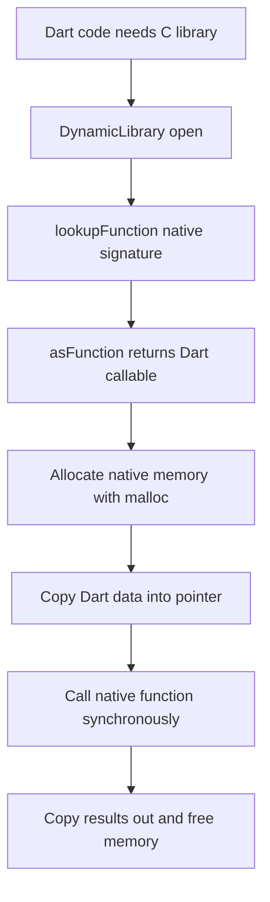

# Dart FFI and dart:ffi: Calling C Libraries Without a Plugin

## English

Platform channels are great for talking to Java/Kotlin or Objective-C/Swift, but they are asynchronous, serialise every message, and require code on both sides. When you need to call an existing C library — a codec, a crypto routine, a game physics engine, an image processor — Dart's FFI (foreign function interface, in the dart:ffi library) lets you call it directly, in-process, with no message passing. The trade-off: FFI is synchronous and dangerous. A bad pointer can crash the whole app, and a long FFI call blocks the isolate just like any other Dart code.

The basic shape: you load a dynamic library with DynamicLibrary.open on the path to a .so, .dylib, or .dll (or DynamicLibrary.process to look inside the running executable). Then you look up a symbol by name with lookupFunction, giving it a native function signature and a Dart function signature. The signatures are written with NativeFunction<Int32 Function(Int32, Pointer<Utf8>)> style types, and you invoke it through .asFunction<...>() which returns a Dart callable. Arguments and return values must be C-compatible primitives or pointers; structs need allocation and manual layout.

Memory is the hard part. Dart objects can move during garbage collection, so you never hand a raw pointer to a Dart string or list. Instead you allocate native memory with malloc from package:ffi (or calloc), copy your bytes in, call the native function, copy results out, and free the memory in a finally block. Strings cross the boundary as Pointer<Utf8> and are converted with toDartString() and toNativeUtf8(). Forgetting to free is a leak; freeing twice is a crash. This is manual memory management, exactly as in C, and it is the price of zero-overhead calls.

Because FFI calls are synchronous, they run on the calling isolate. A 50 ms native call inside a build method will jank your UI. The usual pattern is to move heavy FFI work to a background isolate, where the native library is loaded again in that isolate's context (each isolate has its own view of the process, so library handles are not shared). For truly long-running native work, a native thread with a callback via NativeCallable is the advanced escape hatch.

If you are shipping this, remember that FFI requires the native library to be bundled for every target you support: Android ABIs (arm64-v8a, armeabi-v7a, x86_64 emulators), iOS frameworks, macOS, Windows, Linux, and web — and web has no FFI at all, so you need a conditional import and a pure-Dart fallback. FFI is a scalpel: unbeatable for wrapping an existing C library, overkill for calling three lines of platform API that a plugin already covers.

## 中文

平台通道很適合跟 Java/Kotlin 或 Objective-C/Swift 溝通，但它是非同步的、每則訊息都要序列化，而且兩邊都要寫程式碼。當你要呼叫既有的 C 函式庫——例如編解碼器、加密常式、遊戲物理引擎、影像處理器——Dart 的 FFI（foreign function interface，外部函式介面，位於 dart:ffi 函式庫）讓你直接在行程內呼叫，完全不需要傳訊息。代價是：FFI 是同步且危險的。一個錯誤的指標可以讓整個應用程式崩潰，而一段耗時的 FFI 呼叫會像任何 Dart 程式碼一樣卡住該 isolate。

基本形狀是這樣：用 DynamicLibrary.open 載入動態函式庫，給它 .so、.dylib 或 .dll 的路徑（或用 DynamicLibrary.process 在執行中的執行檔裡找）。然後用 lookupFunction 依名稱查找符號，同時給它原生函式簽名和 Dart 函式簽名。簽名寫成 NativeFunction<Int32 Function(Int32, Pointer<Utf8>)> 這種型別，再透過 .asFunction<...>() 取得可呼叫的 Dart 函式。參數與回傳值必須是 C 相容的基本型別或指標；結構體則需要自行配置記憶體並手動排版。

記憶體是最難的部分。Dart 物件在垃圾回收時可能被搬移，所以絕不能把 Dart 字串或清單的原始指標直接交出去。做法是用 package:ffi 的 malloc（或 calloc）配置原生記憶體，把位元組複製進去，呼叫原生函式，把結果複製出來，最後在 finally 區塊釋放。字串以 Pointer<Utf8> 跨越邊界，用 toDartString() 和 toNativeUtf8() 轉換。忘記釋放就是洩漏；重複釋放就是崩潰。這就是手動記憶體管理，跟 C 一模一樣，也是換取零額外開銷呼叫的代價。

由於 FFI 呼叫是同步的，它會在呼叫它的 isolate 上執行。在 build 方法裡跑一段 50 毫秒的原生呼叫，畫面就會卡頓。常見做法是把吃重的 FFI 工作搬到背景 isolate，並在該 isolate 的環境裡重新載入原生函式庫（每個 isolate 對行程有各自的視角，函式庫控制代碼並不共用）。若原生工作真的很久，進階做法是開原生執行緒，再用 NativeCallable 回呼。

如果你要正式發佈，記得 FFI 需要為每個支援的目標打包原生函式庫：Android 的各個 ABI（arm64-v8a、armeabi-v7a、x86_64 模擬器）、iOS framework、macOS、Windows、Linux——而 web 根本沒有 FFI，所以你需要條件式 import 加一個純 Dart 的替代實作。FFI 是一把手術刀：包裝既有 C 函式庫時無可匹敵，但若只是呼叫三行平台 API、而外掛已經涵蓋，那就是殺雞用牛刀。

## Key Takeaway

dart:ffi lets Dart call C functions in-process with no message serialisation, at the cost of manual memory management and the risk of crashing the isolate.

## Related Concepts
- Platform Channels
- The Dart Isolate Model and Background Work

## Diagram

