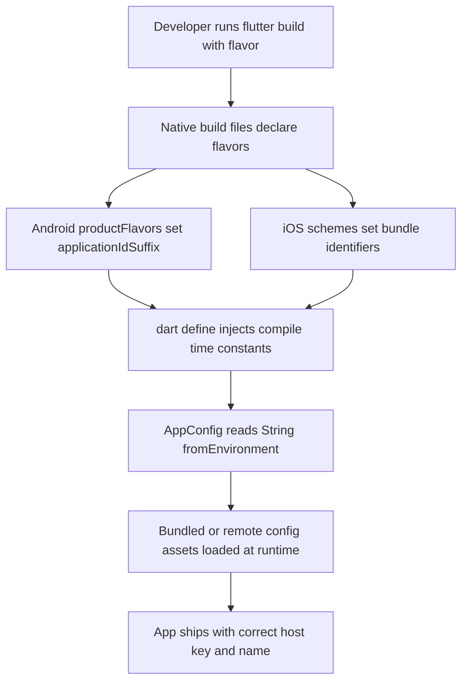

# Flavors, Environment Configuration, and Shipping One Codebase to Many Environments

## English

A real app usually has at least three environments: development, staging, and production, each pointing at a different API host, using a different analytics key, and often showing a different app name or icon. Flutter has no built-in concept of environments; instead you compose one from three layers: build flavors (a native build-system concept), compile-time constants via --dart-define, and runtime configuration loaded from bundled assets or remote config.

Flavors are declared in the native build files, not in Dart. For Android, you add productFlavors in the app-level Gradle build file, each with its own applicationIdSuffix and maybe a different launcher label. For iOS, you create additional Xcode schemes and build configurations, and wire them to different bundle identifiers. You then run flutter run --flavor staging or flutter build apk --flavor production. Inside Dart, you read the flavor with the --dart-define=FLUTTER_APP_FLAVOR=... pattern or by checking a compile-time constant you set alongside it, because Dart itself is not told the flavor name by the tool.

--dart-define is the simpler mechanism and works on every platform including web. It injects a key-value pair that becomes available through the const String.fromEnvironment('KEY') constructor. Because it is const, the value is baked in at compile time and can be tree-shaken and constant-folded; there is no runtime lookup cost. The classic pattern is a small AppConfig class that reads several String.fromEnvironment and bool.fromEnvironment values with sensible defaults, so a plain flutter run without flags still works for local development.

A third layer is files. You can bundle config/dev.json, config/prod.json as assets and pick one at startup, or fetch configuration from a remote endpoint after launch. This is the only layer that can change without a new build, which is why feature flags and kill switches live here. The trade-off is that bundled JSON is visible to anyone who unzips your APK, so never put secrets in it — API keys that must stay secret belong on your server, not in the client, in any layer.

A common failure mode is drift: the Android flavor name and the iOS scheme name get out of sync, or CI builds the default flavor by accident and ships debug config to the store. Defend with a single source of truth — one script or CI job that maps environment names to the exact flavor, dart-define values, and signing config — and assert at startup that the resolved config is not the development default when the app is a release build. Treat environment configuration as a build-time contract, not a runtime afterthought.

## 中文

一個真實的應用程式通常至少有三個環境：開發、預備（staging）和正式，各自指向不同的 API 主機、使用不同的分析金鑰，也常顯示不同的應用名稱或圖示。Flutter 本身沒有環境的概念；你要用三層東西組合出來：建置 flavor（原生建置系統的概念）、透過 --dart-define 注入的編譯期常數，以及從打包資源或遠端設定載入的執行期設定。

Flavor 是在原生建置檔裡宣告的，不在 Dart 裡。Android 方面，你在 app 層級的 Gradle 建置檔加入 productFlavors，每個有自己的 applicationIdSuffix，也可能有不同的啟動器名稱。iOS 方面，你要建立額外的 Xcode scheme 和建置配置，並接到不同的 bundle identifier。然後執行 flutter run --flavor staging 或 flutter build apk --flavor production。在 Dart 裡，你透過 --dart-define=FLUTTER_APP_FLAVOR=... 這種模式讀取 flavor，或檢查同時設定的編譯期常數，因為工具本身不會直接把 flavor 名稱告訴 Dart。

--dart-define 是較簡單的機制，而且在包括 web 的每個平台都能用。它注入一組鍵值，可透過 const String.fromEnvironment('KEY') 建構子取得。因為是 const，值在編譯期就固定下來，可以被 tree-shaking 和常數折疊；執行期沒有查找成本。經典做法是一個小小的 AppConfig 類別，讀取幾個 String.fromEnvironment 和 bool.fromEnvironment 值並附上合理預設值，這樣不帶旗標的單純 flutter run 在本機開發時仍然可用。

第三層是檔案。你可以把 config/dev.json、config/prod.json 打包成資源，在啟動時選一個，或者在啟動後從遠端端點抓取設定。這是唯一不需要重新建置就能改變的一層，所以功能旗標和緊急開關都放在這裡。代價是打包的 JSON 對任何解開你 APK 的人都看得見，所以千萬不要把機密放進去——必須保密的 API 金鑰屬於你的伺服器，不屬於用戶端，任何一層都一樣。

常見的失敗模式是「漂移」：Android 的 flavor 名稱和 iOS 的 scheme 名稱失去同步，或者 CI 不小心建置了預設 flavor，把開發設定送上應用商店。防禦方法是單一真實來源——一個腳本或 CI 工作，把環境名稱對應到確切的 flavor、dart-define 值和簽署設定——並在啟動時斷言：若這是 release 建置，解析出來的設定不可以是開發預設值。把環境設定當成建置期的契約，而不是執行期的補丁。

## Key Takeaway

Environments in Flutter are composed from native build flavors, compile-time --dart-define constants, and runtime config files, and the main risk is drift between them.

## Related Concepts
- The pubspec.yaml Manifest
- Build Modes: Debug, Profile, and Release

## Diagram

