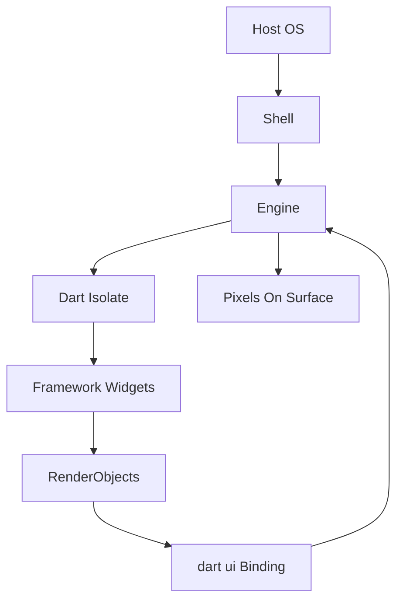

# The Flutter Engine and the Shell: What Actually Runs Your App

## English

Most explanations of Flutter stop at "widgets build elements which build RenderObjects." But below the framework sits a second, much less discussed layer: the Flutter engine. The engine is a C++ library (compiled into your app, not shipped by the OS) that owns the rasteriser, the text layout engine, the Dart VM, and the platform-specific embedder hooks. When you call `flutter run`, you are not running a script inside a browser or a JVM — you are launching a native executable that boots the engine, starts a Dart isolate, and hands that isolate a `dart:ui` binding. Everything your Dart code touches — `Canvas`, `Picture`, `Paragraph`, `Image` — is a thin Dart wrapper over C++ objects owned by the engine. This is why Flutter can paint the same pixels on Android, iOS, web, and desktop: the framework and engine travel together in the binary, so there is no dependency on the host platform's widget toolkit. The only thing the host provides is a window, an input event stream, and a graphics context.

The 'shell' is the term for the platform-specific host that embeds the engine. On Android it is a Java/Kotlin `FlutterActivity` or `FlutterFragment`; on iOS it is a `FlutterViewController` written in Objective-C/Swift; on desktop it is a GTK, Win32, or Cocoa window; on the web it is a JavaScript bootstrapper that boots CanvasKit (or skwasm) to render into a `<canvas>` — the old HTML/DOM renderer has been removed from Flutter web, and the DOM is now used only for platform views and accessibility. The shell's job is narrow but critical: create a surface for the engine to render into, forward lifecycle events (resume, pause, low-memory), forward input and accessibility events, and expose a handful of platform services like clipboard access and the platform message channel. The shell does not know about widgets. It has never heard of `Container`. It just pumps bytes and events between the OS and the engine.

A useful analogy is a video game console. The engine is the console hardware plus the graphics driver — the thing that turns draw calls into pixels. The shell is the TV and the controller — the interface to the outside world. The framework (widgets, elements, render objects) is the game itself, and Dart is the language the game is written in. You can swap TVs without rewriting the game; that is exactly what happens when the same Flutter app runs on an Android phone and a macOS desktop. The engine and framework are identical; only the shell differs. This is also why platform-specific bugs often live in the shell — a lifecycle event that fires at the wrong time, a keyboard inset that is reported late — rather than in your Dart code.

When you start the app, the sequence is roughly: the OS launches the native executable, the shell initialises, the engine boots the JIT Dart VM (in debug) or uses AOT-compiled code (in profile and release — profile simply keeps service extensions and tracing enabled), the Dart isolate begins running `main()`, `runApp` attaches the root widget, and the first frame is scheduled. On the first frame, the engine asks the framework to build and lay out the tree, produces a `Scene` (a tree of `Layer` objects), and submits it to the rasteriser. From that point on, every frame is a loop: vsync from the shell, a `beginFrame` callback into the framework, build/layout/paint, then `Scene` submission. Understanding this loop is what makes frame-budget conversations make sense — a 16.6 ms budget at 60 Hz, 8.3 ms at 120 Hz, and everything you do in build, layout, and paint has to fit inside it.

The practical upshot is that when you debug a Flutter performance issue, you need to know which layer is costing you. A janky animation from too many rebuilds is a framework problem — fix it with `const` widgets, `RepaintBoundary`, or better state scoping. A janky animation from a huge image decode is an engine problem — fix it with `cacheWidth`/`cacheHeight` on `Image`, or pre-decode off the UI isolate. A janky animation that only happens on one platform is likely a shell problem — check the platform's frame callbacks and any custom embedder code. Knowing the engine/shell/framework split turns 'Flutter is slow' into a specific, actionable question about which layer is misbehaving.

## 中文

大部分 Flutter 教學講到「widget 建 element、element 建 RenderObject」就停下來。但框架之下還有一層很少人談的：Flutter 引擎（engine）。引擎是一套 C++ 函式庫（直接編譯進你的 App，不是由作業系統提供），它擁有光柵化器（rasteriser）、文字排版引擎、Dart VM，以及各平台的嵌入層（embedder）接口。當你執行 `flutter run`，你不是在瀏覽器或 JVM 裡跑腳本，而是啟動一個原生執行檔：它開機引擎、啟動一個 Dart isolate，然後把 `dart:ui` 綁定交給那個 isolate。你 Dart 程式碼碰到的每一個東西——`Canvas`、`Picture`、`Paragraph`、`Image`——都只是包在引擎 C++ 物件外面的薄薄一層 Dart 殼。這正是 Flutter 能在 Android、iOS、web、桌面畫出相同像素的原因：框架和引擎一起被打包進二進位檔，所以完全不依賴宿主平台的 widget 工具組。宿主只提供三樣東西：一個視窗、一串輸入事件、一個圖形上下文。

「Shell」指的是把引擎嵌進平台的那層宿主程式碼。在 Android 上是 Java/Kotlin 的 `FlutterActivity` 或 `FlutterFragment`；在 iOS 上是 Objective-C/Swift 的 `FlutterViewController`；在桌面是 GTK、Win32 或 Cocoa 視窗；在 web 上則是一層 JavaScript 啟動載入器，負責啟動 CanvasKit（或 skwasm）並渲染到 `<canvas>`——舊有的 HTML/DOM 渲染器已從 Flutter web 移除，DOM 現在只用於 platform view 與無障礙。Shell 的工作範圍很窄但關鍵：替引擎建立可渲染的表面、轉發生命週期事件（resume、pause、low-memory）、轉發輸入與無障礙事件，並暴露少數平台服務如剪貼簿和平台訊息通道。Shell 不懂 widget，它沒聽過 `Container`，它只是把位元組和事件在作業系統與引擎之間來回搬運。

一個好用的比喻是遊戲主機。引擎是主機硬體加顯示驅動——把繪圖指令變成像素的東西。Shell 是電視加手掣——對外的介面。框架（widget、element、render object）是遊戲本身，Dart 是寫遊戲的語言。你可以換電視而不用重寫遊戲；同一支 Flutter App 跑在 Android 手機和 macOS 桌面，正是如此。引擎和框架一模一樣，只有 shell 不同。這也是為什麼平台相關的 bug 常常住在 shell 裡——某個生命週期事件在錯誤時間觸發、鍵盤 inset 回報太晚——而不是在你的 Dart 程式碼裡。

App 啟動的順序大致是：作業系統啟動原生執行檔、shell 初始化、引擎啟動 JIT Dart VM（debug），或使用 AOT 編譯的程式碼（profile 與 release——profile 只是保留 service extension 與 tracing 功能）、Dart isolate 開始跑 `main()`、`runApp` 掛上根 widget、第一幀被排程。第一幀時，引擎請框架 build 並 layout 整棵樹，產生一個 `Scene`（由 `Layer` 物件組成的樹），再交給光柵化器。從此每一幀都是一個迴圈：shell 送出 vsync、框架收到 `beginFrame` 回呼、build/layout/paint、送出 `Scene`。理解這個迴圈，你才聽得懂「幀預算」在講什麼——60 Hz 下是 16.6 毫秒，120 Hz 下是 8.3 毫秒，而你在 build、layout、paint 裡做的每件事都得塞進這個預算。

實務上的結論是：當你 debug Flutter 效能問題，必須知道哪一層在花你的錢。動畫卡頓來自太多 rebuild，是框架問題——用 `const` widget、`RepaintBoundary`、更好的狀態作用域去修。動畫卡頓來自我一張大圖解碼，是引擎問題——用 `Image` 的 `cacheWidth`/`cacheHeight`，或在 UI isolate 之外預先解碼。只有某個平台會卡，很可能是 shell 問題——檢查該平台的幀回呼與任何自訂嵌入程式碼。懂得引擎／shell／框架這三層分工，就能把「Flutter 很慢」這種模糊抱怨，變成「哪一層在出錯」這種具體、可處理的問題。

## Key Takeaway

Flutter is three layers — framework, engine, and shell — and knowing which one owns a symptom is the difference between a vague complaint and a fixable bug.

## Related Concepts
- Flutter Engine
- Platform Embedder

## Diagram

