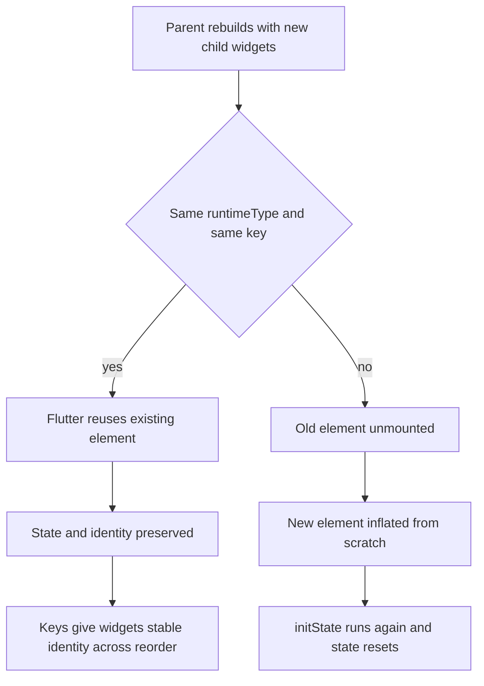

# Widget Keys, Element Identity, and the Rebuild Trap

## English

Every Flutter developer eventually hits a bug that looks impossible: a `TextField` loses its cursor position when a list reorders, an `AnimatedContainer` refuses to animate when its parent's child changes, or a `StatefulWidget`'s `initState` runs again for no obvious reason. Almost all of these trace back to element identity — the question of whether Flutter, when it rebuilds a parent, decides that a child widget 'is the same widget' as before or 'is a different widget.' The answer is governed by the `Widget.canUpdate` rule: two widgets can update the same element if they have the same `runtimeType` and the same `key`. If either differs, the old element is unmounted and a new one is inflated from scratch. That single rule explains a huge fraction of confusing Flutter behaviour.

Consider a `Column` containing `[Text('A'), Text('B')]`. If you rebuild the parent with `[Text('B'), Text('A')]` — same runtimeType, no keys — Flutter matches position-by-position. The first element is reused for the new first child, the second for the new second child, and the `Text` widgets' contents are simply updated. That is fine for `Text`, because `Text` is stateless and has nothing to preserve. Now do the same with two `StatefulWidget`s that hold a counter in their state: the elements are reused, so the counters stay attached to their positions, not to their logical identities. The widget that used to be second now shows the first counter's value. Nothing is 'wrong' in Flutter's model — the widgets simply have no identity beyond their position.

Keys are how you give widgets an identity that survives reordering. A `ValueKey(id)` or `ObjectKey(object)` tells the framework: 'this widget is the one with this id, regardless of where it sits in the list.' When the parent rebuilds, Flutter scans the sibling widgets for a key match and reuses the matching element, preserving its state. This is why `ListView.builder` with reorderable lists, `AnimatedSwitcher`, and any list where items can be inserted or removed almost always needs keys. The `GlobalKey` variant is stronger still: it is globally unique within the app, survives being moved to a completely different part of the tree, and gives you access to the associated `State` object via `key.currentState`. That power comes with a cost — global keys defeat some of the framework's optimisations and are easy to misuse — so reach for them only when you genuinely need to reach across the tree.

There is a subtler trap with `const` constructors and widget equality. Widgets are compared by identity, not by value; two `const Text('hi')` instances in the same library are actually the same canonicalised object, but two non-const `Text('hi')` instances are different objects. This matters because `const` widgets short-circuit rebuilds entirely — if the widget instance is identical to the previous one, Flutter skips the subtree. That is why sprinkling `const` on leaf widgets is one of the cheapest performance wins available, and why removing a `const` to 'fix' a bug is almost always the wrong move. The bug is usually about identity, not about the constness.

A practical debugging habit: when a widget misbehaves after a rebuild, ask three questions in order. First, did the runtimeType change? (Often yes — a conditional returning `Text` in one branch and `RichText` in another, or a `Container` that becomes a `SizedBox`.) Second, did the key change, or was a key added/removed? Third, is the widget's position in a list the only thing identifying it? If so, add a stable key. The Flutter DevTools widget inspector highlights elements that were recreated versus updated, and the `debugPrintRebuildDirtyWidgets` flag prints rebuild activity to the console. These two tools turn 'why did my state reset?' from a mystery into a two-minute investigation. Once you internalise the canUpdate rule, most 'Flutter weirdness' becomes predictable framework behaviour.

## 中文

每個 Flutter 開發者總有一天會撞上一個看起來不可能的 bug：清單重排後 `TextField` 的游標位置跑掉、父層的 child 換了之後 `AnimatedContainer` 不肯做動畫、`StatefulWidget` 的 `initState` 莫名其妙又跑一次。這些幾乎全部指向同一個根源：element 的身分（identity）——也就是當 Flutter 重建父層時，它如何判斷某個 child widget「還是同一個 widget」還是「換成另一個 widget」。答案由 `Widget.canUpdate` 規則決定：兩個 widget 若 `runtimeType` 相同且 `key` 相同，就可以更新同一個 element；只要有一項不同，舊 element 就被卸載，從頭 inflate 一個新的。就這一條規則，解釋了 Flutter 大量令人困惑的行為。

設想一個 `Column` 裝著 `[Text('A'), Text('B')]`。如果你用 `[Text('B'), Text('A')]` 重建父層——runtimeType 相同、沒有 key——Flutter 會按位置一一配對：第一個 element 被重用給新的第一個 child，第二個 element 給新的第二個 child，`Text` 的內容只是被更新。對 `Text` 來說沒問題，因為它是無狀態的，沒東西要保留。但換成兩個在 state 裡各有一個計數器的 `StatefulWidget` 做同樣的事：element 被重用，所以計數器黏在位置上，而不是黏在邏輯身分上。原本排第二的那個 widget，現在顯示的是第一個計數器的值。在 Flutter 的模型裡這沒有「錯」——這些 widget 除了位置之外本來就沒有身分。

Key 就是你給 widget 一個能撐過重排的身分。`ValueKey(id)` 或 `ObjectKey(object)` 等於告訴框架：「這個 widget 就是這個 id 的那一個，不管它排在清單哪裡。」父層重建時，Flutter 會在同層 widget 裡掃描 key 相符的，重用對應 element，保住它的 state。這就是為什麼可重排清單的 `ListView.builder`、`AnimatedSwitcher`，以及任何會插入或刪除項目的清單幾乎都需要 key。`GlobalKey` 更強：它在整個 App 內全域唯一，可以跟著 widget 搬到樹的完全不同位置，還能透過 `key.currentState` 拿到關聯的 `State` 物件。這種能力有代價——global key 會破壞框架一些優化，也很容易被誤用——所以只在真的需要跨樹存取時才用它。

還有一個更細的陷阱，關於 `const` 建構子與 widget 相等性。Widget 是以身分而非值來比較的；同一個 library 裡兩個 `const Text('hi')` 其實是同一個被正規化的物件，但兩個非 const 的 `Text('hi')` 是不同物件。這很重要，因為 `const` widget 會完全短路重建——若 widget 實例與上一次完全相同，Flutter 就跳過整個子樹。這就是為什麼在葉節點 widget 上加 `const` 是最便宜的性能優化之一，也是為什麼「為了修 bug 而拿掉 const」幾乎總是錯的方向。Bug 通常出在身分，而不是出在 const。

一個實用的 debug 習慣：當某個 widget 在重建後行為異常，依序問三個問題。第一，runtimeType 變了嗎？（常常是——某個分支回 `Text`、另一個分支回 `RichText`，或一個 `Container` 變成 `SizedBox`。）第二，key 變了嗎，或者 key 被加上／拿掉了？第三，這個 widget 在清單裡是不是只靠位置來辨識？若是，就給它一個穩定的 key。Flutter DevTools 的 widget inspector 會標示哪些 element 是被重建的、哪些是被更新的；`debugPrintRebuildDirtyWidgets` 旗標則會把重建活動印到 console。這兩個工具能把「我的 state 為什麼被重置」從謎團變成兩分鐘的調查。一旦你把 canUpdate 規則內化，大部分所謂「Flutter 的怪異行為」都會變成可預測的框架行為。

## Key Takeaway

Flutter reuses an element only when runtimeType and key match, so keys are the tool that gives widgets an identity beyond their position in the list.

## Related Concepts
- Widget.canUpdate
- GlobalKey

## Diagram

