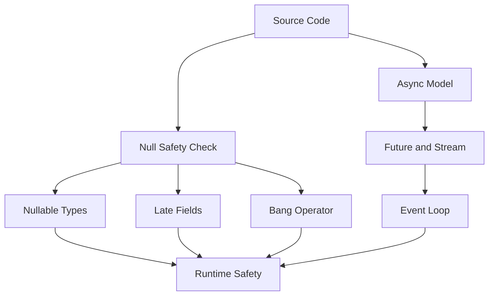

# Dart's Null Safety and Async Model as Flutter's Safety Net

## English

Flutter's reliability is not just a product of its widget system — it is heavily inherited from Dart's type system and concurrency model. Two features in particular shape how Flutter code is written: sound null safety, and the `Future`/`Stream` async model built on the event loop. Understanding both is what separates code that compiles from code that behaves correctly under load, on slow networks, and after the user backgrounds the app.

Sound null safety means the compiler proves, at compile time, that no non-nullable variable can ever hold `null`. A `String` is always a string; a `String?` might be null and must be checked before use. This is enforced by the Dart compiler, not by runtime assertions, so it costs nothing at runtime and catches an enormous class of bugs before the app ships. The practical implications are significant. First, `late` variables let you declare a non-nullable field that is initialised later — but the compiler inserts a runtime check that throws if you read it before assignment, so `late` is a promise you make and the runtime verifies. Second, null-aware operators like `?.`, `??`, and `??=` become idiomatic, and the `!` bang operator is a red flag in code review: it says 'I know better than the compiler,' and it is where null-safety bugs hide. Third, plugin and platform-channel APIs often return nullable types because the native side genuinely may not have an answer — treating those as non-null without checking is the single most common source of crashes in Flutter apps that talk to native code.

Dart's concurrency model is single-threaded per isolate, with an event loop that processes microtasks and events. `Future` represents a value that will arrive later; `async`/`await` is syntactic sugar over `.then()` callbacks that lets you write asynchronous code that reads like synchronous code. The key insight — and the one that trips up developers coming from multithreaded languages — is that `await` does not block the isolate. It suspends the current function, returns control to the event loop, and lets other events run. That is why Flutter can keep rendering frames at 60 or 120 Hz while your `await http.get(...)` is in flight: the UI is not blocked, the future is just pending. But it also means a tight synchronous loop or a heavy `jsonDecode` on the main isolate will freeze the UI, because the event loop never gets a chance to run. That is what `compute` and `Isolate.run` are for — moving CPU-bound work to another isolate so the UI isolate's event loop stays responsive.

Streams are the multi-value sibling of futures. A `Stream` delivers a sequence of events over time, and Flutter's `StreamBuilder` widget rebuilds whenever a new event arrives. This is the natural fit for anything that is inherently a sequence: WebSocket messages, sensor readings, user input debounced over time, Firebase realtime updates, or a repository that emits loading/success/error states. The subtlety is lifecycle. A `StreamBuilder` subscribes when it mounts and cancels when it unmounts, but a `Stream` you subscribe to manually in `initState` must be cancelled in `dispose`, or you leak the subscription and, worse, may call `setState` after the widget is gone — which throws. The `StreamSubscription` returned by `.listen()` is the handle you must keep and cancel. This is the single most common source of 'setState() called after dispose()' errors in Flutter codebases.

Put together, null safety and the async model form Flutter's safety net. Null safety catches the 'I forgot the value might be missing' class of bugs at compile time. The event loop and isolate model catch the 'I blocked the UI' class of bugs at runtime — but only if you respect them, by keeping synchronous work short on the UI isolate and by cancelling subscriptions in `dispose`. A useful mental checklist for any Flutter feature: does this data have a legitimate 'absent' state (use `?`), does it arrive over time (use `Future` for one value, `Stream` for many), does it involve heavy computation (move it off the UI isolate), and does it need cleanup (cancel in `dispose`). Getting those four questions right is most of what 'writing correct Flutter' means.

## 中文

Flutter 的可靠性不只來自 widget 系統，很大一部分是繼承自 Dart 的型別系統與並行模型。其中兩個特性特別塑造了 Flutter 程式碼的寫法：健全的空安全（sound null safety），以及建立在事件迴圈上的 `Future`／`Stream` 非同步模型。搞懂這兩者，才是「能編譯的程式碼」與「在慢網路、高負載、使用者把 App 切到背景之後仍然行為正確的程式碼」之間的差別。

健全空安全的意思是：編譯器在編譯期就證明「非可空的變數永遠不會是 `null`」。`String` 永遠是字串；`String?` 可能是 null，使用前必須檢查。這件事由 Dart 編譯器強制執行，不是執行期斷言，所以執行期零成本，卻能在上架前攔下一大類 bug。實務影響很大。第一，`late` 變數讓你宣告一個之後才初始化的非可空欄位——但編譯器會插入執行期檢查，若在賦值前讀取就拋錯，所以 `late` 是你許的承諾，執行期會驗證。第二，`?.`、`??`、`??=` 這類空值感知運算子成為慣用寫法，而 `!` 驚嘆號運算子在 code review 裡是紅旗：它等於說「我比編譯器懂」，而空安全 bug 正是躲在這裡。第三，plugin 與 platform channel 的 API 常常回傳可空型別，因為原生端真的可能沒有答案——不檢查就當成非空，是「會跟原生溝通的 Flutter App」最常見的當機來源。

Dart 的並行模型是每個 isolate 單執行緒，配一個處理 microtask 和事件的 event loop。`Future` 代表「之後才會到的值」；`async`／`await` 是 `.then()` 回呼的語法糖，讓你用看起來像同步的方式寫非同步程式碼。關鍵洞見——也是從多執行緒語言過來的人最常誤解的地方——是 `await` 不會阻塞 isolate。它暫停目前函式、把控制權交回 event loop、讓其他事件繼續跑。這就是為什麼你的 `await http.get(...)` 還在飛的時候，Flutter 仍能穩定畫 60 或 120 幀：UI 沒被擋住，future 只是 pending。但反過來說，一個緊湊的同步迴圈或一個吃重的 `jsonDecode` 跑在 main isolate 上，就會凍住 UI，因為 event loop 根本沒機會跑。這就是 `compute` 和 `Isolate.run` 存在的理由——把 CPU 密集工作搬到另一個 isolate，讓 UI isolate 的 event loop 保持靈敏。

Stream 是 Future 的多值兄弟。`Stream` 隨時間送出一連串事件，而 Flutter 的 `StreamBuilder` 每收到一個新事件就重建。這天然適合任何本質上就是一串序列的東西：WebSocket 訊息、感測器讀數、經過 debounce 的使用者輸入、Firebase 即時更新，或一個會依序送出 loading／success／error 狀態的 repository。微妙之處在生命週期。`StreamBuilder` 在 mount 時訂閱、unmount 時取消；但你在 `initState` 手動訂閱的 `Stream`，必須在 `dispose` 裡取消，否則訂閱會洩漏，更糟的是可能在 widget 已經消失後才呼叫 `setState`——那就會拋錯。`.listen()` 回傳的 `StreamSubscription` 就是你必須保留並取消的把手。這是 Flutter 程式碼裡「setState() called after dispose()」錯誤最常見的來源。

把兩者合起來看，空安全與非同步模型就是 Flutter 的安全網。空安全在編譯期攔下「我忘了這個值可能不存在」這類 bug；event loop 與 isolate 模型在執行期攔下「我擋住了 UI」這類 bug——但前提是你尊重它：在 UI isolate 上保持同步工作簡短，並在 `dispose` 裡取消訂閱。對任何 Flutter 功能，一個好用的小檢查表是：這份資料有沒有合法的「不存在」狀態（用 `?`）、它是不是隨時間到達（單值用 `Future`、多值用 `Stream`）、它是否涉及大量運算（搬離 UI isolate）、它是否需要清理（在 `dispose` 取消）。把這四個問題答對，就等於「寫出正確的 Flutter」的大部分內容。

## Key Takeaway

Null safety and the Future/Stream event-loop model are Flutter's compile-time and runtime safety nets, and respecting both is most of what writing correct Flutter code means.

## Related Concepts
- Sound Null Safety
- Event Loop

## Diagram

