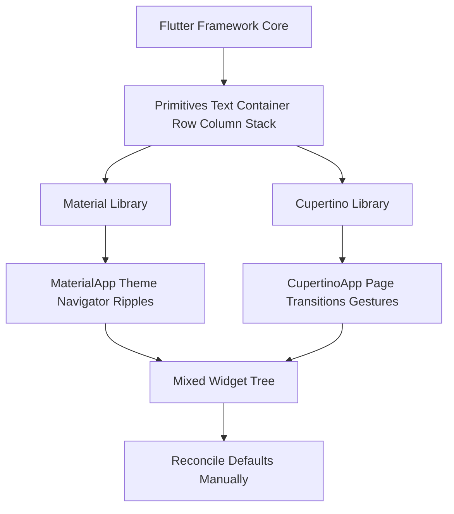

# Where Flutter's Widgets Come From: The Material and Cupertino Design Libraries

## English

Flutter itself ships almost no visual widgets. The framework core gives you fundamentals like Text, Container, Row, Column, and Stack — primitives with no opinion about how a button should look. Everything that actually looks like an app comes from two separate design-language packages that live in the same repository: Material (Google's design system, imported as package:flutter/material.dart) and Cupertino (Apple's iOS-flavoured widgets, imported as package:flutter/cupertino.dart). When you write ElevatedButton, you are not using "Flutter the engine" — you are using a specific design system's opinionated component that happens to be written in Dart on top of the same primitives.

This split matters because it explains a subtle source of confusion. A MaterialApp is not just "an app"; it is a widget that installs a Theme, a Navigator, a Directionality, a MediaQuery, and a default text style for its subtree. If you build a CupertinoApp instead, you get a different bundle of inherited widgets and different default page transitions. Mixing them is legal — you can use a CupertinoSwitch inside a Material Scaffold — but the defaults (ripples, scroll physics, back-button gestures, fonts) will not always agree, and you have to reconcile them yourself.

Because these libraries are ordinary Dart packages, they are also forkable and replaceable. Flutter's own repository keeps Material and Cupertino under packages/flutter/lib/src/, so the source of a widget like Slider is readable and debuggable like any other code — you can step into it in DevTools. Third parties have built alternatives (Fluent UI for Windows-style apps, for instance) that plug into the same widget and theme machinery without touching the engine. The design system is a layer, not a law.

A practical consequence: when a Material widget misbehaves, the fix is often to understand what inherited widget it depends on. A ButtonStyle does not resolve from thin air — it merges with Theme.of(context) and any ButtonTheme or Theme extension above it. Knowing that Material is just a package of widgets and inherited data turns "why does my button look wrong" into a tractable question about which ancestor is providing the style, rather than a mystery about the framework.

So the mental model is: the engine paints, the framework lays out, and a design library decides what a checkbox should look like. Keeping those three layers separate in your head makes it obvious why you can build a beautiful app with zero Material widgets, why a Cupertino app on Android still works, and why importing material.dart pulls in a whole design vocabulary you may or may not want.

## 中文

Flutter 本身幾乎不提供視覺化的 widget。框架核心給你的是 Text、Container、Row、Column、Stack 這類基礎原語——它們對「按鈕應該長什麼樣」完全沒有意見。真正看起來像應用程式的東西，全部來自同一份原始碼庫裡兩個獨立的設計語言套件：Material（Google 的設計系統，以 package:flutter/material.dart 匯入）與 Cupertino（Apple iOS 風格的 widget，以 package:flutter/cupertino.dart 匯入）。當你寫 ElevatedButton 時，你用的並不是「Flutter 引擎」，而是某個設計系統對元件的既定主張，而它剛好是用 Dart 寫在同樣的原語之上。

這個分界很重要，因為它解釋了一個常見的困惑來源。MaterialApp 不只是「一個應用程式」，它是一個會為其子樹安裝 Theme、Navigator、Directionality、MediaQuery 與預設文字樣式的 widget。如果你改用 CupertinoApp，你會得到另一組 inherited widget 與不同的預設頁面轉場。混用是合法的——你可以在 Material 的 Scaffold 裡放 CupertinoSwitch——但預設行為（漣漪效果、滾動物理、返回手勢、字型）不一定一致，你得自己協調。

因為這些函式庫就是普通的 Dart 套件，它們也可以被分支、被替換。Flutter 自己的原始碼庫把 Material 與 Cupertino 放在 packages/flutter/lib/src/ 之下，所以像 Slider 這種 widget 的原始碼是可以閱讀、可以在 DevTools 裡單步追進去的。第三方也做過替代品（例如給 Windows 風格應用程式用的 Fluent UI），它們接上同一套 widget 與主題機制，完全不必動到引擎。設計系統是一層，不是法律。

一個實務上的後果：當某個 Material widget 行為怪異時，解法往往是搞清楚它依賴哪個 inherited widget。ButtonStyle 不會憑空出現——它會與上層的 Theme.of(context) 以及任何 ButtonTheme 或 Theme extension 合併。明白 Material 只是一包 widget 加 inherited 資料，就能把「我的按鈕為什麼長這樣」從玄學問題，變成「哪個祖先在提供樣式」這種可追查的問題。

所以心智模型是：引擎負責繪製，框架負責佈局，設計函式庫決定核取方塊該長什麼樣。把這三層分清楚，你就能理解：為什麼你可以完全不用 Material widget 也做出漂亮的應用程式、為什麼 Cupertino 應用程式在 Android 上仍能運作，以及為什麼匯入 material.dart 會帶進一整套設計語彙——不管你需不需要。

## Key Takeaway

Flutter's core is design-agnostic; Material and Cupertino are ordinary Dart packages layered on top, which is why you can swap, fork, or ignore them.

## Related Concepts
- MaterialApp and Theme inheritance
- Cupertino widgets and platform-adaptive UI

## Diagram

