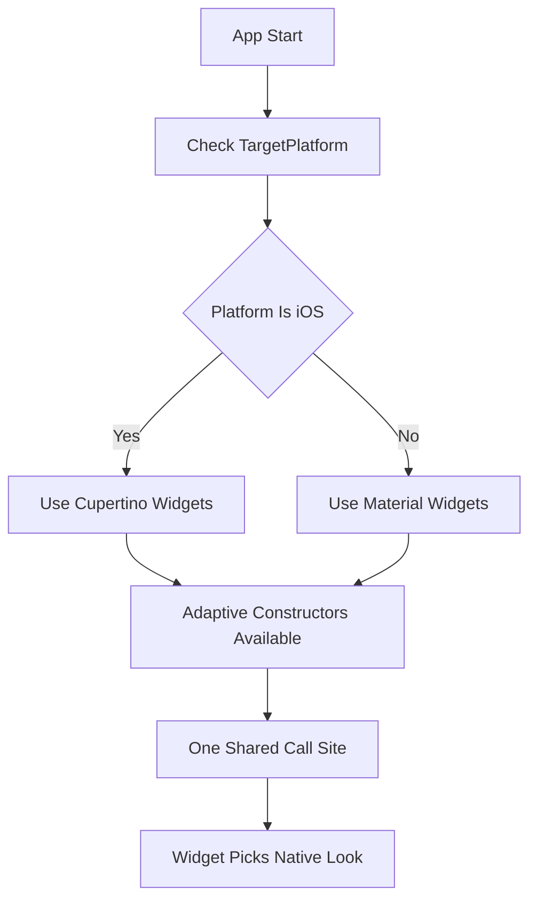

# Adaptive Versus Adaptive-Looking: Choosing Widgets at Runtime

## English

Flutter's promise of one codebase for four platforms hides a design decision every team must make: does the app look the same everywhere, or does it look native on each platform? These are two different strategies. A "unified" app uses Material widgets on iOS, Android, web, and desktop alike — think of many Google apps. An "adaptive" app inspects the platform at runtime and swaps in Cupertino widgets on iOS, Material on Android, and perhaps a desktop-flavoured layout on macOS and Windows. Neither is correct in the abstract; the choice affects testing, design review, and how much code you maintain.

Adaptive code usually starts with a check of the platform. The classic idiom is defaultTargetPlatform from package:flutter/foundation.dart, which returns a TargetPlatform enum (android, iOS, macOS, windows, linux, fuchsia). You compare against it and branch. Note that this is compile-time-ish information about the operating system, not the screen size — for layout decisions you use MediaQuery or LayoutBuilder instead. Mixing the two concepts ("is this iOS?" versus "is this a phone?") is a common bug: an iPad in landscape and a Mac window can be similar widths but want different widgets.

Many Material widgets already adapt a little. Scroll physics differ (bouncing on iOS, clamping on Android), page transitions differ, and widgets like Switch.adaptive, Slider.adaptive, and showAdaptiveDialog exist precisely to pick the right look without you writing the branch. These constructors are the cheapest form of adaptivity: you keep one call site, and the widget consults the platform itself. For anything without an .adaptive variant, you write a small factory function that returns either the Material or Cupertino widget, and keep it in one place so the branching is not scattered across screens.

The cost of adaptivity is real. Every branch is a code path that needs testing on a device or simulator of that platform, and widget tests can only exercise the branch you force by overriding the platform (debugDefaultTargetPlatformOverride is the usual tool). Design review doubles because two visual languages must both be signed off. Teams often start unified and add adaptivity only where users notice — the back-swipe gesture, the date picker, the text selection handles — rather than adapting every single control.

A useful rule of thumb: adapt the things users have muscle memory for (navigation gestures, pickers, context menus, switches) and unify the things that define your brand (colours, typography, spacing, illustration). That gets you most of the "feels native" benefit at a fraction of the maintenance cost, and it keeps your widget tree readable because the branches live in small, named helper widgets rather than inline ternaries.

## 中文

Flutter 承諾一份程式碼跑四個平台，但這掩蓋了每個團隊都必須做的設計抉擇：應用程式要在每個平台長得一樣，還是要在各平台上看起來原生？這是兩種不同策略。「統一」風格的應用程式在 iOS、Android、網頁與桌面上一律使用 Material widget——很多 Google 自家應用程式就是這樣。「適應式」應用程式則在執行時檢查平台，在 iOS 換上 Cupertino widget、在 Android 用 Material、在 macOS 與 Windows 也許用桌面風格的佈局。抽象地說，兩者都無對錯；這個選擇會影響測試、設計審查，以及你要維護多少程式碼。

適應式程式碼通常從檢查平台開始。經典寫法是 package:flutter/foundation.dart 裡的 defaultTargetPlatform，它回傳 TargetPlatform 列舉（android、iOS、macOS、windows、linux、fuchsia）。你拿它來比對並分支。要注意這是關於作業系統的資訊，不是螢幕尺寸——要做佈局決策時，你用的是 MediaQuery 或 LayoutBuilder。把這兩個概念混在一起（「這是 iOS 嗎？」對比「這是手機嗎？」）是常見的 bug：橫向的 iPad 與一個 Mac 視窗寬度可能相近，但想要的 widget 不同。

很多 Material widget 本身已經會做一點適應。滾動物理不同（iOS 會回彈，Android 會夾住）、頁面轉場不同，而 Switch.adaptive、Slider.adaptive、showAdaptiveDialog 這些東西存在的目的，就是讓你不用自己寫分支就能選對外觀。這些建構子是最便宜的適應方式：呼叫點只有一個，widget 自己查詢平台。對於沒有 .adaptive 變體的元件，你寫一個小工廠函式回傳 Material 或 Cupertino widget，並把它集中在一處，避免分支散落在各個畫面。

適應的代價是真實的。每個分支都是一條得在該平台裝置或模擬器上測試的程式碼路徑，而 widget 測試只能測到你強制覆寫平台後的那一條（常用工具是 debugDefaultTargetPlatformOverride）。設計審查也加倍，因為兩套視覺語言都要過關。團隊通常先做統一風格，只在使用者會注意到的地方加適應——返回滑動手勢、日期選擇器、文字選取控點——而不是把每一個控制項都改一遍。

一個實用的經驗法則：使用者有肌肉記憶的東西要適應（導覽手勢、選擇器、右鍵選單、開關），定義你品牌調性的東西要統一（色彩、字體、間距、插畫）。這樣能用一小部分維護成本換到大部分「感覺很原生」的好處，而且 widget 樹仍然易讀，因為分支都放在小小的、有名字的輔助 widget 裡，而不是行內三元運算式。

## Key Takeaway

Adaptive design is a strategy, not a switch: use .adaptive constructors and small platform-branching factories for muscle-memory controls, and unify the parts that carry your brand.

## Related Concepts
- defaultTargetPlatform and TargetPlatform
- LayoutBuilder and MediaQuery

## Diagram

