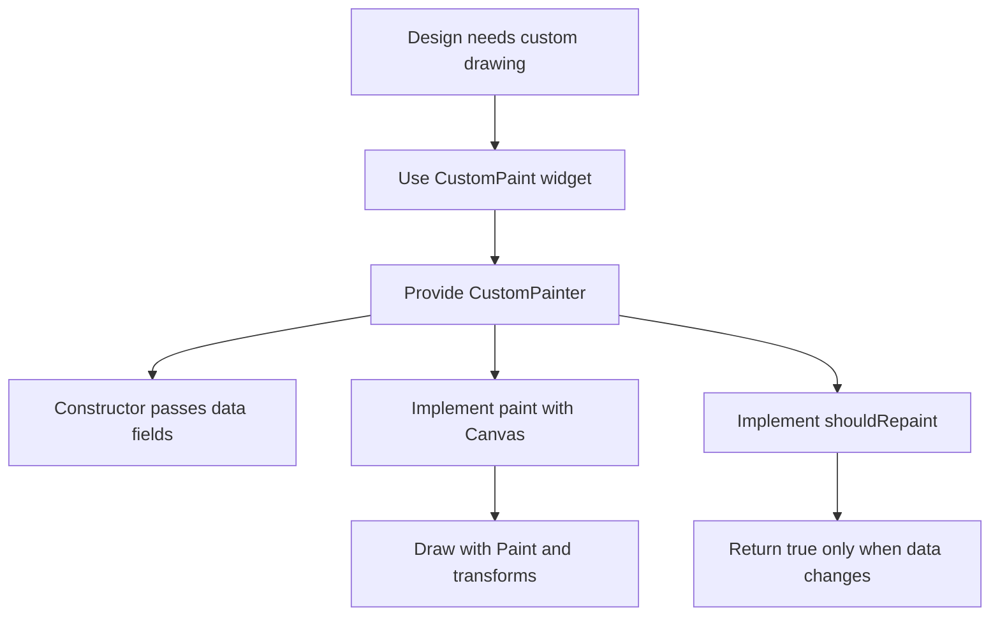

# CustomPaint, Shaders, and Drawing Your Own Pixels

## English

Sooner or later a design calls for something no widget provides: a chart with a custom axis, a progress ring with a gradient sweep, a signature pad, a particle effect. Flutter's answer is CustomPaint, a widget that hands you a Canvas and asks you to draw. The Canvas API is deliberately close to the HTML5 canvas and Skia's model: moveTo, lineTo, drawCircle, drawPath, drawImage, save/restore for transforms, and Paint objects that carry colour, stroke width, blending mode, and antialiasing. You are not fighting the framework here — you are using the same drawing surface the framework's own widgets use.

A CustomPaint takes a painter (and optionally a foregroundPainter). The painter is a class extending CustomPainter with a paint(Canvas, Size) method and a shouldRepaint(oldDelegate) method. shouldRepaint is the performance contract: return true only when the inputs that affect the drawing have changed. Returning true unconditionally means every rebuild repaints your canvas; returning false when data did change leaves stale pixels on screen. The painter should be a pure function of its fields, with the data passed in through the constructor, so shouldRepaint can compare them cheaply.

Sizing deserves care. CustomPaint has a size property, but if it is placed inside a parent that imposes tight constraints, the parent wins — remember that constraints go down and sizes go up. The common pattern is to wrap it in a SizedBox or an AspectRatio, or to let it fill available space and read the actual size from the Size argument inside paint(). Inside paint you should also account for device pixel ratio implicitly by working in logical pixels; the engine handles the scaling to physical pixels.

For anything animated or expensive, reach for a fragment shader instead of repainting Dart code every frame. Flutter supports GLSL fragment shaders declared in pubspec.yaml under the shaders section and loaded with FragmentProgram.fromAsset, then applied through Paint.shader. This runs on the GPU, which is the right tool for gradients with noise, fluid effects, or per-pixel math. Impeller, Flutter's newer renderer, handles shaders differently from the older Skia path, so test on real devices and check the current documentation for supported shader features rather than assuming desktop behaviour matches mobile.

Finally, remember that CustomPaint participates in the normal widget tree: it can be wrapped in GestureDetector for hit testing, animated with an AnimationController passed into the painter, and tested with golden tests that compare rendered images. The painter is also a good place to keep logic out of the widget layer — a chart painter that takes a list of data points and a scale is far easier to unit-test than a chart assembled from dozens of Positioned widgets.

## 中文

遲早會有一個設計需求是任何現成 widget 都做不到的：帶自訂座標軸的圖表、有漸層掃描的進度環、簽名板、粒子效果。Flutter 的答案是 CustomPaint——一個把 Canvas 交給你、要你自己畫的 widget。Canvas API 刻意貼近 HTML5 canvas 與 Skia 的模型：moveTo、lineTo、drawCircle、drawPath、drawImage、用 save/restore 做變換，以及帶著顏色、線寬、混合模式與反鋸齒設定的 Paint 物件。你在這裡並不是在跟框架對抗——你用的正是框架自身 widget 所用的同一塊繪圖表面。

CustomPaint 接收一個 painter（可選一個 foregroundPainter）。painter 是繼承 CustomPainter 的類別，要有 paint(Canvas, Size) 方法與 shouldRepaint(oldDelegate) 方法。shouldRepaint 是效能契約：只有在影響繪製的輸入改變時才回傳 true。無條件回傳 true 代表每次重建都會重繪畫布；資料真的變了卻回傳 false，畫面上就會留下過期的像素。painter 應該是自身欄位的純函式，資料透過建構子傳入，這樣 shouldRepaint 才能便宜地比對。

尺寸要特別小心。CustomPaint 有 size 屬性，但如果它被放在施加緊縮限制的父層裡，父層說了算——記得限制往下傳、尺寸往上報。常見做法是外面包一層 SizedBox 或 AspectRatio，或讓它填滿可用空間，並在 paint() 內從 Size 參數讀取實際尺寸。在 paint 內你應該以邏輯像素工作，引擎會處理到實體像素的縮放，裝置像素比不必自己乘。

對於任何會動或很貴的東西，改用 fragment shader，而不是每一幀都用 Dart 程式碼重繪。Flutter 支援在 pubspec.yaml 的 shaders 區段宣告 GLSL fragment shader，用 FragmentProgram.fromAsset 載入，再透過 Paint.shader 套用。這是在 GPU 上執行，適合帶雜訊的漸層、流體效果或逐像素運算。Impeller（Flutter 較新的渲染器）處理 shader 的方式與舊的 Skia 路徑不同，所以要在真實裝置上測試，並查閱當前文件確認支援的 shader 功能，不要假設桌面行為與行動端一致。

最後，記住 CustomPaint 參與正常的 widget 樹：它可以被 GestureDetector 包住以做命中測試、可以用傳進 painter 的 AnimationController 做動畫，也可以用 golden test 比對渲染影像來測試。painter 也是把邏輯抽離 widget 層的好地方——一個接收資料點清單與比例尺的圖表 painter，遠比用幾十個 Positioned widget 拼出來的圖表容易做單元測試。

## Key Takeaway

CustomPaint gives you the same Canvas the framework uses; keep painters pure, get shouldRepaint right, and move per-pixel work to fragment shaders when performance matters.

## Related Concepts
- CustomPainter and shouldRepaint
- Fragment shaders and Impeller

## Diagram

