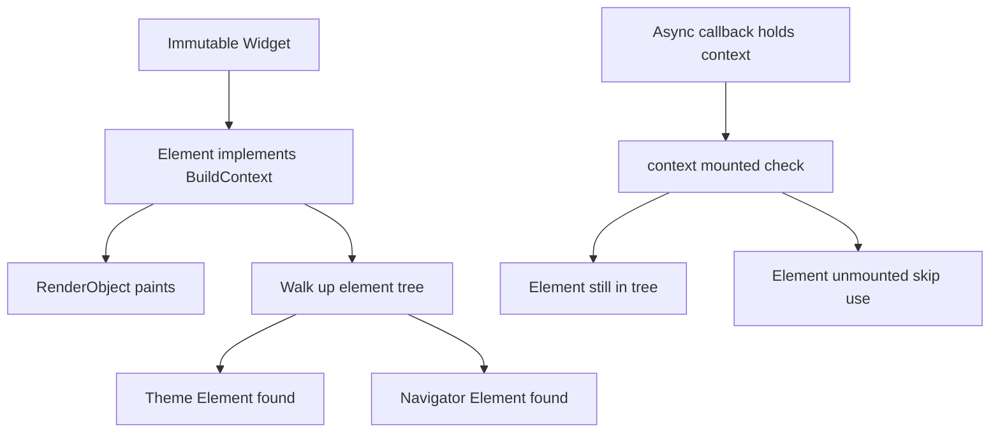

# The BuildContext Contract: What a Context Really Points At

## English

Most Flutter tutorials say a BuildContext is 'a handle to the widget's location in the tree,' which is technically true but hides the interesting part. In the framework's source, BuildContext is an abstract class, and the only class that implements it is Element. So when you receive a BuildContext inside a build method, you are literally holding the Element that is currently rebuilding — the long-lived object that sits between your immutable Widget description and the RenderObject that paints. That is why context outlives the widget it came from: the widget is thrown away and rebuilt constantly, but the Element persists and is reused.

This identity explains the rules you keep bumping into. Calling Theme.of(context) works because it walks up the element tree looking for the nearest ancestor Element whose widget is a Theme, then reads data from that element's widget. Calling Navigator.of(context) does the same with an InheritedWidget that exposes the navigator state. If you capture a context in an async callback and use it after an await, you may be holding an Element that has been deactivated or unmounted, which is why the analyzer warns about use_build_context_synchronously and why the idiom `if (!context.mounted) return;` exists — mounted on a BuildContext just asks whether that Element is still in the tree.

A concrete failure case: you open a dialog, await its result, then try to show a SnackBar with the same context. If the user navigated away while the dialog was open, the widget that owned that context is gone, and ScaffoldMessenger.of(context) may throw or attach to the wrong scaffold. The fix is either to capture the messenger before the await (`final messenger = ScaffoldMessenger.of(context);`) or to guard with context.mounted.

Because context is an Element, the position in the tree is the whole point. Two widgets with identical configuration but different parents get different contexts, and thus resolve different themes, different MediaQuery data, and different navigators. This is also why GlobalKey exists: it lets you keep a stable reference to an Element across reparenting, which is the only way to move a widget to a different part of the tree while preserving its State.

A useful mental model: Widgets are cheap blueprints, Elements are the standing structures, and RenderObjects are the machinery inside. A BuildContext is a badge that says 'I am this particular structure, and I can look up and down from here.' Once you internalise that, dependency lookups, the `of(context)` pattern, and the async-context warnings all stop feeling like arbitrary rules.

## 中文

大部分 Flutter 教學都會說 BuildContext 是「widget 在樹中位置的把手」，這句技術上沒錯，但掩蓋了最有趣的部分。在框架原始碼裡，BuildContext 是一個抽象類別，而唯一實作它的類別就是 Element。所以當你在 build 方法內收到一個 BuildContext，你手上拿到的其實就是正在重建的那個 Element——那個夾在不可變的 Widget 描述與負責繪製的 RenderObject 之間、壽命很長的物件。這正是為何 context 比它來自的 widget 活得更久：widget 不斷被丟棄重建，但 Element 會持續存在並被重用。

這個身分解釋了你老是撞到的那些規則。Theme.of(context) 之所以可行，是因為它沿著 element 樹往上找最近的、widget 是 Theme 的祖先 Element，再從那個 element 的 widget 讀取資料。Navigator.of(context) 也一樣，只是找的是暴露 navigator 狀態的 InheritedWidget。如果你在非同步回呼裡捕獲 context，並在 await 之後才使用，你可能正握著一個已被停用或卸載的 Element，這就是分析器會警告 use_build_context_synchronously、以及為何會有 `if (!context.mounted) return;` 這個慣用寫法的原因——BuildContext 上的 mounted 只是在問那個 Element 是否還在樹中。

一個具體的失敗案例：你開啟對話框、await 它的結果，然後想用同一個 context 顯示 SnackBar。若使用者在對話框開著時已導航離開，擁有該 context 的 widget 已經消失，ScaffoldMessenger.of(context) 可能拋錯或掛到錯的 scaffold 上。解法有兩個：在 await 之前先捕獲 messenger（`final messenger = ScaffoldMessenger.of(context);`），或用 context.mounted 做守衛。

因為 context 就是 Element，它在樹中的位置就是一切。兩個設定完全相同但父層不同的 widget 會拿到不同的 context，因而解析出不同的 theme、不同的 MediaQuery 資料、不同的 navigator。這也是 GlobalKey 存在的原因：它讓你能在重新掛載時保持對某個 Element 的穩定引用，這是把 widget 搬到樹的另一處卻保留其 State 的唯一辦法。

一個好用的心智模型：Widget 是便宜藍圖，Element 是實際站立的結構，RenderObject 是裡面的機械。BuildContext 就像一張識別證，寫著「我是這個特定結構，我可以從這裡往上往下查資料」。一旦內化這點，依賴查找、`of(context)` 模式，以及非同步 context 的警告，就都不再像任意的規矩了。

## Key Takeaway

A BuildContext is really an Element, so its lifetime, its tree position, and its async-safety rules all follow from that identity.

## Related Concepts
- The Element Tree
- InheritedWidget dependency lookup

## Diagram

