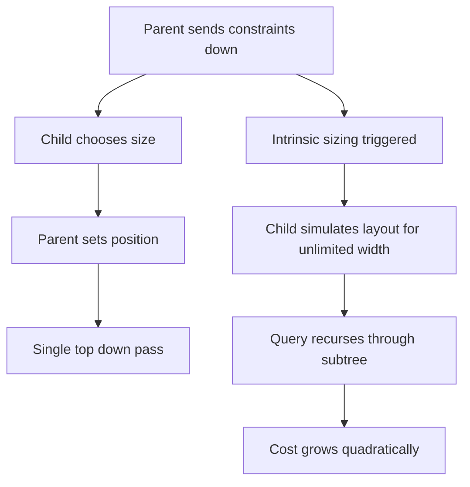

# Constraints, Intrinsic Sizing, and the Expensive Widgets You Should Avoid

## English

Flutter's layout protocol is one sentence: constraints go down, sizes go up, parents set position. But there is a second, much costlier protocol hiding behind it — intrinsic sizing — and knowing when it triggers explains some of the worst performance cliffs in real apps. Normally a parent tells a child 'you may be between 0 and 400 pixels wide,' the child picks a size, and the parent positions it. That is one top-down pass. Intrinsic sizing asks the opposite question: 'child, if I gave you unlimited width, how tall would you want to be?' Answering that requires the child to simulate a layout, which can cascade into its own subtree.

Widgets like IntrinsicHeight, IntrinsicWidth, and Table trigger this. A classic case is a Row of two cards you want to be equal height: wrapping the Row in IntrinsicHeight makes Flutter ask each card for its intrinsic height, then re-lay-out both at the maximum. It works, but each query may recurse through the entire subtree, so the cost can be roughly quadratic in tree depth. On a static settings screen that is fine; inside a scrolling list of hundreds of rows it can drop frames.

Text is another place this shows up. A Text widget with softWrap needs to know its width before it can compute its height, because line breaking changes the number of lines. That is why a Text inside an unconstrained horizontal Row can throw the infamous 'RenderFlex children have non-zero flex but incoming width constraints are unbounded' error, and why wrapping text in Flexible or Expanded — which passes a bounded width — fixes it. The error is the layout protocol telling you that the parent could not supply a width, so the child cannot answer.

AspectRatio and FractionallySizedBox are cheap because they derive one dimension from the other using the incoming constraints, with no simulation. Expanded and Flexible are cheap because they only redistribute the parent's finite space. The expensive ones are the ones that ask children to measure themselves in the abstract: intrinsics, and to a lesser extent widgets that must lay out children twice. When you profile with DevTools and see a long 'layout' bar that dwarfs 'build' and 'paint', this family of widgets is a prime suspect.

Practical guidance: prefer fixed or ratio-based sizing where the design allows it; use Expanded and Flexible to share space rather than intrinsic measurement; if you truly need equal-height siblings, consider a custom RenderObject or a layout that derives the height once at the parent level. And when a layout error appears, read it as a conversation: the parent said 'here are your constraints,' the child said 'I cannot answer without a width,' and the fix is to make the parent's constraints definite.

## 中文

Flutter 的佈局協定只有一句話：約束往下傳、尺寸往上報、父層決定位置。但在它背後還藏著一套昂貴得多的協定——內在尺寸（intrinsic sizing）——知道它何時被觸發，就能解釋真實應用中一些最嚴重的效能懸崖。正常情況下，父層告訴子層「你的寬度可以介於 0 到 400 像素之間」，子層選一個尺寸，父層再定位它。這是一趟由上而下的流程。內在尺寸問的卻是相反的問題：「子層啊，如果我給你無限寬，你會想多高？」要回答這題，子層得模擬一次佈局，而這可能一路遞迴到它自己的子樹。

IntrinsicHeight、IntrinsicWidth 和 Table 這類 widget 就會觸發它。經典案例是一列兩張卡片、你想讓它們等高：把 Row 包進 IntrinsicHeight，Flutter 就會問每張卡片的內在高度，再用最大值重新佈局兩者。它能用，但每次查詢都可能遞迴整個子樹，成本大約與樹深成平方關係。在靜態設定頁面沒問題；放在數百列的滾動清單裡就可能掉幀。

文字是另一個會出現這情況的地方。啟用 softWrap 的 Text 必須先知道寬度才能算出高度，因為換行會改變行數。這就是為何放在沒有寬度約束的水平 Row 裡的 Text 會拋出那句惡名昭彰的「RenderFlex children have non-zero flex but incoming width constraints are unbounded」，也是為何把文字包進 Flexible 或 Expanded（它們會傳入有界寬度）就能修好。這個錯誤其實是佈局協定在告訴你：父層給不出寬度，子層就答不出來。

AspectRatio 和 FractionallySizedBox 很便宜，因為它們用傳入的約束從一個維度推導另一個維度，不需模擬。Expanded 和 Flexible 也很便宜，因為它們只是重新分配父層有限的空間。昂貴的是那些要求子層抽象地自我測量的 widget：內在尺寸，以及程度較輕的、必須佈局子層兩次的 widget。當你用 DevTools 分析、看到「layout」那一條遠長於「build」和「paint」時，這一類 widget 就是頭號嫌疑犯。

實務建議：設計允許時優先用固定或比例尺寸；用 Expanded 和 Flexible 分享空間，而不是靠內在測量；若真的需要等高的兄弟節點，可考慮自訂 RenderObject，或在父層一次推導出高度。而當佈局錯誤出現時，把它讀成一場對話：父層說「這是你的約束」，子層說「沒有寬度我答不出來」，解法就是讓父層的約束變得明確。

## Key Takeaway

Intrinsic sizing forces extra layout passes that can recurse through the subtree, so reach for Expanded, AspectRatio, or parent-level derivation before IntrinsicHeight.

## Related Concepts
- BoxConstraints
- RenderObject layout protocol

## Diagram

