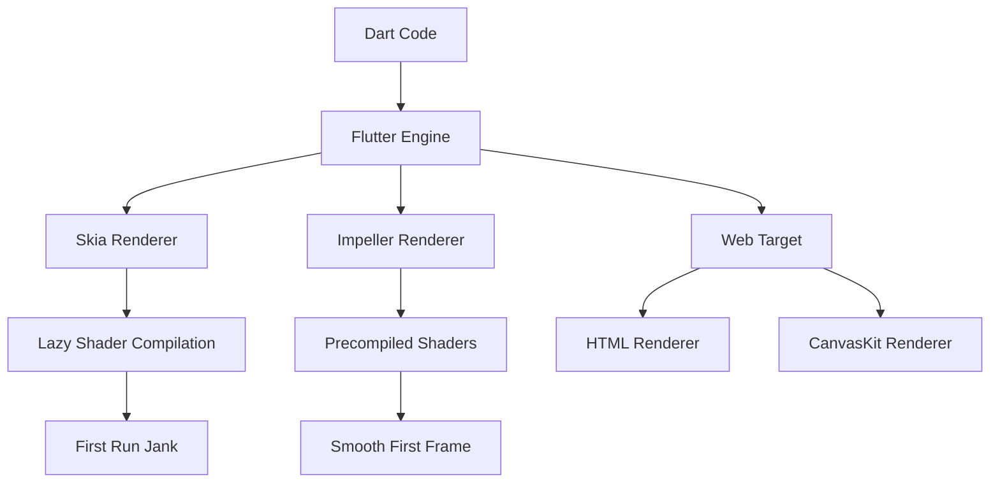

# Rendering Backends Compared: Skia, Impeller, and the Web Target

## English

Flutter does not use the platform's buttons, text fields, or scroll views. It draws every pixel itself, which is what makes the same Dart code look identical on iOS, Android, and desktop. The thing doing the drawing is the Flutter engine, and the engine's renderer has changed over time in ways worth understanding. Historically the engine used Skia, a mature 2D graphics library also used by Chrome, to rasterise a display list of drawing commands into pixels. Skia is fast, but it compiles shaders lazily, and on mobile that lazy compilation can cause the notorious 'first-run jank' — an animation stutters the first time it plays because the GPU shader was compiled just then.

Impeller is Flutter's newer renderer, designed to fix that class of problem. Instead of relying on runtime shader compilation, Impeller precompiles its shaders ahead of time and is built around modern graphics APIs (Metal on iOS, Vulkan on Android, with OpenGL fallbacks). The practical effect is that animations should be smooth on the first frame, not just the second time you see them. Impeller became the default on iOS some releases ago and has been rolling out on Android; the exact default depends on your Flutter version, so check the release notes rather than assuming.

On the web, the story is different again. Flutter compiles Dart to JavaScript (or WebAssembly in newer work) and renders using one of two strategies: an HTML/CSS renderer that leans on the browser's own layout and text, and a CanvasKit renderer that ships Skia compiled to WebAssembly and draws into a canvas. The trade-off is fidelity versus download size and startup time — CanvasKit gives pixel-identical rendering to mobile but costs a larger initial payload, while the HTML renderer starts faster but can differ subtly in text and layout. Which is the default has shifted between versions.

Why does this matter to you as a developer? Because renderer differences explain bugs that look impossible. A custom shader that works on iOS but not Android may be hitting a different backend. A blur or shadow that looks slightly different on web may be a CanvasKit-versus-HTML artefact. Text metrics can differ by a pixel or two across platforms because font loading and shaping go through different paths. Knowing which renderer you are on narrows the search enormously.

A useful analogy: Flutter is a game engine for apps. The widget and render layers are your game logic, and the renderer is the graphics driver underneath. You mostly do not think about the driver, but when a shadow flickers or a shader misbehaves, the driver is exactly where you look. Checking `flutter doctor -v` and the platform you are running on tells you which backend is in play, and that is often the first question to answer when a visual bug only reproduces on one platform.

## 中文

Flutter 不使用平台本身的按鈕、文字框或滾動視圖。它自己繪製每一個像素，這正是同一份 Dart 程式碼在 iOS、Android 和桌面上看起來一模一樣的原因。負責繪製的是 Flutter 引擎，而引擎的渲染器這些年有值得理解的演變。歷史上引擎使用 Skia，一個成熟的 2D 圖形庫（Chrome 也用過），把一串繪製指令的光柵化成像素。Skia 很快，但它會延遲編譯著色器，而在手機上這種延遲編譯會造成惡名昭彰的「首次執行動畫卡頓」——動畫第一次播放時會頓，因為 GPU 著色器是那一刻才編譯的。

Impeller 是 Flutter 較新的渲染器，正是為了修正這類問題而設計。它不依賴執行期編譯著色器，而是預先編譯，並圍繞現代圖形 API 建構（iOS 用 Metal、Android 用 Vulkan，並有 OpenGL 後備）。實際效果是動畫在第一幀就該順暢，而不是第二次看到時才順。Impeller 在幾個版本前已成為 iOS 的預設，並逐步在 Android 推出；確切的預設值取決於你的 Flutter 版本，所以請查發行說明，不要憑假設。

在 Web 上又是另一回事。Flutter 把 Dart 編譯成 JavaScript（較新的工作也支援 WebAssembly），並用兩種策略之一來渲染：一種是倚賴瀏覽器自身佈局與文字的 HTML/CSS 渲染器，另一種是把 Skia 編譯成 WebAssembly、畫進 canvas 的 CanvasKit 渲染器。取捨在於保真度對上下載大小與啟動時間——CanvasKit 能給出與手機像素一致的渲染，但初始載荷較大；HTML 渲染器啟動較快，但文字與佈局可能有細微差異。哪個是預設值在版本之間有變動。

為何這對開發者重要？因為渲染器差異能解釋看似不可能的 bug。一個在 iOS 可用、Android 卻不行的自訂著色器，可能撞上了不同的後端。在 Web 上看起來略有不同的模糊或陰影，可能是 CanvasKit 對 HTML 的產物。文字度量在不同平台間可能差一兩個像素，因為字型載入與字形排版走的是不同路徑。知道你身處哪個渲染器，能把搜尋範圍大幅縮小。

一個好用的比喻：Flutter 是應用程式的遊戲引擎。widget 與 render 層是你的遊戲邏輯，渲染器是底下的顯示驅動。你大多時候不用想驅動，但當陰影閃爍或著色器出錯時，驅動正是你要看的地方。執行 `flutter doctor -v` 以及你所在的平台，能告訴你正用哪個後端，而這往往是視覺 bug 只在單一平台重現時要回答的第一個問題。

## Key Takeaway

Flutter draws everything itself, so knowing whether you are on Skia, Impeller, CanvasKit, or the HTML renderer is often the fastest route to diagnosing platform-specific visual bugs.

## Related Concepts
- Impeller
- CanvasKit and the web renderer

## Diagram

