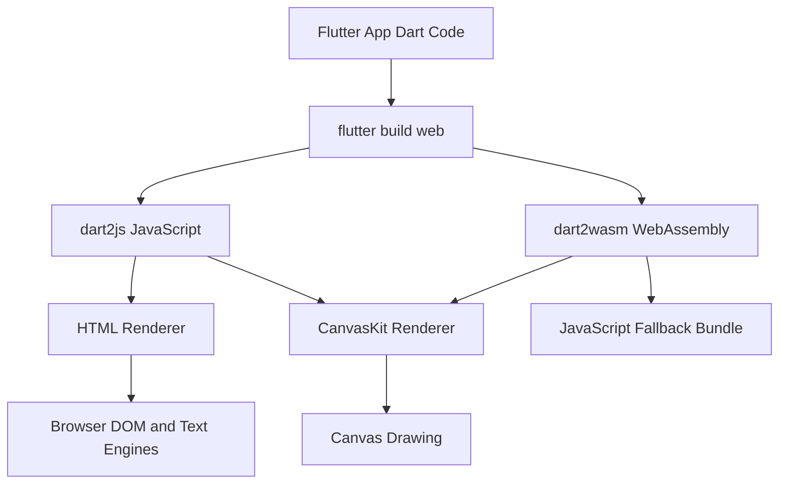

# Flutter Web: How the Same App Compiles to JavaScript or WASM

## English

When you run `flutter build web`, Flutter does not ship the engine you get on mobile. On Android and iOS the engine is a compiled native binary; on the web the engine itself is Dart code that must be compiled to something a browser can run, and that "something" has changed over time. Historically Flutter web compiled the framework and your app to JavaScript with the dart2js compiler, and rendered through the HTML/CSS/DOM or through CanvasKit, a WebAssembly build of Skia. The renderer choice matters: the HTML renderer leans on the browser's own layout and text engines, which keeps download size small and text crisp, but cannot faithfully reproduce every painting primitive. CanvasKit downloads a larger WASM binary and draws into a canvas, giving pixel-identical results to mobile at the cost of startup weight.

Newer Flutter releases have pushed toward WebAssembly as the primary compilation target via the `dart2wasm` toolchain, with a fallback to JavaScript for browsers that lack the required features. This is not a trivial swap: WebAssembly needs garbage collection support in the browser (the WasmGC proposal) and Flutter ships a JS fallback bundle alongside the Wasm one so older browsers still load something. The build output therefore contains multiple artifacts and a small loader that picks the right one at runtime.

A practical consequence is that web behaviour diverges from mobile in ways you must plan for. There is no `dart:io`, so file access, sockets, and many plugins simply do not exist on web; plugins declare which platforms they support in their pubspec, and calling an unsupported one throws at runtime or fails to compile. Scrolling and text selection follow browser conventions, and the `PointerEvent` model differs because a mouse has hover and a finger does not.

Performance profiling also changes shape. On mobile you profile with DevTools against a Dart VM; on web you profile with Chrome DevTools, and the Dart code you see may be minified or mapped through source maps. Frame timing is governed by the browser's rendering pipeline, so a janky animation might be caused by layout thrash in the host page rather than by your widget code.

For a student, the useful mental model is: Flutter web is Flutter, but the engine is a passenger in someone else's vehicle. You control the widgets; the browser controls scheduling, fonts, input, and the network stack. Design for graceful degradation — feature-detect, avoid assuming `dart:io`, and test on a real browser, not just the desktop emulator.

## 中文

當你執行 `flutter build web` 時，Flutter 出貨的引擎與手機版並不相同。在 Android 與 iOS 上，引擎是一份已編譯的原生二進位檔；在網頁上，引擎本身是 Dart 程式碼，必須編譯成瀏覽器能執行的東西，而這個「東西」隨時間演變。歷史上，Flutter web 用 dart2js 編譯器把框架與你的 app 編譯成 JavaScript，並透過 HTML/CSS/DOM 或 CanvasKit（Skia 的 WebAssembly 版本）來繪製。渲染器的選擇很關鍵：HTML 渲染器倚賴瀏覽器自身的排版與文字引擎，下載體積小、文字銳利，但無法忠實重現每一個繪製原語；CanvasKit 則下載較大的 WASM 二進位檔並畫進 canvas，達到與手機畫素一致的結果，代價是啟動負擔。

較新的 Flutter 版本透過 `dart2wasm` 工具鏈，把 WebAssembly 推向主要編譯目標，並為不支援所需功能的瀏覽器保留 JavaScript 後備方案。這不是簡單的交換：WebAssembly 需要瀏覽器支援垃圾回收（WasmGC 提案），而 Flutter 會在 Wasm 版本旁一併附上 JS 後備包，讓舊瀏覽器仍能載入。因此建置產物包含多份 artifact，以及一個在執行時挑選正確版本的小型載入器。

實務上的後果是：網頁行為會以你必須預先規劃的方式與手機分歧。網頁沒有 `dart:io`，所以檔案存取、socket 與許多 plugin 在網頁上根本不存在；plugin 會在 pubspec 中宣告支援哪些平臺，呼叫不支援的會在執行時拋錯或編譯失敗。捲動與文字選取遵循瀏覽器慣例，`PointerEvent` 模型也不同，因為滑鼠有 hover 而手指沒有。

效能剖析的形態也改變。手機上你用 DevTools 對 Dart VM 做剖析；網頁上你用 Chrome DevTools，而看到的 Dart 程式碼可能已被壓縮，或需透過 source map 對應。影格時序由瀏覽器的渲染管線決定，所以卡頓的動畫可能肇因於宿主頁面的 layout thrash，而非你的 widget 程式碼。

對學生而言，有用的心智模型是：Flutter web 仍是 Flutter，但引擎是別人車上的乘客。你控制 widget；瀏覽器控制排程、字型、輸入與網路堆疊。要為優雅降級而設計——做功能偵測、避免假設有 `dart:io`，並在真實瀏覽器上測試，而不只是桌面模擬器。

## Key Takeaway

Flutter web recompiles the engine itself to JavaScript or WebAssembly and runs inside the browser's rules, so platform gaps and renderer choices are design constraints, not afterthoughts.

## Related Concepts
- dart2wasm and WasmGC
- CanvasKit renderer

## Diagram

