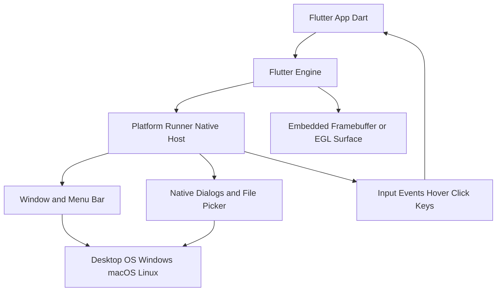

# Desktop and Embedded Targets: Window Management, Menus, and the Gaps

## English

Flutter's desktop targets — Windows, macOS, and Linux — run the same engine and framework as mobile, but the host environment is a full operating system with windows, menus, and a filesystem. The framework does not own the window; a thin platform runner does. When you create a desktop project, Flutter generates a small native host in C++ (Windows), Swift (macOS), or C++/GTK (Linux) that boots the engine, creates a window, and forwards events. This runner is where you set the initial window size, title, and native menu bar, usually by editing the generated source or using a community plugin.

The biggest conceptual shift is that desktop apps have multiple surfaces. A mobile app is one full-screen surface; a desktop app may have a menu bar, a system tray, draggable and resizable windows, and native dialogs like file pickers. Flutter exposes some of this through framework APIs and some through plugins. File selection, for example, goes through a plugin that calls the OS's native dialog — you cannot open a picker with pure Dart because the picker belongs to the platform.

Input handling also differs. Desktop users expect hover states, right-click context menus, keyboard shortcuts, and precise pointer movement. Flutter's `MouseRegion`, `Focus`/`Shortcuts`/`Actions`, and `GestureDetector` support these, but you must opt in. A tap on mobile is a click on desktop, but a hover is a new event category that many mobile-first designs ignore. Text selection, scrollbars, and cursor changes (the `SystemMouseCursors` set) are part of making an app feel native rather than like a blown-up phone screen.

Embedded targets — kiosks, automotive displays, single-board computers — push further. Here the window may not exist at all: the app draws directly to a framebuffer or an EGL surface. The engine supports these through embedder APIs, and the constraints are memory, GPU capability, and input devices that are not touchscreens. A common pattern is to disable animations that assume a compositor and to budget aggressively for RAM.

The takeaway for a student is that "cross-platform" is not "identical everywhere." Desktop and embedded are first-class targets with their own idioms, and the platform runner is the seam where Flutter meets the operating system. Understanding that seam — what the runner does and what the framework does — is what separates a port from a genuinely native-feeling app.

## 中文

Flutter 的桌面目標——Windows、macOS 與 Linux——執行與手機相同的引擎與框架，但宿主環境是具備視窗、選單與檔案系統的完整作業系統。框架並不擁有視窗；一個薄薄的平臺 runner 才擁有。當你建立桌面專案時，Flutter 會產生一個小型原生宿主，以 C++（Windows）、Swift（macOS）或 C++/GTK（Linux）撰寫，負責啟動引擎、建立視窗並轉發事件。這個 runner 就是你設定初始視窗大小、標題與原生選單列的地方，通常透過編輯產生的原始碼或使用社群 plugin。

概念上最大的轉變是桌面 app 有多個表面。手機 app 是單一全螢幕表面；桌面 app 可能有選單列、系統匣、可拖曳可縮放的視窗，以及檔案選擇器之類的原生對話方塊。Flutter 透過框架 API 與 plugin 分別暴露其中一部分。例如檔案選取要透過呼叫作業系統原生對話方塊的 plugin——你無法用純 Dart 開啟選擇器，因為選擇器屬於平臺。

輸入處理也不同。桌面使用者期待 hover 狀態、右鍵情境選單、鍵盤快捷鍵與精確的指標移動。Flutter 的 `MouseRegion`、`Focus`/`Shortcuts`/`Actions` 與 `GestureDetector` 支援這些，但你必須主動啟用。手機上的 tap 在桌面是 click，但 hover 是許多手機優先設計所忽略的新事件類別。文字選取、捲軸與遊標變化（`SystemMouseCursors` 集合）都是讓 app 感覺原生、而非像放大的手機畫面的要素。

嵌入式目標——kiosk、車用顯示、單板電腦——更進一步。這裡可能根本沒有視窗：app 直接繪製到 framebuffer 或 EGL 表面。引擎透過 embedder API 支援這些，限制在於記憶體、GPU 能力，以及並非觸控螢幕的輸入裝置。常見模式是關閉假設有合成器的動畫，並積極編列 RAM 預算。

對學生而言，結論是「跨平臺」不等於「處處相同」。桌面與嵌入式是有自身慣例的一等目標，而平臺 runner 是 Flutter 與作業系統相接的縫隙。理解這道縫隙——runner 做什麼、框架做什麼——正是移植與真正具原生感的 app 之間的差別。

## Key Takeaway

Desktop and embedded Flutter apps are hosted by a native runner that owns the window and OS integration, so native feel comes from opting into desktop idioms rather than from the framework alone.

## Related Concepts
- Platform runner and embedder
- MouseRegion and Shortcuts

## Diagram

