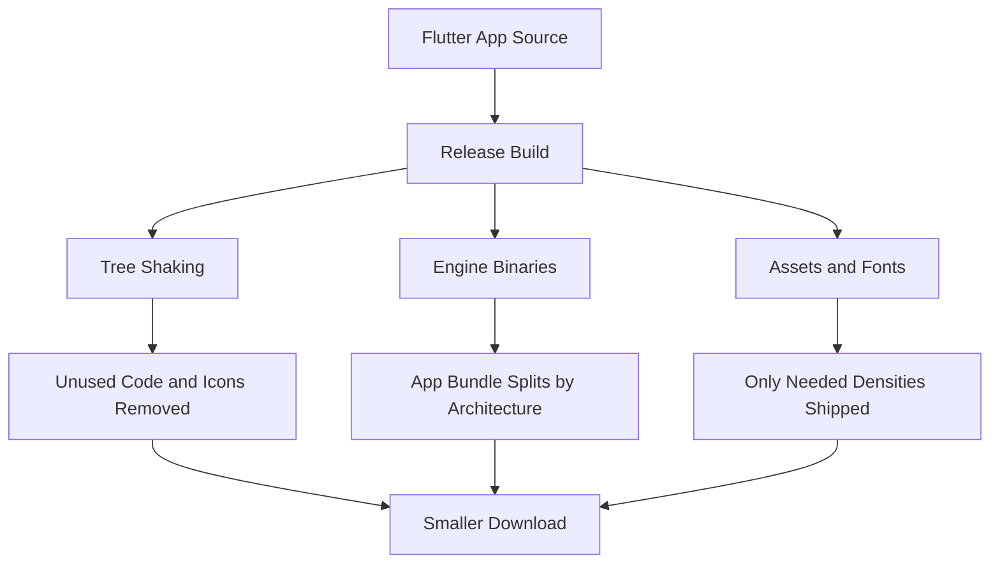

# App Size, Tree Shaking, and the Cost of Shipping an Engine

## English

A hello-world Flutter app is not small. A release APK for Android is typically several megabytes before you add a single asset, because the binary includes the Flutter engine, the Dart runtime, and the compiled Dart snapshot of your code. Understanding where those bytes come from turns app size from a mystery into a budget you can manage.

The first lever is tree shaking, which Flutter performs automatically in release builds. Dart's compiler can remove code that is provably unreachable from your entry point, and Flutter extends this to assets: fonts you never reference and icons you never use in an icon font can be stripped. The `--tree-shake-icons` flag (on by default in release builds) scans your `IconData` usages and subsets the Material icon font to only the glyphs you reference. If you build icon names dynamically — for example from a string — the tool cannot see them, warns you, and disables the optimisation, so prefer constant `IconData` references.

The second lever is the engine itself, which you cannot tree-shake away. Flutter ships a precompiled engine per architecture, and a fat APK contains multiple architectures (arm64, armeabi-v7a, x86_64) so it runs on many devices. App bundles and split APKs solve this: the store delivers only the architecture a device needs. Building an App Bundle (`.aab`) instead of a universal APK can cut download size substantially because the user never receives binaries for CPUs they do not have.

The third lever is assets and fonts. Images should be sized for the densities you actually target, and you can use `flutter build` flags to strip debug symbols in release. Deferred components and split-debug-info (which moves symbol data out of the binary for later symbolication of crash reports) are additional tools. For web, the same logic applies but the artifact is JavaScript or WebAssembly; CanvasKit adds a large fixed cost that the HTML renderer avoids.

The lesson is that size is a design constraint, not a build-time afterthought. Decide early which platforms and architectures you support, keep icon references constant, audit assets, and measure with `flutter build apk --analyze-size` or the equivalent for your target. A student who can explain why a Flutter app is large, and which levers reduce it, understands the framework's packaging model far better than one who only knows the widget API.

## 中文

一個 hello-world 的 Flutter app 並不小。Android 的 release APK 在你加入任何資源之前通常就有數 MB，因為二進位檔包含 Flutter 引擎、Dart 執行環境，以及你程式碼編譯後的 Dart snapshot。理解這些位元組從何而來，能把 app 大小從謎團變成可管理的預算。

第一個槓桿是 tree shaking，Flutter 在 release 建置中自動執行。Dart 編譯器能移除從進入點可證明無法觸及的程式碼，Flutter 並將其延伸到資源：你從未引用的字型、從未在圖示字型中使用到的圖示都可被剝離。`--tree-shake-icons` 旗標（release 建置預設開啟）會掃描你的 `IconData` 用法，並把 Material 圖示字型子集化成你引用到的字元。若你以動態方式建構圖示名稱——例如從字串——工具看不到它們，會警告你並停用最佳化，所以偏好常數 `IconData` 引用。

第二個槓桿是引擎本身，你無法把它 tree-shake 掉。Flutter 為每個架構出貨預先編譯的引擎，而 fat APK 包含多個架構（arm64、armeabi-v7a、x86_64），以便在眾多裝置上執行。App bundle 與 split APK 解決此問題：商店只派送裝置所需的架構。建置 App Bundle（`.aab`）而非 universal APK，能大幅削減下載大小，因為使用者永遠不會收到他們沒有的 CPU 的二進位檔。

第三個槓桿是資源與字型。圖片應依你實際目標的密度調整尺寸，並可用 `flutter build` 旗標在 release 中剝離除錯符號。Deferred components 與 split-debug-info（把符號資料移出二進位檔，供日後對當機報告做符號化）是額外工具。對網頁而言邏輯相同，但產物是 JavaScript 或 WebAssembly；CanvasKit 會加上一筆很大的固定成本，而 HTML 渲染器可避開。

教訓是：大小是設計約束，而非建置階段的補救。及早決定支援哪些平臺與架構、讓圖示引用保持常數、稽核資源，並用 `flutter build apk --analyze-size` 或對應目標的等效指令量測。能解釋 Flutter app 為何大、以及哪些槓桿能縮小它的學生，遠比只懂 widget API 的人更理解框架的封裝模型。

## Key Takeaway

Flutter app size is dominated by the engine and architecture binaries, so tree shaking, App Bundles, and asset discipline are the levers that turn size into a managed budget.

## Related Concepts
- Tree shaking and icon subsetting
- App Bundle and split APKs

## Diagram

