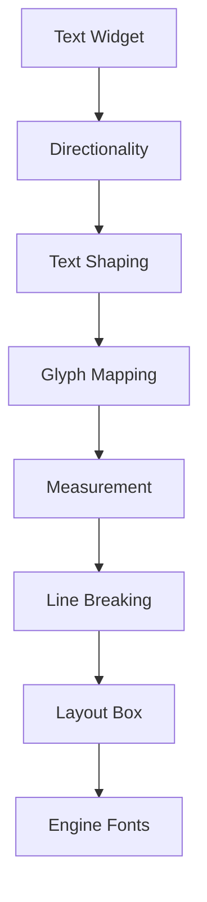

# Fonts, Text Shaping, and Why Text Is Harder Than It Looks

## English

A Text widget looks trivial, but behind it sits a pipeline that most developers never see. Flutter first needs to shape the string: it maps characters to glyphs, applies kerning and ligatures, and does bidirectional reordering so Arabic and Hebrew render right-to-left while embedded Latin runs still go left-to-right. It then measures the result to compute line breaks and produce a box whose size feeds the layout system. Flutter delegates most of this to the engine, which uses text-shaping libraries like HarfBuzz and the platform's font discovery, but the Dart side owns the layout policy through TextStyle, TextPainter, and the paragraph builder. If you have ever wondered why a Text widget needs a directionality ancestor, this is why: shaping cannot happen without knowing which way the paragraph runs.

Fonts themselves are a packaging concern. Flutter ships with a fallback font (Roboto on Android by default) but for anything else you declare font families in pubspec.yaml under the fonts section, listing asset paths and optional weights and styles. Each declared family becomes a FontFamily you can request by name. A subtle trap: if you declare only the bold weight of a custom font, the engine will synthesize a fake bold for regular text rather than fall back gracefully, which often looks smeared. Declaring every weight you actually use avoids synthetic styling.

Internationalisation complicates measurement because line-breaking rules differ per script. Chinese and Japanese can break between almost any two ideographs, whereas English breaks at spaces and hyphens; Thai has no spaces between words at all, so the engine needs a dictionary-based segmenter. Flutter exposes this through locale-aware text layout: the same string can occupy different heights depending on the locale you pass down. That is why a fixed-height container around text is a bug waiting to happen when your app ships in a second language.

Text scaling is another dimension. The user's system font-size preference arrives via MediaQuery's textScaler, and Flutter applies it to text unless you opt out. Ignoring it produces inaccessible apps; blindly honouring it can break layouts that assumed a fixed line height. The robust pattern is to design with flexible heights and to test at large scale factors, because accessibility settings on real devices often sit well above 1.0.

Finally, rendering text is expensive enough that Flutter caches shaped paragraphs. A TextPainter that is rebuilt every frame with the same style and string can still be costly if you re-shape unnecessarily, which is why widgets like RichText and libraries that lay out long documents cache their TextPainter results. Understanding that text is shaped, measured, then painted — three distinct phases — explains a whole class of performance and layout surprises.

## 中文

Text 這個 widget 看似微不足道，但背後其實有一條大多數開發者從未見過的處理管道。Flutter 首先要對字串做字形塑形（shaping）：把字元對映到字形、套用字距調整與連字、並進行雙向文字重排，令阿拉伯文與希伯來文由右至左顯示，而夾雜其中的拉丁文字仍然由左至右。接著它要量度結果、計算換行位置，產生一個尺寸交給排版系統。Flutter 把大部分工作交給引擎，引擎使用 HarfBuzz 之類的文字塑形函式庫與平臺的字型探索機制，但 Dart 這一層透過 TextStyle、TextPainter 與段落建構器掌握排版策略。如果你曾疑惑為何 Text widget 需要一個 Directionality 祖先，原因就在此：不知道段落方向就無法進行塑形。

字型本身是個打包問題。Flutter 內建一個後備字型（Android 上預設是 Roboto），但要使用其他字型，你必須在 pubspec.yaml 的 fonts 區段宣告字型家族，列出資源路徑以及可選的字重與樣式。每個宣告的家族都會成為一個可按名要求的 FontFamily。有個微妙的陷阱：若你只宣告自訂字型的粗體字重，引擎會為一般文字合成假粗體，而不是優雅地回退，效果通常糊成一團。把你實際用到的每個字重都宣告，就能避免合成樣式。

國際化會令量度變得複雜，因為各文字的換行規則不同。中文與日文幾乎可在任意兩個表意文字之間斷行，英文在空格與連字號處斷行；泰文詞與詞之間根本沒有空格，引擎需要以詞典為基礎的分詞器。Flutter 透過地區感知的文字排版處理此事：同一段字串會因為你向下傳遞的 locale 而佔用不同高度。這就是為何用固定高度的容器包住文字，是當你的 app 推出第二種語言時必然出事的 bug。

文字縮放是另一個維度。使用者的系統字型大小偏好會經由 MediaQuery 的 textScaler 傳入，Flutter 會套用到文字上，除非你選擇退出。忽略它會做出無障礙性差的 app；盲目遵從又會破壞假設了固定行高的版面。穩健的做法是以可伸縮高度設計，並在大的縮放倍數下測試，因為真實裝置上的無障礙設定往往遠高於 1.0。

最後，繪製文字的成本高得足以令 Flutter 快取已塑形的段落。一個每幀都以相同樣式與字串重建的 TextPainter，若你無謂地重新塑形，仍然可以很昂貴，這就是為何 RichText 之類的 widget 與負責排版長檔案的函式庫會快取 TextPainter 結果。明白文字是先塑形、再量度、然後繪製這三個截然不同的階段，就能解釋一整類效能與排版上的意外。

## Key Takeaway

Text is a three-phase pipeline — shape, measure, paint — and fonts, locale, and text scaling all feed into it, which is why fixed-height text containers break in multilingual or accessible apps.

## Related Concepts
- TextPainter and text shaping
- MediaQuery textScaler

## Diagram

