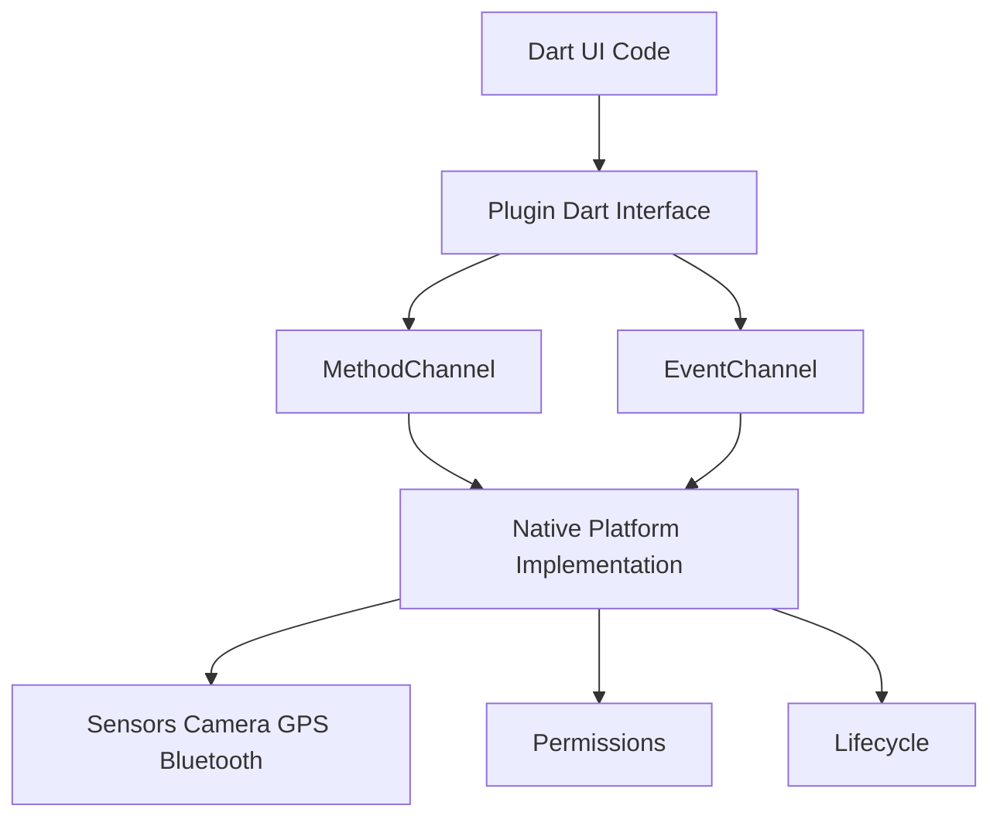

# The Dart-to-Native Boundary for Hardware: Sensors, Permissions, and Lifecycle

## English

Flutter's UI runs in Dart, but the sensors, camera, GPS, and Bluetooth live on the native side. The bridge is the plugin system: a Dart package declares an interface, and each platform provides an implementation behind a MethodChannel or an EventChannel. MethodChannel handles request-response calls (invoke a method, await a result), while EventChannel handles streams of events like accelerometer readings or battery-level changes. The distinction matters because sensor data is inherently push-based: you subscribe once and receive a stream of samples, not a series of one-off calls. Plugins like sensors_plus or battery_plus wrap these channels so your Dart code never touches the raw binary messenger.

Permissions are the part that trips up new developers. On Android, dangerous permissions must be declared in AndroidManifest.xml and requested at runtime from Android 6 onward; on iOS, every sensitive capability needs a usage-description key in Info.plist, and the OS will crash your app at request time if the key is missing. Flutter plugins generally expose a permission API, but the underlying rules are the platform's, not Flutter's. A common bug is requesting a permission in initState before the widget tree is ready to show a rationale dialog, producing a request the user never sees.

Lifecycle is equally platform-shaped. When the user backgrounds the app, Android may pause or destroy your activity, and iOS may suspend you; sensors should be unsubscribed to save battery, and streams should be cancelled. Flutter exposes this through AppLifecycleState (resumed, inactive, paused, detached) via WidgetsBindingObserver. Failing to handle it means your pedometer keeps counting in the background or your camera keeps the sensor warm, draining battery and sometimes triggering OS kill policies.

There is also a hardware-capability question. Not every device has a barometer, a gyroscope, or NFC. Good plugins expose a way to query availability, and your UI should degrade gracefully rather than throw. This is a design decision as much as a technical one: a fitness app might hide the step counter on devices without a pedometer, or offer manual entry instead.

Finally, native hardware APIs are asynchronous and can fail in ways Dart does not model well. A Bluetooth scan can return zero devices, a GPS fix can time out, a camera can be locked by another app. Robust code wraps every channel call in error handling and timeouts, and treats the native boundary as an unreliable network rather than a local function call. That mental model — the platform is a remote service that can be slow, refuse, or disappear — is the single most useful habit when working with hardware in Flutter.

## 中文

Flutter 的 UI 在 Dart 中執行，但感測器、相機、GPS 與藍芽都存在於原生那一側。橋樑就是外掛系統：一個 Dart 套件宣告介面，每個平臺在 MethodChannel 或 EventChannel 背後提供實作。MethodChannel 處理請求—回應式呼叫（呼叫方法、等待結果），EventChannel 則處理事件串流，例如加速度計讀數或電量變化。這個區別很重要，因為感測器資料本質上是推送式的：你訂閱一次，然後收到一連串樣本，而不是一連串一次性呼叫。sensors_plus 或 battery_plus 之類的外掛把這些 channel 包起來，令你的 Dart 程式碼永遠不用接觸原始的 binary messenger。

許可權是令新手絆倒的部分。在 Android 上，危險許可權必須在 AndroidManifest.xml 宣告，並由 Android 6 起在執行時請求；在 iOS 上，每項敏感能力都需要在 Info.plist 中有一個用途說明鍵，若缺少該鍵，作業系統會在請求時令你的 app 崩潰。Flutter 外掛通常會提供許可權 API，但底層規則屬於平臺而非 Flutter。常見的 bug 是在 initState 中請求許可權，而 widget 樹尚未準備好顯示說明對話方塊，結果產生一個使用者從未看見的請求。

生命週期同樣由平臺塑造。當使用者把 app 切到背景，Android 可能暫停或銷毀你的 activity，iOS 可能把你掛起；感測器應被取消訂閱以節省電量，串流應被取消。Flutter 透過 WidgetsBindingObserver 的 AppLifecycleState（resumed、inactive、paused、detached）暴露此事。不處理它，你的計步器就會在背景繼續計數，或相機繼續令感測器保持運作，耗電之餘有時還會觸發系統的終止政策。

還有硬體能力的問題。並非每部裝置都有氣壓計、陀螺儀或 NFC。好的外掛會提供查詢可用性的方法，你的 UI 應該優雅降級而不是丟擲例外。這既是技術決定也是設計決定：健身 app 可能在沒有計步器的裝置上隱藏步數計，或改為提供手動輸入。

最後，原生硬體 API 是非同步的，而且會以 Dart 難以妥善建模的方式失敗。藍芽掃描可以回傳零部裝置，GPS 定位可以逾時，相機可以被另一個 app 鎖住。穩健的程式碼會把每個 channel 呼叫包在錯誤處理與逾時之中，並把原生邊界視為不可靠的網路，而不是本地函式呼叫。這個心智模型——平臺是一個可能緩慢、拒絕或消失的遠端服務——就是在 Flutter 中處理硬體時最有用的一個習慣。

## Key Takeaway

Treat the native side as an unreliable remote service: subscribe to streams for sensors, declare and request permissions per platform, handle lifecycle transitions, and always code for missing hardware and failing calls.

## Related Concepts
- EventChannel and MethodChannel
- AppLifecycleState and WidgetsBindingObserver

## Diagram

