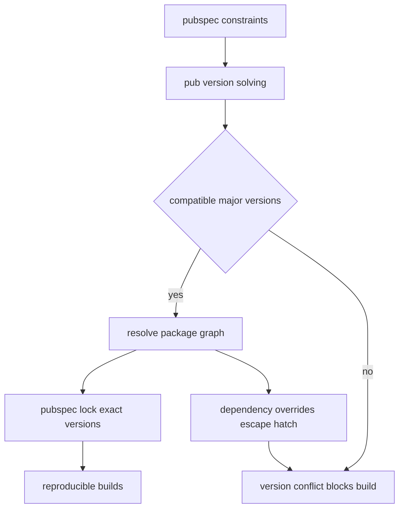

# Dependency Hygiene: How Pubspec Constraints Shape Your App's Future

## English

Every Flutter project sits on a graph of packages resolved by pub, and the constraints you write in pubspec.yaml determine how much freedom you will have six months from now. A caret constraint like ^2.3.0 means 'compatible with 2.3.0' under semantic versioning: pub may pick 2.9.1 but not 3.0.0, because a major version bump signals a breaking change. If two of your dependencies require incompatible major versions of a shared transitive package, pub reports a version-solving conflict and refuses to build until you widen or narrow a constraint. This is why upgrading one package can force upgrades across your tree.

Reproducibility comes from pubspec.lock, which records the exact resolved version and content hash of every package. Commit it for applications so every machine and CI runner builds identical code; libraries usually do not commit it, since consumers resolve their own graph. The lockfile is not a substitute for constraints, though: it pins what you have today, while constraints describe what you are willing to accept tomorrow when someone runs pub upgrade.

A practical hazard is dependency drift. A package that is abandoned, or one that pulls in a large native dependency, can quietly bloat your binary or break on a new OS version. Before adding a package, check its last publish date, its platform support (does it actually implement web and desktop, or only Android and iOS?), and whether the functionality is small enough to write yourself. A 30-line utility does not need a dependency that will outlive its maintainer.

Overrides are the escape hatch and the footgun. dependency_overrides in pubspec.yaml forces a specific version regardless of constraints, which is useful for a temporary patch but dangerous long-term because it silently violates the declared contract. If you must override, document why and remove it as soon as the upstream fix lands, otherwise future upgrades will surprise you.

Finally, think of your dependency graph as part of your architecture. Fewer, well-maintained packages with narrow purposes compose better than one monolith, and each dependency is a surface you must audit for security, licensing, and platform behaviour. The healthiest Flutter projects tend to have short pubspec files, explicit constraints, a committed lockfile, and a habit of asking whether a package earns its place.

## 中文

每個 Flutter 專案都坐落在一個由 pub 解析的套件圖之上，而你在 pubspec.yaml 中寫下的約束，決定你六個月後有多少自由。像 ^2.3.0 這樣的 caret 約束，在語意化版本之下意思是「與 2.3.0 相容」：pub 可以選 2.9.1，但不會選 3.0.0，因為主版本號的提升代表破壞性變更。若你的兩個依賴要求某個共用遞移套件的不相容主版本，pub 會回報版本解析衝突，並拒絕建置，直到你放寬或收窄某個約束。這就是為何升級一個套件可能迫使你整棵依賴樹一起升級。

可重現性來自 pubspec.lock，它記錄每個套件解析出來的確切版本與內容雜湊。應用程式應提交此檔，令每部機器與 CI 執行器都建置出完全相同的程式碼；函式庫通常不提交，因為使用方會自行解析依賴圖。不過 lockfile 不是約束的替代品：它釘住你今天擁有的東西，而約束描述當有人執行 pub upgrade 時，你願意接受甚麼。

一個實際的危險是依賴漂移。一個被遺棄的套件，或一個拉入大量原生依賴的套件，可以悄悄地令你的二進位檔膨脹，或在新版作業系統上壞掉。加入套件前，檢查它最後釋出日期、平臺支援（它是否真的實作了 web 與桌面，還是隻有 Android 與 iOS？），以及功能是否小得可以自己寫。三十行的工具函式不需要一個會比它的維護者更長壽的依賴。

覆寫是逃生門，也是陷阱。pubspec.yaml 中的 dependency_overrides 會不顧約束強制使用某個版本，作為臨時修補很有用，但長期危險，因為它悄悄違反了已宣告的合約。若你必須覆寫，記錄原因，並在上游修正推出後盡快移除，否則將來的升級會令你大吃一驚。

最後，把你的依賴圖視為架構的一部分。數量少、維護良好、用途狹窄的套件，比一個龐然巨物更容易組合，而每個依賴都是一個你必須審查安全性、授權與平臺行為的表面。最健康的 Flutter 專案往往有簡短的 pubspec、明確的約束、已提交的 lockfile，以及一個習慣：先問某個套件是否值得佔一席位。

## Key Takeaway

Constraints describe what you will accept, the lockfile records what you have, and every added package is a long-term maintenance and platform-support liability — so keep the graph small and deliberate.

## Related Concepts
- Semantic versioning and caret constraints
- pubspec.lock and reproducible builds

## Diagram

