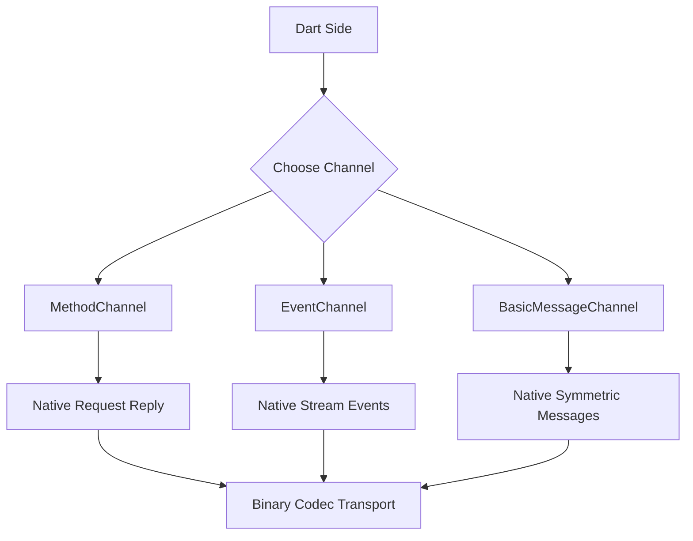

# MethodChannel vs EventChannel vs BasicMessageChannel: Choosing the Right Pipe

## English

Flutter gives you three distinct message channels for talking to native code, and picking the wrong one is a common source of subtle bugs. The first is MethodChannel, which implements a request/response pattern: Dart invokes a named method with arguments, and the native side returns a result asynchronously. It is the right tool for one-off actions like 'get the battery level' or 'open the camera'. The second is EventChannel, which models a stream: the native side pushes an arbitrary number of events over time, and Dart subscribes with a Stream. This is what you want for continuous signals like sensor readings, connectivity changes, or location updates. The third is BasicMessageChannel, which is the lowest-level and most flexible: you define the codec (how data is encoded into bytes) and both sides can send messages in either direction without a strict request/response pairing.

The key distinction is the direction and cardinality of data flow. MethodChannel is one request, one reply. EventChannel is one subscription, many events, plus an optional error and done signal. BasicMessageChannel is a symmetric pipe where either side can initiate. If you find yourself building a MethodChannel where the native side fires callbacks repeatedly, you are almost certainly reinventing EventChannel badly, and you will leak resources because there is no clean cancellation path.

All three channels share the same underlying transport: a binary message codec (by default StandardMethodCodec, which wraps StandardMessageCodec) that serialises Dart values into a compact byte format and back. Values like int, double, String, List, and Map are supported natively; anything else must be converted to those primitives first. This is why you can never pass a Dart object straight across — you must serialise it, typically as a Map.

Channel names are strings, and they are global to the engine. Two plugins that both register 'com.example/battery' will collide, which is why convention dictates reverse-domain namespacing. On the native side you register a handler against that name; on the Dart side you construct the channel with the same string. A typo produces a MissingPluginException at runtime rather than a compile error, so the contract is enforced only by discipline and tests.

Finally, remember that channel calls are asynchronous and cross a thread boundary. On Android the handler runs on the platform's main thread by default; on iOS on the main queue. Doing heavy work there will jank your UI. The pattern is to acknowledge quickly, hand work to a background thread or isolate, and reply when done — or, for EventChannel, push events from wherever the native work completes.

## 中文

Flutter 提供三種截然不同的訊息通道與原生程式碼溝通，揀錯咗係好多隱蔽 bug 嘅來源。第一種係 MethodChannel，實作請求／回應模式：Dart 呼叫一個具名方法並傳入引數，原生端非同步回傳結果。佢適合一次性動作，例如「攞電量」或者「開相機」。第二種係 EventChannel，模擬一個 stream：原生端隨時間推送任意數量嘅事件，Dart 用 Stream 訂閱。呢個就係你想要嘅，用嚟處理感測器讀數、網路連線變化、位置更新等持續訊號。第三種係 BasicMessageChannel，最低層次亦最靈活：你自己定義 codec（即係資料點樣編碼成位元組），兩邊都可以雙向發訊息，冇嚴格嘅請求／回應配對。

關鍵分別在於資料流嘅方向同數量。MethodChannel 係一個請求、一個回覆。EventChannel 係一次訂閱、多個事件，再加可選嘅錯誤同完成訊號。BasicMessageChannel 係對稱管道，任何一邊都可以主動發起。如果你發現自己用 MethodChannel 但原生端不斷回呼，你十有八九係喺度用錯方法重新發明 EventChannel，而且會漏資源，因為冇乾淨嘅取消途徑。

三個通道共用同一個底層傳輸：一個二進位訊息編碼器（預設係 StandardMethodCodec，包住 StandardMessageCodec），將 Dart 值序列化成緊湊位元組格式再還原。int、double、String、List、Map 原生支援；其他型別要先轉做呢啲基本型別。所以永遠唔可以將 Dart 物件直接掟過去——你要序列化，通常用 Map。

通道名係字串，對整個 engine 全域有效。兩個 plugin 都註冊 'com.example/battery' 就會撞名，所以慣例要求用反向域名做名稱空間。原生端用同一個字串註冊 handler；Dart 端用同一個字串建構通道。打錯字只會喺執行期出 MissingPluginException，唔會編譯錯誤，所以個契約只靠紀律同測試去維持。

最後要記住，通道呼叫係非同步而且跨越執行緒邊界。Android 上 handler 預設喺平臺主執行緒行；iOS 就喺 main queue。喺嗰度做重活會令 UI 卡頓。正確做法係快速確認、將工作交去背景執行緒或 isolate，完成後才回覆——或者對 EventChannel 嚟講，喺原生工作完成嘅任何地方推送事件。

## Key Takeaway

MethodChannel is one-shot request/response, EventChannel is a native-to-Dart stream, and BasicMessageChannel is a symmetric pipe — pick by data flow shape, not by habit.

## Related Concepts
- StandardMessageCodec serialisation
- MissingPluginException

## Diagram

