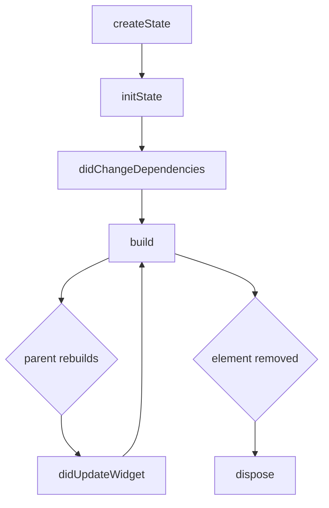

# The Widget Lifecycle Contract: initState, didUpdateWidget, and dispose

## English

Every StatefulWidget's State object goes through a well-defined lifecycle, and violating its contract is one of the easiest ways to leak memory or crash. The sequence is roughly: createState, then initState, then didChangeDependencies, then build (possibly many times), then didUpdateWidget whenever the parent rebuilds with a new widget configuration, and finally dispose when the element is removed from the tree. Each hook has a specific job, and mixing them up causes real problems.

initState runs exactly once, before the first build. It is the place to create controllers (AnimationController, TextEditingController, ScrollController), start subscriptions, and do one-time setup. You cannot call context-dependent inherited widgets here in a safe way — the docs warn against it — because the element has not yet been fully mounted into the tree with its dependencies resolved. If you need Theme or MediaQuery, do it in didChangeDependencies, which runs after initState and again whenever an inherited dependency changes.

didUpdateWidget is called when the parent rebuilds and passes a widget of the same runtime type but a different instance. This is where you compare oldWidget with widget and react to configuration changes — for example, if a TextField's initial value changed, or if a stream parameter was swapped. Forgetting this hook means your State silently keeps stale data from the previous configuration, a classic bug when a widget is reused in a list.

dispose is the mirror of initState: whatever you created there must be torn down here. Controllers must be disposed, stream subscriptions cancelled, timers cancelled, listeners removed. Flutter will not do this for you. A leaked AnimationController keeps a ticker alive and burns frames forever; a leaked StreamSubscription keeps a native resource open. In debug mode Flutter even has leak-tracking tools that will flag undisposed objects.

A subtle point: setState after dispose throws. If you kick off an async operation in initState and it completes after the widget is gone, calling setState will throw. The standard guard is to check `if (!mounted) return;` before touching state. Similarly, never call setState inside build, and remember that didUpdateWidget is followed by a build automatically, so you do not need to trigger one yourself there.

## 中文

每個 StatefulWidget 嘅 State 物件都會經歷一套明確定義嘅生命週期，違反佢嘅契約係最容易漏記憶體或者炒車嘅原因之一。次序大致係：createState、initState、didChangeDependencies、build（可能好多次）、每當父層用新 widget 配置重建時嘅 didUpdateWidget，最後係元素從樹中移除時嘅 dispose。每個 hook 都有特定職責，撈亂咗就會出真問題。

initState 只會行一次，喺第一次 build 之前。呢度係建立 controller（AnimationController、TextEditingController、ScrollController）、開始訂閱、做一次性設定嘅地方。你唔可以喺呢度安全地呼叫依賴 context 嘅 inherited widget——官方文件有警告——因為元素仲未完全掛載入樹、依賴仲未解析好。如果你需要 Theme 或 MediaQuery，請喺 didChangeDependencies 做，佢喺 initState 之後行，之後每次 inherited 依賴改變都會再行。

didUpdateWidget 喺父層重建、傳入同一個 runtime type 但唔同實例嘅 widget 時被呼叫。呢度係你比較 oldWidget 同 widget、對配置改變作出反應嘅地方——例如 TextField 嘅初始值變咗，或者 stream 參數換咗。唔記得寫呢個 hook，你嘅 State 就會靜靜地保留上一個配置嘅舊資料，係 widget 喺 list 中被重用時嘅經典 bug。

dispose 係 initState 嘅鏡像：喺嗰度建立嘅嘢，全部要喺呢度拆走。Controller 要 dispose、stream 訂閱要取消、timer 要取消、listener 要移除。Flutter 唔會幫你做。漏咗 dispose 嘅 AnimationController 會令 ticker 一直生存、不停燒 frame；漏咗嘅 StreamSubscription 會令原生資源一直開住。喺 debug 模式下 Flutter 甚至有洩漏追蹤工具，會標記未 dispose 嘅物件。

一個微妙嘅重點：dispose 之後再 setState 會拋例外。如果你喺 initState 展開非同步操作，而佢喺 widget 消失之後才完成，呼叫 setState 就會拋錯。標準防禦係喺改動 state 之前檢查 `if (!mounted) return;`。同樣，永遠唔好喺 build 裡面呼叫 setState，亦要記住 didUpdateWidget 之後會自動 build，所以你唔需要喺嗰度自己觸發。

## Key Takeaway

initState creates, didChangeDependencies resolves inherited data, didUpdateWidget reacts to new config, and dispose must undo everything initState did.

## Related Concepts
- AnimationController disposal
- mounted guard

## Diagram

