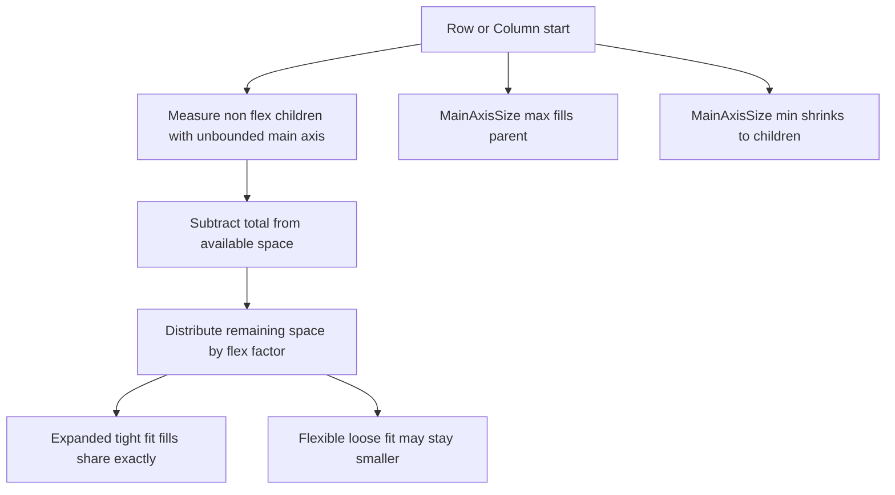

# Render Flexibility: Expanded, Flexible, and the MainAxisSize Trap

## English

Row and Column look simple until you put something that wants infinite space inside them, and then you get the infamous 'RenderFlex overflowed by N pixels' yellow-and-black stripes. Understanding why requires knowing how the flex layout algorithm distributes space, because the difference between Expanded and Flexible is not cosmetic.

The algorithm works in two phases. First, Row or Column lays out all non-flex children with unbounded constraints along the main axis, measuring their natural sizes. Then it subtracts the total from the available space, and distributes what remains among the flex children according to their flex factor. A child with flex: 1 gets one share, flex: 2 gets two shares, and so on. This is why putting a ListView (which wants infinite height) inside a Column without wrapping it in Expanded causes an error: the Column tries to measure it with unbounded constraints, and the ListView cannot answer.

Expanded is Flexible with fit: FlexFit.tight. That means the child is forced to fill its allocated share exactly. Flexible with the default FlexFit.loose lets the child be smaller than its share if it wants — the leftover space is simply not used. This is the practical difference: use Expanded when you want the child to occupy all remaining space (a divider, a background, a flexible image), and Flexible when you want to allow a child to take up to its share but not be stretched.

There is also the mainAxisSize property on Row and Column. By default it is MainAxisSize.max, meaning the flex container tries to be as large as its parent allows along the main axis. Set it to MainAxisSize.min and the Row or Column shrinks to fit its children instead. This matters when you nest a Row inside a Column: a Row with max size will try to fill the full width, while min will hug its content. Confusingly, mainAxisSize does not affect cross-axis behaviour — that is controlled by crossAxisAlignment.

Finally, the overflow stripes appear when a child's measured size exceeds the space allocated. This is not just a visual warning; it means the layout is genuinely wrong and content is being clipped. The fix is almost never 'wrap in SingleChildScrollView' as a reflex — it is to ask whether the child should be flexible (Expanded/Flexible), whether the constraint should be relaxed, or whether the parent should scroll. Diagnosing the constraint flow, not masking the symptom, is the skill.

## 中文

Row 同 Column 睇落好簡單，直到你放啲想要無限空間嘅嘢入去，就會見到惡名昭彰嘅「RenderFlex overflowed by N pixels」黃黑間條。要理解點解，就要知道 flex 佈局演算法點樣分配空間，因為 Expanded 同 Flexible 嘅分別唔係裝飾性嘅。

演算法分兩階段。首先 Row 或 Column 用無界約束（unbounded constraints）沿主軸佈局所有非 flex 子項，量度佢哋嘅自然尺寸。然後從可用空間減去總和，再按 flex 係數將剩餘空間分俾 flex 子項。flex: 1 嘅子項分一份，flex: 2 分兩份，如此類推。所以將 ListView（想要無限高度）放入 Column 而唔用 Expanded 包住就會出錯：Column 用無界約束去量度佢，而 ListView 答唔到。

Expanded 其實就係 fit: FlexFit.tight 嘅 Flexible，意思係子項被迫準確填滿佢嗰份。Flexible 用預設嘅 FlexFit.loose 就容許子項細過佢嗰份——剩餘空間就咁唔用。呢個就係實際分別：想子項佔滿所有剩餘空間（分隔線、背景、可伸縮圖片）就用 Expanded；想容許子項最多佔佢嗰份但唔好拉長就用 Flexible。

Row 同 Column 仲有個 mainAxisSize 屬性。預設係 MainAxisSize.max，即係 flex 容器沿主軸盡量佔滿父層容許嘅大小。設做 MainAxisSize.min，Row 或 Column 就會縮到啱啱好包住子項。呢點喺你將 Row 嵌套入 Column 時好重要：max 嘅 Row 會嘗試填滿整個闊度，min 就會貼住內容。容易混淆嘅係，mainAxisSize 唔影響橫軸行為——嗰個由 crossAxisAlignment 控制。

最後，當子項量度出嚟嘅尺寸超過分配空間，就會出現 overflow 間條。呢個唔止係視覺警告；佢代表佈局真係錯咗、內容被裁切。修正方法幾乎永遠唔係反射性咁「包一層 SingleChildScrollView」——而係問：子項應唔應該有彈性（Expanded／Flexible）？約束應唔應該放寬？定係父層應該可以滾動？診斷約束流向、而唔係遮蓋症狀，才係真正嘅技能。

## Key Takeaway

Expanded forces a child to fill its flex share while Flexible lets it stay smaller, and overflow stripes mean the constraint flow is wrong — fix the layout, do not just wrap it in a scroll view.

## Related Concepts
- FlexFit.tight vs FlexFit.loose
- MainAxisSize

## Diagram

